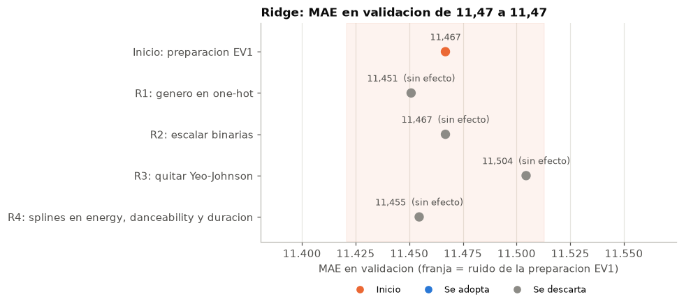
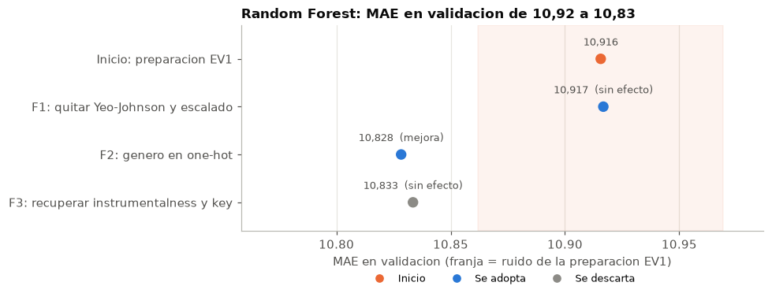
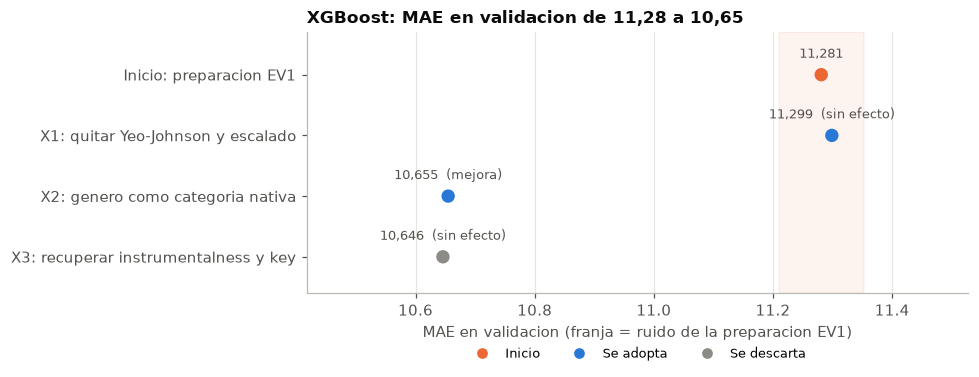
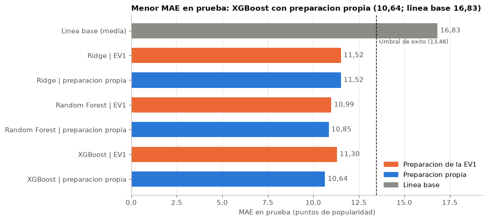
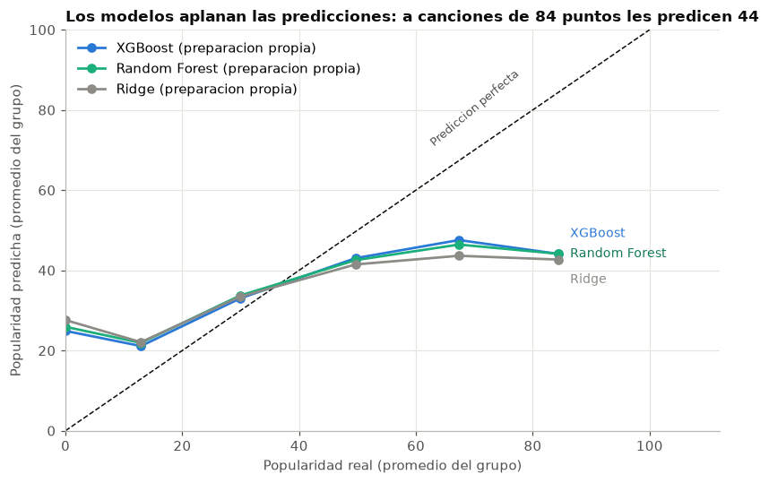
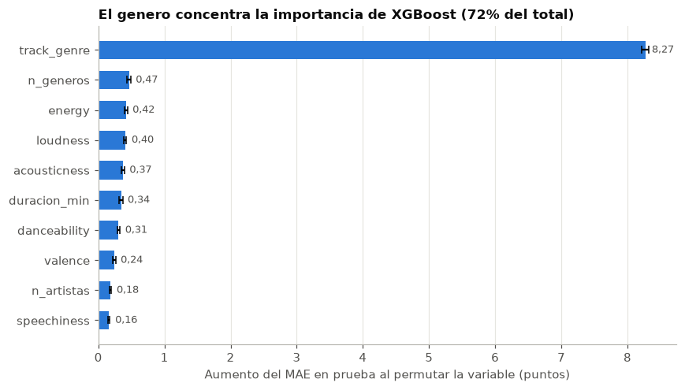
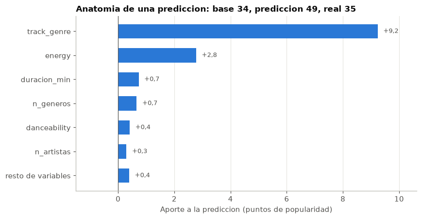
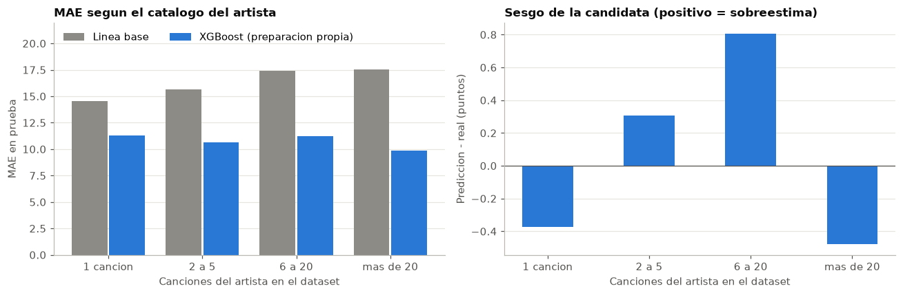

# Inteligencia musical: prediccion de la popularidad de canciones de Spotify

**Informe tecnico del proyecto de Machine Learning: EDA, preparacion de datos, modelado con Ridge, Random Forest y XGBoost, y evaluacion**

| | |
|---|---|
| **Asignatura** | MLY1101 Machine Learning, DuocUC |
| **Evaluacion** | Parcial Nro. 2: presentacion y defensa tecnica del proyecto (incluye lo desarrollado en la Parcial Nro. 1) |
| **Equipo** | Grupo 5: Cristian Romero y Rolando Paredes |
| **Caso** | C: inteligencia musical y prediccion de popularidad de canciones (Spotify Tracks) |
| **Metodologia** | CRISP-DM, fases 1 a 5 |
| **Respaldo tecnico** | `ev1/notebook_ev1.ipynb` (EDA y preparacion) y `ev2/notebook_ev2.ipynb` (modelado y evaluacion). Cada cifra de este informe sale de una celda de esos notebooks |

## Resumen

- **Problema:** estimar la popularidad de una cancion en Spotify (indice de 0 a 100) a partir de su audio, su genero y metadatos basicos. Es una regresion supervisada.
- **Datos:** 114.000 filas del Spotify Tracks Dataset. Tras una limpieza que elimino sobre todo filas repetidas, quedan **85.859 canciones**, divididas por cancion en 68.704 de entrenamiento y 17.155 de prueba.
- **Hallazgo del EDA:** el audio se relaciona poco y de forma no lineal con la popularidad (ninguna correlacion supera 0,13). El genero explica cerca de un tercio de la variacion, y el artista aun mas.
- **Pregunta del modelado:** ¿preparar los datos segun lo que necesita cada modelo mejora los resultados frente a usar una sola preparacion para todos? Los modelos usan sus parametros por defecto; para cada uno se probaron hipotesis de preparacion una a una y, al final, todas juntas.
- **Respuesta: si en los dos modelos de arboles, no en Ridge.** XGBoost baja su MAE de prueba de 11,30 a 10,64 con el genero como categoria nativa, y Random Forest de 10,99 a 10,85 con el genero en one-hot.
- **Veredicto:** ningun modelo cumple los seis criterios de exito. **XGBoost con preparacion propia es el mejor candidato** (37% menos error que la linea base), pero todavia no es apto: le faltan R², RMSE, error en exitos y control del sobreajuste.

## Indice

1. Descripcion del problema de negocio
2. Objetivos del proyecto
3. Descripcion de las fuentes de datos utilizadas
4. Analisis exploratorio de los datos (EDA)
5. Preparacion y transformacion de los datos
6. Justificacion de la seleccion de modelos
7. Detalles y caracteristicas de las variables finales por modelo
8. Implementacion de los modelos
9. Evaluacion y seleccion del modelo
10. Sesgos, etica y privacidad
11. Conclusiones y recomendaciones
12. Limitaciones y proximos pasos
13. Estructura del repositorio y reproducibilidad
14. Referencias

---

## 1. Descripcion del problema de negocio

### 1.1 Contexto

En la industria discografica y en las plataformas de streaming, artistas, sellos y equipos de marketing invierten en produccion y promocion sin certeza del retorno. Un sello o una plataforma decide cada semana en que canciones invertir: cuales promocionar, cuales proponer para playlists y con que artistas trabajar. Muchas veces lo decide cuando el exito ya ocurrio.

Spotify calcula para cada cancion un indice de **popularidad** (0 a 100), basado principalmente en sus reproducciones recientes, y un conjunto de **caracteristicas de audio** obtenidas de la señal sonora: que tan bailable es, su energia, su tempo, su positividad, entre otras.

### 1.2 Problema

> **¿Es posible estimar la popularidad que alcanzara una cancion a partir de sus caracteristicas musicales y de metadatos basicos (genero, contenido explicito, duracion, colaboraciones)?**

Una estimacion asi serviria para priorizar canciones en campañas de promocion, detectar canciones con potencial no aprovechado y entender que atributos se asocian con el exito en cada genero.

### 1.3 Tipo de problema

Es un problema de **aprendizaje supervisado de regresion**: la variable objetivo `popularity` es numerica y hay ejemplos con su valor conocido. Se descarto convertirlo en una clasificacion (popular / no popular) para no imponer un umbral arbitrario y conservar toda la escala.

### 1.4 Metodologia

| Fase CRISP-DM | Aplicacion en el proyecto | Donde |
|---|---|---|
| 1. Comprension del negocio | Problema, objetivos y criterios de exito | Secciones 1 y 2; EV1 |
| 2. Comprension de los datos | Calidad de datos y EDA | Secciones 3 y 4; EV1 |
| 3. Preparacion de los datos | Limpieza, variables nuevas, division y preparacion por modelo | Seccion 5; EV1 y EV2 |
| 4. Modelado | Ridge, Random Forest y XGBoost | Secciones 6 a 8; EV2 |
| 5. Evaluacion | Criterios de exito, protocolo de seleccion y sesgos | Secciones 9 y 10; EV2 |
| 6. Despliegue | Fuera del alcance | - |

CRISP-DM es iterativo: varias decisiones de preparacion nacieron de hallazgos del EDA, y en el modelado se volvio a la preparacion para adaptarla a cada modelo.

---

## 2. Objetivos del proyecto

### 2.1 Objetivo general

Desarrollar, evaluar y seleccionar un modelo de regresion que estime la popularidad de una cancion en Spotify a partir de sus caracteristicas musicales y metadatos, con datos preparados sin fuga de informacion y con criterios de exito fijados de antemano.

### 2.2 Objetivos especificos

1. Caracterizar el dataset e identificar sus problemas de calidad: nulos, duplicados, valores invalidos y outliers.
2. Identificar con un EDA las variables y los patrones que se relacionan con la popularidad.
3. Construir una preparacion reproducible (limpieza, ingenieria de caracteristicas, division, codificacion, transformacion y escalado) que evite la fuga de datos.
4. Revisar en la documentacion que necesita cada modelo y probar, una por una, hipotesis de preparacion para Ridge, Random Forest y XGBoost.
5. Comparar cada modelo con la preparacion unica y con la suya, contra una linea base y seis criterios de exito.
6. Explicar que aprendio el modelo, donde se equivoca y que sesgos y riesgos eticos tiene su uso.

**Alcance del modelado.** Los tres modelos usan sus parametros y su funcion de perdida por defecto. Elegirlos es el ajuste de hiperparametros, que corresponde a la etapa siguiente.

### 2.3 Metricas y su justificacion

| Metrica | Que mide | Por que se usa |
|---|---|---|
| **MAE** (principal) | Puntos de popularidad que se equivoca el modelo en promedio | Se lee directo en la escala del negocio y no se deja dominar por unos pocos errores grandes |
| **RMSE** | Como el MAE, pero castiga mas los errores grandes | Un error de 40 puntos en una cancion importa mucho mas que varios errores chicos |
| **R²** | Parte de la variacion de la popularidad que explica el modelo (0 = predecir la media) | Permite comparar contra lo que ya explica el genero por si solo |

No se usa **MAPE**: el 7,6% de las canciones tiene popularidad 0 y el MAPE divide por el valor real.

### 2.4 Criterios de exito

Se fijaron en la EV1, antes de entrenar, y no se cambian. Varios se expresan contra una **linea base** que predice siempre la popularidad media de entrenamiento (MAE 16,83, RMSE 20,15 y R² 0,00 en prueba).

| Criterio (en prueba) | Umbral | Que controla |
|---|---|---|
| R² | ≥ 0,40 | Superar lo que explica el genero solo (cerca de 0,35) |
| RMSE | ≤ 15,51 (77% de la linea base) | Errores grandes |
| MAE | ≤ 13,46 (80% de la linea base) | Error tipico, en puntos |
| Brecha de R² entre entrenamiento y prueba | ≤ 0,05 | Sobreajuste |
| MAE en canciones con popularidad ≥ 70 | ≤ 20 (la linea base comete 41,2) | El segmento que mas le importa al negocio |
| Brecha de MAE entre cuartiles de genero | ≤ 5 (la linea base tiene 6,1) | Equidad: que el error no se concentre en algunos generos |

**Justificacion de los umbrales.** R² ≥ 0,40 y RMSE ≤ 77% de la linea base son la misma exigencia vista de dos formas (la raiz de 0,60 es 0,77). El umbral es moderado a proposito: el genero solo ya explica cerca de 0,35, y la popularidad depende de factores que no estan en los datos (fama, marketing, playlists). El criterio de exitos existe porque un buen error promedio puede esconder que el modelo falla justo donde el negocio invierte, y el de equidad porque la linea base ya comete errores desiguales entre generos.

### 2.5 Protocolo de seleccion

| Paso | Regla |
|---|---|
| 1 | Una configuracion es **apta** solo si cumple los seis criterios en prueba |
| 2 | Entre las aptas gana la de menor MAE en **validacion**, no en prueba |
| 3 | Si otra queda a menos del ruido del lider, se consideran empatadas y gana la mas interpretable |
| 4 | Los umbrales no se bajan. Si ninguna es apta, la ganadora queda como **mejor candidata** para la etapa siguiente, no como modelo listo para usar |

---

## 3. Descripcion de las fuentes de datos utilizadas

### 3.1 Dataset

| Atributo | Valor |
|---|---|
| Nombre | Spotify Tracks Dataset |
| Fuente | Kaggle, usuario *maharshipandya*: https://www.kaggle.com/datasets/maharshipandya/-spotify-tracks-dataset |
| Origen | Web API de Spotify, consultada por genero (datos de plataforma, no de encuesta) |
| Licencia | "Database: Open Database, Contents: (c) Original Authors" |
| Tamaño | 114.000 filas y 21 columnas, en CSV |
| Construccion | Aprox. 1.000 canciones por cada uno de 114 generos |
| Unidad de observacion | Una cancion recuperada al buscar un genero |
| Variable objetivo | `popularity`, entero de 0 a 100 |

Un detalle de construccion condiciona todo el analisis: como las canciones se recuperaron **por genero**, una misma cancion aparece varias veces si pertenece a mas de un genero.

### 3.2 Glosario de variables

| Variable | Descripcion | Tipo | Rango / valores | Rol en el proyecto |
|---|---|---|---|---|
| `Unnamed: 0` | Indice de fila exportado junto al CSV | Identificador (artefacto) | 0 a 113.999 | Eliminada |
| `track_id` | Identificador de un lanzamiento en Spotify | Identificador | Texto de 22 caracteres | Trazabilidad; excluida del modelo |
| `artists` | Artista(s), separados por `;` | Texto libre | 31.437 valores | Agrupa la division y la validacion; origen de `n_artistas` |
| `album_name` | Album en que aparece la cancion | Texto libre | 46.589 valores | Excluida del modelo |
| `track_name` | Titulo de la cancion | Texto libre | 73.608 valores | Agrupa la division y la validacion |
| `popularity` | Popularidad calculada por Spotify, segun reproducciones recientes | Numerica discreta | 0 a 100 | **Variable objetivo** |
| `duration_ms` | Duracion en milisegundos | Numerica continua | > 0 | Reemplazada por `duracion_min` |
| `explicit` | Letras explicitas | Binaria | True / False | Predictor (0/1) |
| `danceability` | Que tan apta es para bailar | Numerica continua | 0,0 a 1,0 | Predictor |
| `energy` | Intensidad percibida | Numerica continua | 0,0 a 1,0 | Predictor |
| `key` | Tonalidad (0 = Do ... 11 = Si) | Categorica nominal | 0 a 11 | Excluida (sin relacion con la popularidad) |
| `loudness` | Volumen promedio en dB | Numerica continua | Aprox. -60 a 0 | Predictor |
| `mode` | Mayor (1) o menor (0) | Binaria | 0 / 1 | Predictor |
| `speechiness` | Presencia de palabra hablada | Numerica continua | 0,0 a 1,0 | Predictor; definio un filtro |
| `acousticness` | Confianza de que sea acustica | Numerica continua | 0,0 a 1,0 | Predictor |
| `instrumentalness` | Probabilidad de que no tenga voz | Numerica continua | 0,0 a 1,0 | Reemplazada por `es_instrumental` |
| `liveness` | Probabilidad de que sea en vivo | Numerica continua | 0,0 a 1,0 | Predictor |
| `valence` | Positividad musical | Numerica continua | 0,0 a 1,0 | Predictor |
| `tempo` | Tempo en BPM | Numerica continua | > 0 | Predictor |
| `time_signature` | Compas estimado | Categorica ordinal | Documentado de 3 a 7 | Reemplazada por `compas_4_4` |
| `track_genre` | Genero con que se recupero la cancion | Categorica nominal | 114 (113 tras unificar `songwriter`) | Predictor; cada modelo lo recibe distinto |

### 3.3 Archivos derivados

El notebook de la EV1 deja en `data/processed/` los datos que usa el modelado, todos sobre la misma division y con el mismo orden de filas:

| Archivo | Contenido |
|---|---|
| `X_train_base.csv`, `X_test_base.csv` | 16 variables limpias, con el genero como texto y sin transformar: punto de partida de la preparacion de cada modelo |
| `X_train_procesado_ev1.csv`, `X_test_procesado_ev1.csv` | La preparacion unica completa (seccion 5.6) |
| `y_train.csv`, `y_test.csv` | `popularity` |
| `ids_train.csv`, `ids_test.csv` | `track_id`, artista, titulo, album y grupo de cancion |
| `metadatos_preprocesamiento.json` | Semilla, listas de columnas y linea base |

---

## 4. Analisis exploratorio de los datos (EDA)

### 4.1 Calidad de los datos

El archivo parecia limpio (una sola fila con nulos y "0 duplicados"), pero el analisis revelo problemas ocultos:

| Problema | Magnitud | Tratamiento |
|---|---|---|
| Indice exportado (`Unnamed: 0`) que escondia duplicados | 1 columna; al quitarla aparecen 450 duplicados exactos | Eliminar ambos |
| Fila con nulos y duracion 0 | 1 fila | Eliminar |
| Etiqueta de genero duplicada | `songwriter` y `singer-songwriter` comparten sus 1.000 canciones | Unificar |
| Misma cancion en varios generos | 24.259 filas extra (21,3% del archivo); 16.299 canciones en mas de un genero, algunas hasta en 9 | Una fila por cancion |
| Versiones de una misma cancion (single, album, recopilatorio) | 13.054 canciones con otra version de igual artista y titulo | Division agrupada por cancion |
| `tempo = 0` | 157 filas, el 88% del genero `sleep` (ruido blanco) | Eliminar |
| Contenido casi solo hablado (`speechiness > 0,66`) | 876 filas, el 87% de `comedy` (stand-up y sketches) | Eliminar |
| `popularity = 0` | 16.020 filas (14%) | Analizar antes de decidir (4.2) |

Las copias por genero son la misma grabacion: en el 100% de los casos sus caracteristicas de audio son identicas y solo cambia la etiqueta de genero. Esto muestra tambien que el genero viene de resultados de busqueda y no de una clasificacion musical rigurosa (por ejemplo, `reggae` y `reggaeton` comparten 804 canciones).

### 4.2 Variable objetivo y canciones con popularidad 0

- **Distribucion.** Con una fila por cancion (89.741), la popularidad tiene media 33,2, mediana 33 y desviacion 20,6, con asimetria casi nula (0,07). El 50% central esta entre 19 y 49 puntos. No necesita transformacion.
- **Pico en 0.** Hay 9.448 canciones con popularidad 0 (10,5%), separadas del resto de la distribucion.
- **Ceros artificiales.** El **30,3% de esas canciones (2.867) tiene otra version con popularidad positiva.** Ejemplo: *93 Million Miles* de Jason Mraz tiene popularidad 67 en su album original y 0 en un recopilatorio, con la misma grabacion. Spotify concentra las reproducciones en una version, y la otra queda en 0 aunque la cancion sea un exito.
- **Ceros por genero.** En el archivo original, `jazz` (68%), `iranian` (66%) y `romance` (64%) tienen mas de la mitad de sus canciones con popularidad 0.

### 4.3 Caracteristicas de audio

| Variable | Forma | Implicancia |
|---|---|---|
| `danceability`, `energy`, `valence` | Razonablemente simetricas (asimetria entre -0,56 y 0,13) | Sin transformacion |
| `acousticness` | Forma de U: 21% bajo 0,01 y otro grupo cerca de 1 | Se conserva |
| `instrumentalness` | Bimodal: 68% bajo 0,01 (con voz) y un grupo entre 0,8 y 1 | Resumir en `es_instrumental` |
| `speechiness` (4,5), `liveness` (2,1), `loudness` (-2,0) | Colas largas | Yeo-Johnson |
| `duration_ms` (11,1) | La mas asimetrica: la mayoria dura 2 a 6 minutos, pero hay pistas de mas de una hora | Yeo-Johnson |

Entre las discretas, `explicit` esta muy desbalanceada (8,6% explicitas), `mode` tiene 63,7% en tonalidad mayor y `time_signature` esta dominada por el 4/4 (88,6%), por eso se resume en una variable binaria.

### 4.4 Generos musicales

La popularidad media va de **2,2 (`iranian`) a 59,3 (`pop-film`)**, con un gradiente continuo y la mayoria de los generos entre 25 y 45 puntos. Los mas populares se asocian a streaming masivo o bandas sonoras (`pop-film`, `k-pop`, `chill`); los menos, a mercados regionales, nichos electronicos y catalogos antiguos (`iranian`, `detroit-techno`, `classical`, `honky-tonk`).

### 4.5 Relacion de las variables con la popularidad

- **El audio se relaciona poco.** Ninguna caracteristica de audio supera una correlacion de 0,13. La mas alta es `instrumentalness` (Spearman -0,12).
- **Pero de forma no lineal.** `energy`, `danceability` y la duracion tienen **forma de U invertida**: las canciones con valores intermedios son las mas populares (cerca de 35 puntos) y las de ambos extremos caen a 28 o 29. Por eso la correlacion de `energy` es casi 0 aunque la diferencia entre deciles llega a 7 puntos.
- **El genero domina.** Explica el 32,6% de la variacion de la popularidad (η² = 0,326; 0,351 con los datos limpios). `time_signature`, `explicit`, `key` y `mode` explican menos de 0,01 cada una.

**Implicancia:** no descartar variables por su correlacion lineal baja, preferir modelos no lineales y fijar expectativas moderadas de R².

### 4.6 Multicolinealidad

Solo tres pares superan |0,5|, todos sobre la "intensidad" de la produccion: `energy` y `loudness` (0,76), `energy` y `acousticness` (-0,73) y `loudness` y `acousticness` (-0,58). Con el conjunto final de variables, todos los VIF quedan bajo 5 (maximo `energy`, 4,34): hay colinealidad moderada, no severa.

### 4.7 Outliers

Con el criterio IQR aparecen muchos valores atipicos, pero son **variacion real entre tipos de contenido**, no errores: las pistas de mas de 10 minutos son sesiones de `detroit-techno`, `chicago-house` o musica clasica; los volumenes muy bajos son de `sleep`, `ambient` y `piano`; las grabaciones en vivo se concentran en generos brasileños. En `loudness`, 5 generos acumulan el 52% de los atipicos. Eliminarlos quitaria generos completos, por lo que se conservan.

### 4.8 Sintesis: del EDA a las decisiones

| Hallazgo | Decision |
|---|---|
| Canciones repetidas por genero y etiquetas solapadas | Unificar etiquetas y dejar una fila por cancion |
| Ceros artificiales en versiones duplicadas | Eliminar esas versiones |
| Contenido no musical (`tempo = 0`, casi solo habla) | Eliminar |
| Audio con relacion debil y no lineal | Conservar todas las variables de audio; probar modelos no lineales |
| El genero es el predictor dominante | Cuidar como se entrega a cada modelo |
| `key` sin efecto; `instrumentalness` bimodal; `time_signature` dominada por 4/4 | Eliminar `key`; crear `es_instrumental` y `compas_4_4` |
| Asimetria fuerte y escalas muy distintas | Yeo-Johnson y `StandardScaler` en la preparacion unica |
| Outliers legitimos | Conservar |

---

## 5. Preparacion y transformacion de los datos

### 5.1 Regla contra la fuga de datos

Todo lo que **no** aprende parametros de los datos se aplica antes de dividir. Todo lo que **si** aprende (codificacion por objetivo, transformaciones y escalado) se ajusta solo con entrenamiento. En el modelado se va un paso mas alla: esa preparacion se reajusta dentro de cada fold de la validacion cruzada.

### 5.2 Limpieza

| Paso | Filas afectadas | Filas restantes | Por que |
|---|---|---|---|
| Archivo original | - | 114.000 | |
| Fila con nulos | -1 | 113.999 | Faltan artista, album y titulo, y su duracion es 0: no se puede imputar |
| Duplicados exactos | -450 | 113.549 | No aportan informacion y duplican el peso de esas canciones |
| Unificacion de `songwriter` | -1.000 | 112.549 | Es la misma etiqueta que `singer-songwriter` |
| Una fila por cancion | -22.809 | 89.740 | Evita fuga, sobrerrepresentacion y objetivos contradictorios |
| `tempo = 0` | -157 | 89.583 | Ruido blanco y sonidos ambientales: no es musica y su audio no es confiable |
| Contenido casi solo hablado | -868 | 88.715 | Umbral de la documentacion de Spotify para palabra hablada |
| Ceros artificiales | -2.856 | **85.859** | Su 0 no refleja el interes de los oyentes |

Detalles de las decisiones:

- **Popularidad = promedio entre copias.** Solo 720 canciones tenian popularidades distintas entre copias, con una diferencia mediana de 1 punto.
- **Genero conservado elegido al azar** (semilla fija). El archivo esta ordenado alfabeticamente: conservar la primera aparicion habria dejado a `reggaeton` con 74 canciones. Al azar, el genero mas reducido conserva 371.
- **`time_signature = 0` restantes:** 5 filas imputadas con la moda (4).
- **Se conservan** `time_signature = 1` (compas irregular), `loudness > 0 dB` (masterizaciones muy comprimidas) y los outliers.

El resultado es el **75,3% del archivo original**. La reduccion corresponde casi toda a filas repetidas, no a informacion perdida.

### 5.3 Ingenieria de caracteristicas

| Variable nueva | Calculo | Que aporta |
|---|---|---|
| `duracion_min` | `duration_ms / 60000` | La misma informacion en una unidad legible |
| `n_artistas` | Artistas separados por `;` | Las colaboraciones combinan audiencias |
| `n_generos` | Generos en que aparecia la cancion antes de dejar una fila | Canciones que cruzan generos llegan a mas gente: las que aparecen en 2 generos promedian 41,3 puntos, frente a 33,3 las de uno |
| `es_instrumental` | `instrumentalness > 0,5` (umbral de Spotify) | Resume una variable bimodal; las instrumentales tienen unos 8 puntos menos |
| `compas_4_4` | 1 si `time_signature == 4` | Las demas categorias tienen muy pocos casos |
| `explicit` | Booleano a 0/1 | Formato numerico |

### 5.4 Seleccion de variables

| Variable | Decision | Justificacion |
|---|---|---|
| `track_id`, `album_name` | Excluir | Identificador y texto libre sin valor predictivo generalizable |
| `artists`, `track_name` | Excluir del modelo | Solo agrupan la division y se usan en el analisis de sesgos |
| `instrumentalness` | Excluir | Junto a `es_instrumental` su VIF supera 13 |
| `key` | Excluir | Sin relacion con la popularidad (η² = 0,0006) y necesitaria 11 columnas one-hot |
| `energy`, `loudness`, `acousticness` | Conservar | Correlacionadas, pero con VIF bajo 5; cada una aporta un matiz |

Quedan **16 variables**: 11 continuas, 4 binarias y el genero.

### 5.5 Division en entrenamiento y prueba

Se usa `GroupShuffleSplit` con grupos = artista + titulo, para que todas las versiones de una misma cancion queden del mismo lado. El resultado: **68.704 canciones de entrenamiento y 17.155 de prueba (20%)**, sin canciones compartidas. La popularidad queda equilibrada entre ambos conjuntos (media 34,32 y 34,67).

### 5.6 Preparacion unica (EV1)

| Paso | Herramienta | Por que |
|---|---|---|
| Genero | `TargetEncoder` con *cross fitting* | Reemplaza cada genero por su popularidad media en una sola columna; cada fila se codifica con medias calculadas en otros pliegues, para no filtrar su propia popularidad. El label encoding impondria un orden falso y el one-hot crearia mas de 100 columnas |
| Asimetria | Yeo-Johnson en 6 variables con asimetria > 1 en entrenamiento (`loudness`, `speechiness`, `liveness`, `n_generos`, `duracion_min`, `n_artistas`) | Admite ceros; la duracion pasa de 11,7 a -0,04 |
| Escala | `StandardScaler` en las continuas | Las escalas son muy distintas (BPM, dB, minutos, proporciones) |
| Binarias | Sin tocar | Ya estan en 0/1 |

Esta preparacion fue pensada sobre todo para un modelo lineal. La pregunta del modelado es si sirve igual para todos.

### 5.7 Preparacion propia de cada modelo (EV2)

**Metodo: una hipotesis a la vez.** Para cada modelo, partiendo de la preparacion unica: se plantea una **hipotesis** de lo que podria necesitar, segun su documentacion oficial o una idea propia del EDA; se cambia **una sola cosa**; se mide con validacion cruzada agrupada; y se decide. Al final se prueban **todos los cambios juntos**, por si suman aunque por separado no hicieran nada. La prueba no participa en ninguna decision.

**Regla de decision.** El ruido es la desviacion del MAE entre los 5 folds de validacion (0,05 a 0,09 puntos).

| Resultado del cambio | Veredicto | Decision |
|---|---|---|
| Baja el MAE en mas que el ruido | Mejora | Se adopta |
| Sube el MAE en mas que el ruido | Empeora | Se descarta |
| Cambia menos que el ruido | Sin efecto | Se mantiene la preparacion vigente, salvo que la documentacion diga que el paso que se quita no hace falta |

**Hipotesis y veredictos**

| # | Modelo | Hipotesis | Fuente | Veredicto |
|---|---|---|---|---|
| R1 | Ridge | El genero en one-hot rinde igual que codificado por objetivo | Documentacion | Confirmada |
| R2 | Ridge | Escalar las binarias mejora el resultado | Documentacion | No confirmada |
| R3 | Ridge | Quitar Yeo-Johnson empeora el resultado | Documentacion | Parcial |
| R4 | Ridge | Splines en las variables con forma de U invertida mejoran el resultado | Propia (EDA) | No confirmada |
| F1 | Random Forest | Quitar Yeo-Johnson y escalado no cambia el resultado | Documentacion | Confirmada |
| F2 | Random Forest | El genero en one-hot empeora el resultado | Documentacion | Refutada: mejora |
| F3 | Random Forest | Recuperar `instrumentalness` y `key` mejora el resultado | Propia (EV1) | No confirmada |
| X1 | XGBoost | Quitar Yeo-Johnson y escalado no cambia el resultado | Documentacion | Confirmada |
| X2 | XGBoost | El genero como categoria nativa mejora el resultado | Documentacion | Confirmada |
| X3 | XGBoost | Recuperar `instrumentalness` y `key` mejora el resultado | Propia (EV1) | No confirmada |
| T | Los tres | Todos los cambios propuestos juntos mejoran a algun modelo | Propia | No confirmada |

#### Ridge

La documentacion dice que los regularizadores de los modelos lineales suponen variables con "variance in the same order" $_{[7]}$, y que el one-hot es "better suited for low cardinality" $_{[10]}$.

| # | Prueba | Evidencia (MAE validacion, ruido 0,046) | Veredicto | Costo de no hacerlo |
|---|---|---|---|---|
| R1 | Genero en one-hot (113 columnas) | 11,467 a 11,451 (-0,016); mejora en 5 de 5 folds, pero bajo el ruido | Sin efecto: se mantiene la codificacion por objetivo (1 columna) | Ninguno |
| R2 | Escalar las 4 binarias | 11,467 a 11,467 (0,000) | Sin efecto: con `alpha = 1` y 68.704 filas el castigo es muy debil (razonamiento) | Ninguno con los parametros por defecto |
| R3 | Quitar Yeo-Johnson | 11,467 a 11,504 (+0,038); empeora en 5 de 5 folds | Sin efecto, en la direccion esperada: se mantiene Yeo-Johnson | 0,04 puntos |
| R4 | Splines en `energy`, `danceability` y duracion | 11,467 a 11,455 (-0,012); mejora en 5 de 5 folds | Sin efecto: Ridge ya seguia casi toda la U, que le llega a traves del genero | Ninguno |



*Ninguno de los cuatro cambios sale de la franja de ruido: la preparacion unica ya era la adecuada para un modelo lineal.*

#### Random Forest

Los arboles requieren "little data preparation" y no necesitan normalizar $_{[13]}$: un corte "variable < umbral" no cambia si la transformacion conserva el orden (razonamiento).

| # | Prueba | Evidencia (MAE validacion) | Veredicto | Costo de no hacerlo |
|---|---|---|---|---|
| F1 | Quitar Yeo-Johnson y escalado | 10,916 a 10,917 (+0,001; ruido 0,054) | Sin efecto: se adopta la version simple, porque la documentacion dice que no hace falta | Ninguno en precision |
| F2 | Genero en one-hot en vez de por objetivo | 10,917 a 10,828 (-0,088; ruido 0,055); mejora en 5 de 5 folds | **Mejora: se adopta.** La hipotesis (que empeoraria) queda refutada | 0,09 puntos; a cambio, 128 columnas y varias veces mas tiempo de entrenamiento |
| F3 | Recuperar `instrumentalness` y `key` | 10,828 a 10,833 (+0,005; ruido 0,079) | Sin efecto: se descarta | Ninguno |

Posible explicacion de F2 (razonamiento, no verificada): la codificacion por objetivo resume cada genero en su popularidad media, y el arbol solo puede cortar por rangos de esa media. Con el one-hot, cada arbol puede separar un genero concreto, y Random Forest prueba todas las columnas en cada corte.



#### XGBoost

Ademas de no necesitar transformaciones, XGBoost puede recibir el genero como categoria: en cada corte busca agrupar "the categories that output similar leaf values" $_{[3]}$.

| # | Prueba | Evidencia (MAE validacion) | Veredicto | Costo de no hacerlo |
|---|---|---|---|---|
| X1 | Quitar Yeo-Johnson y escalado | 11,281 a 11,299 (+0,018; ruido 0,071) | Sin efecto: se adopta la version simple | Ninguno en precision |
| X2 | Genero como categoria nativa | 11,299 a 10,655 (-0,644; ruido 0,058, 11 veces el ruido); mejora en 5 de 5 folds | **Mejora: se adopta.** Es el mayor efecto de todo el trabajo | 0,64 puntos: XGBoost quedaria detras de Random Forest |
| X3 | Recuperar `instrumentalness` y `key` | 10,655 a 10,646 (-0,009; ruido 0,085) | Sin efecto: se descarta | Ninguno |



#### Todo junto

El paso a paso descarta un cambio si por separado no supera el ruido, pero varios cambios pequeños podrian sumar. Por eso, al final, cada modelo se probo con todos los cambios propuestos a la vez (en Ridge se dejo fuera R3, porque quitar Yeo-Johnson iba en contra de su hipotesis).

| Modelo | Cambios juntos | MAE paso a paso | MAE todo junto | Diferencia (ruido) | Folds que mejoran | Veredicto |
|---|---|---|---|---|---|---|
| Ridge | R1 + R2 + R4 | 11,467 | 11,433 | -0,034 (0,046) | 5 de 5 | Sin efecto |
| Random Forest | F1 + F2 + F3 | 10,828 | 10,833 | +0,005 (0,079) | 2 de 5 | Sin efecto |
| XGBoost | X1 + X2 + X3 | 10,655 | 10,646 | -0,009 (0,085) | 2 de 5 | Sin efecto |

En Ridge los efectos pequeños si se suman, pero siguen bajo el ruido y Ridge pasaria de 16 a 146 columnas. **Ningun modelo mejora con todo junto**: las preparaciones del paso a paso son las finales.

**Balance.** De 10 cambios, 2 mejoran (F2 y X2, ambos sobre como se entrega el genero), 8 no tienen efecto y ninguno empeora mas que el ruido.

---

## 6. Justificacion de la seleccion de modelos

Se eligieron tres familias distintas, para que la comparacion diga algo sobre los datos y no solo sobre un algoritmo.

| | **Ridge** | **Random Forest** | **XGBoost** |
|---|---|---|---|
| Familia | Lineal regularizado | Arboles en paralelo (bagging) | Arboles en secuencia (boosting) |
| Como aprende | Minimiza el error cuadratico mas un castigo a los coeficientes grandes $_{[6]}$ | Promedia arboles entrenados con muestras al azar de las filas $_{[5]}$ | Cada arbol corrige el error de los anteriores, con un termino que castiga arboles complejos $_{[8]}$ |
| Por que encaja en este caso | Es la referencia interpretable; el castigo hace los coeficientes "more robust to collinearity" $_{[2]}$, util con `energy`, `loudness` y `acousticness` correlacionadas | Capta las relaciones no lineales del EDA (la U invertida) sin programarlas | Acepta el genero como categoria $_{[3]}$, el predictor dominante |
| Que necesita de los datos | Escalas comparables y el genero como numero | Casi nada: los cortes no cambian si la transformacion conserva el orden | Casi nada, y puede recibir categorias |
| Limitacion | Solo relaciones lineales en lo que recibe | Con `max_depth=None` los arboles crecen sin limite y tienden a memorizar $_{[5]}$ | Por defecto no esta ajustado a estos datos |

**Configuracion (sin cambios en todo el trabajo).** Ridge con `alpha = 1`. Random Forest con 100 arboles, sin limite de profundidad y todas las variables en cada corte. XGBoost con 100 arboles, `eta = 0,3`, `max_depth = 6` y perdida cuadratica; con 113 generos usa la particion de categorias, porque supera `max_cat_to_onehot = 4` $_{[4]}$. Semilla 42 en todos.

---

## 7. Detalles y caracteristicas de las variables finales por modelo

Las 15 variables que no son el genero son las mismas en todos los casos; cambia el formato.

- **Continuas (11):** `danceability`, `energy`, `loudness`, `speechiness`, `acousticness`, `liveness`, `valence`, `tempo`, `n_generos`, `duracion_min`, `n_artistas`.
- **Binarias (4):** `explicit`, `mode`, `es_instrumental`, `compas_4_4`.
- **Genero (1):** `track_genre`.

| Grupo | Preparacion unica (los tres) | Ridge propio | Random Forest propio | XGBoost propio |
|---|---|---|---|---|
| Continuas (11) | Yeo-Johnson en 6 + estandarizadas | Igual a la unica | Sin transformar | Sin transformar |
| Binarias (4) | Sin tocar | Sin tocar | Sin tocar | Sin tocar |
| Genero (1) | 1 columna por objetivo, estandarizada | Igual a la unica | 113 columnas one-hot | 1 columna categorica |
| **Columnas** | **16** | **16** | **128** | **16** |

---

## 8. Implementacion de los modelos

- **Pipelines.** Cada preparacion se encadena con su modelo en un `Pipeline` (`ColumnTransformer` + modelo). En cada fold, el escalado, Yeo-Johnson y la codificacion del genero se ajustan solo con las filas de entrenamiento de ese fold.
- **Validacion.** `GroupKFold` de 5 folds dentro del entrenamiento, con grupos = cancion: cada grupo aparece una sola vez en validacion $_{[1]}$, asi que las versiones de una misma cancion nunca quedan separadas.
- **Bitacora.** Una funcion prueba cada cambio contra la preparacion vigente, aplica la regla de decision y anota el resultado. Se evaluaron 17 preparaciones en validacion cruzada.
- **Prueba.** Las seis configuraciones finales (cada modelo con la preparacion unica y con la suya) se entrenan con todo el entrenamiento y se evaluan juntas, **una sola vez**.
- **Control.** La preparacion unica rearmada dentro del notebook es identica a los archivos de la EV1 (diferencia maxima de 4e-15) y da en prueba exactamente lo mismo que un modelo entrenado con esos archivos.
- **Precauciones.** Identificadores y textos fuera del modelo; codificacion por objetivo con *cross fitting*; ninguna decision tomada mirando la prueba; semilla fija en todo paso aleatorio.

---

## 9. Evaluacion y seleccion del modelo

### 9.1 Tabla comparativa (prueba)

| Modelo | Preparacion | MAE valid. | MAE test | RMSE test | R² test | R² train | MAE exitos |
|---|---|---|---|---|---|---|---|
| Linea base | - | - | 16,83 | 20,15 | 0,00 | - | 41,19 |
| Ridge | Unica | 11,47 | 11,52 | 16,27 | 0,35 | 0,36 | 32,82 |
| Ridge | Propia (igual a la unica) | 11,47 | 11,52 | 16,27 | 0,35 | 0,36 | 32,82 |
| Random Forest | Unica | 10,92 | 10,99 | 15,86 | 0,38 | 0,84 | 30,89 |
| Random Forest | Propia | 10,83 | 10,85 | **15,76** | **0,39** | 0,92 | 29,95 |
| XGBoost | Unica | 11,28 | 11,30 | 16,04 | 0,37 | 0,54 | 30,86 |
| **XGBoost** | **Propia** | **10,66** | **10,64** | 15,79 | **0,39** | 0,65 | **29,36** |



*Todos superan a la linea base y cumplen el umbral de MAE (13,46). Los dos modelos de arboles mejoran con su preparacion propia; Ridge queda igual.*

### 9.2 ¿Valio la pena adaptar la preparacion?

| Modelo | Cambios adoptados | Cambio en MAE validacion | Cambio en MAE test | ¿Valio la pena? |
|---|---|---|---|---|
| Ridge | Ninguno | 0,000 | 0,000 | No hacia falta: la preparacion unica ya era adecuada |
| Random Forest | F1, F2 | -0,087 | -0,144 | Si, poco |
| XGBoost | X1, X2 | **-0,626** | **-0,656** | Si |

**El orden de los modelos cambia con la preparacion.** Con la preparacion unica gana Random Forest (10,99 en prueba; luego XGBoost con 11,30 y Ridge con 11,52). Con la propia gana XGBoost (10,64; luego Random Forest con 10,85 y Ridge con 11,52). Con una sola preparacion para todos, XGBoost se habria descartado por error.

### 9.3 Donde se equivoca

| Segmento (prueba) | Canciones | MAE linea base | MAE XGBoost propio |
|---|---|---|---|
| Popularidad 0 | 1.316 | 34,3 | 25,3 |
| Popularidad 1 a 69 | 15.182 | 14,3 | 8,6 |
| Popularidad ≥ 70 (exitos) | 657 | 41,2 | 29,4 |

| Error medido en puntos | Linea base | XGBoost propio |
|---|---|---|
| Error mediano | 14,3 | **6,4** |
| Canciones con error ≤ 5 puntos | 14,7% | 41,8% |
| Canciones con error ≤ 10 puntos | 32,4% | 64,5% |
| Canciones con error ≤ 20 puntos | 64,9% | 83,8% |
| Canciones con error > 30 puntos | 17,0% | 7,8% |

El error medio (10,6) es mayor que el mediano porque unas pocas canciones, sobre todo los exitos, tienen errores grandes.



*Los modelos aplanan las predicciones hacia el centro. A canciones con popularidad real de 84 en promedio, XGBoost les predice 44; a las de popularidad 0, les predice 25. Los exitos se subestiman en unos 29 puntos. Hipotesis (no verificada): el audio y el genero describen la popularidad tipica de un tipo de cancion, no lo que hace destacar a una en particular.*

**Equidad.** La brecha de MAE entre cuartiles de genero es de 6,1 en la linea base y queda entre 3,8 y 4,4 en los seis modelos (4,0 en XGBoost propio). Todos cumplen.

### 9.4 Criterios de exito

| Criterio | Umbral | XGBoost propio | ¿Cumple? | Mejor de los seis |
|---|---|---|---|---|
| MAE en prueba | ≤ 13,46 | 10,64 | Si | 10,64 (los seis cumplen) |
| RMSE en prueba | ≤ 15,51 | 15,79 | No | 15,76 (ninguno cumple) |
| R² en prueba | ≥ 0,40 | 0,386 | No | 0,388 (ninguno cumple) |
| MAE en exitos | ≤ 20 | 29,36 | No | 29,36 (ninguno cumple) |
| Brecha de R² | ≤ 0,05 | 0,265 | No | 0,009 (solo Ridge cumple) |
| Brecha de MAE entre generos | ≤ 5 | 3,98 | Si | 3,79 (los seis cumplen) |

R² y RMSE son la misma exigencia vista de dos formas, por eso fallan juntos. **La preparacion propia aumenta el sobreajuste de los arboles:** la brecha de R² de Random Forest pasa de 0,459 a 0,533 y la de XGBoost de 0,178 a 0,265. Las variables mejor entregadas tambien le permiten al arbol memorizar mas; controlarlo corresponde al ajuste de hiperparametros.

### 9.5 Protocolo de seleccion aplicado

| Paso | Resultado |
|---|---|
| 1. ¿Alguna preparacion propia cumple los seis criterios? | Ninguna |
| 2. Menor MAE en validacion | XGBoost, 10,655 |
| 3. ¿Empate? (tolerancia: el ruido del lider = 0,085) | No: Random Forest queda a 0,174 y Ridge a 0,812 |
| 4. Veredicto | **Ningun modelo es apto. XGBoost con preparacion propia es el mejor candidato** para la etapa de ajuste |

La prueba confirma la eleccion: XGBoost tambien tiene el menor MAE en prueba.

### 9.6 Escenario cancion inedita

`n_generos` (en cuantos generos aparecia la cancion en las busquedas de Spotify) solo existe cuando la cancion ya esta publicada, y el uso de negocio es justamente decidir antes. Se repitio la preparacion final sin esa variable, con los mismos folds.

| | MAE validacion | MAE test | RMSE test | R² test | MAE exitos |
|---|---|---|---|---|---|
| XGBoost con `n_generos` | 10,655 | 10,64 | 15,79 | 0,386 | 29,36 |
| XGBoost sin `n_generos` (cancion inedita) | 10,903 | 10,84 | 15,93 | 0,374 | 29,31 |

Sin `n_generos` la candidata pierde 0,25 puntos en validacion (2,9 veces el ruido). Random Forest pierde algo parecido (0,27) y Ridge casi nada (0,006), y XGBoost sigue siendo el mejor (10,903 contra 11,102 de Random Forest y 11,472 de Ridge). Para canciones aun no publicadas, la version sin `n_generos` es la que corresponde.

### 9.7 Interpretacion del modelo candidato



*La importancia por permutacion es cuanto empeora la metrica al desordenar una variable $_{[11]}$. Desordenar el genero empeora el MAE en 8,27 puntos: el 72% de toda la importancia. Le sigue `n_generos` (0,47), unas 18 veces menos.*

**Anatomia de una prediccion.** XGBoost entrega el aporte de cada variable con valores SHAP, cuya suma es la prediccion $_{[12]}$. En promedio, el genero mueve cada prediccion en 9,4 puntos; ninguna otra variable pasa de 0,9.



*If the World Was Ending - Acoustic (Jonah Baker y Celine, genero `acoustic`) tiene popularidad 35 y el modelo predice 48,8. Desde un valor base de 34,3, el genero suma 9,2 y `energy` 2,8. Casi todo el exceso viene del genero: el modelo le asigna la popularidad tipica de las versiones acusticas, no la de esta cancion.*

**Lectura para el negocio (asociacion, no causa).** La popularidad se asocia mucho mas con el genero en que se lista una cancion que con como suena. Predecir el exito de una cancion concreta requiere datos que el audio no tiene: artista, promocion, momento del lanzamiento.

---

## 10. Sesgos, etica y privacidad

### 10.1 Sesgos presentes en los datos

| Sesgo | Evidencia | Medida |
|---|---|---|
| **Muestreo artificial por genero** | 1.000 canciones por genero, que no representan el catalogo real. Tras deduplicar, los generos masivos quedan subrepresentados: `reggaeton` pierde el 69% y `tango` conserva sus 1.000 | Genero conservado elegido al azar; documentar que el modelo no representa al catalogo real |
| **Seleccion por busqueda** | Las canciones son las que devolvio la busqueda de Spotify, que favorece contenido popular: las canciones en 2 o 3 generos tienen 6 a 8 puntos mas de popularidad | Interpretar `n_generos` como posible artefacto; evaluar el modelo sin ella (9.6) |
| **Efecto superestrella** | El artista explica mas que el genero: exceso de η² sobre el azar de 0,51, frente a 0,35 del genero. El 1% de artistas con mas canciones concentra el 15,3% del dataset | Artista excluido del modelo; auditar el error por catalogo del artista (10.2) |
| **Factores no observados** | Marketing, playlists editoriales, fama previa y redes sociales no estan en los datos | Expectativas moderadas en los criterios de exito |
| **Alcance de Spotify** | La popularidad es popularidad *dentro de Spotify*, una plataforma con penetracion desigual por pais. Solo incluye musica que ya logro entrar a la plataforma | Documentado como limite de lo que mide `popularity` |

### 10.2 Auditoria de sesgos con el modelo

Con el modelo ya entrenado se reviso si castiga a los artistas con pocas canciones, como haria si heredara el efecto superestrella.



*La candidata se equivoca entre 9,87 puntos (artistas con mas de 20 canciones) y 11,30 (artistas con una sola cancion), sin una direccion fija de sesgo (-0,48 a +0,81). La brecha entre tramos es de 1,43, menos de la mitad que la de la linea base (2,99).*

El modelo no castiga de forma visible a los artistas con pocas canciones. Matiz: tener una sola cancion en el dataset no equivale a ser emergente; esas canciones tienen la popularidad media mas alta (39,0), por la seleccion por busqueda. El efecto de fondo (promocion, seguidores, fama) sigue fuera de los datos: el modelo no lo hereda de forma visible, pero tampoco lo corrige.

### 10.3 Privacidad y condiciones de uso

- **Datos personales.** No hay datos de usuarios: la popularidad es un indicador agregado. Si hay nombres de artistas (31.437), que son figuras publicas en su actividad profesional; no hay datos sensibles en el sentido de la Ley 19.628 (actualizada por la Ley 21.719) ni del RGPD. Aun asi, el artista se excluye del modelo y los resultados no deberian publicarse por artista sin contexto.
- **Terminos de Spotify.** Desde mayo de 2023, los terminos para desarrolladores de Spotify prohiben usar su contenido para entrenar modelos de Machine Learning. El dataset se publica con fines educativos y este proyecto es academico, pero **un uso comercial requeriria revisar la licencia o un acuerdo con Spotify**.
- **Reproducibilidad del despliegue.** Desde el 27 de noviembre de 2024, Spotify restringio el acceso de nuevas aplicaciones a las caracteristicas de audio. No es posible obtener estas variables para canciones nuevas por la API publica; una alternativa seria calcularlas con librerias abiertas como `librosa` o Essentia.

### 10.4 Riesgos eticos y uso responsable

- **Uso dual.** El modelo puede apoyar decisiones de promocion, pero usado como filtro automatico para fichar o descartar artistas replicaria los sesgos de genero, mercado y artista descritos. Perjudicaria sobre todo a la musica no anglosajona, a los generos de nicho y a los artistas emergentes.
- **Explicabilidad como responsabilidad.** Las predicciones pueden afectar el sustento de un artista. Por eso cada prediccion debe acompañarse de su anatomia (aporte de cada variable) y del error esperado de su genero, para que quien decide entienda por que el modelo llego a ese numero.
- **Precision contra interpretabilidad.** Ridge es transparente en sus coeficientes; XGBoost es mas preciso pero mas dificil de auditar. Los valores SHAP reducen esa distancia y el protocolo de seleccion da prioridad al modelo interpretable en caso de empate.

---

## 11. Conclusiones y recomendaciones

### 11.1 Conclusiones

1. **La calidad de los datos era el primer desafio.** El archivo parecia limpio, pero escondia 450 duplicados, 24.259 filas repetidas por genero, etiquetas duplicadas, contenido no musical y 2.856 ceros artificiales. Sin tratarlos, cualquier modelo se habria evaluado con metricas infladas por fuga de datos.
2. **La popularidad depende poco del audio y mucho del contexto.** El genero explica cerca de un tercio de la variacion y el artista aun mas; el audio aporta relaciones debiles y no lineales.
3. **Adaptar la preparacion valio la pena en los dos modelos de arboles y no en Ridge.** En ambos arboles, lo que importa es como se entrega el genero. Para Ridge, la preparacion unica ya era la correcta. Con una sola preparacion para todos, XGBoost habria quedado detras de Random Forest y se habria descartado por error.
4. **Ningun modelo es apto todavia.** El mejor candidato es **XGBoost con el genero como categoria nativa y las variables sin transformar**: MAE de 10,64 en prueba (37% menos que la linea base) y 0,17 puntos mejor que el siguiente en validacion. Cumple MAE y equidad; le faltan R², RMSE, exitos y sobreajuste.

| Decision | Efecto medido (MAE de validacion) | ¿Valio la pena? |
|---|---|---|
| Genero como categoria nativa en XGBoost (X2) | -0,644 | Si |
| Genero en one-hot en Random Forest (F2) | -0,088 | Si, aunque es pequeño y suma 112 columnas |
| Quitar Yeo-Johnson y escalado en los arboles (F1, X1) | +0,001 y +0,018 | Si, como simplificacion |
| Genero en one-hot en Ridge (R1) | -0,016 | No |
| Escalar binarias en Ridge (R2) | 0,000 | No, con el `alpha` por defecto |
| Quitar Yeo-Johnson en Ridge (R3) | +0,038 | No: se mantiene |
| Splines en Ridge (R4) | -0,012 | No |
| Recuperar `instrumentalness` y `key` (F3, X3) | +0,005 y -0,009 | No |
| Todos los cambios juntos | Ridge -0,034; Random Forest +0,005; XGBoost -0,009 | No: combinar no supera al paso a paso |
| Quitar `n_generos` (cancion inedita) | +0,248 en XGBoost | Costo pequeño y aceptable |

### 11.2 Recomendaciones

1. **Usarlo para ordenar y priorizar, no para decidir solo.** La mitad de las canciones queda a 6,4 puntos o menos, pero el error medio es de 10,6.
2. **No usarlo para detectar exitos:** los subestima en unos 29 puntos.
3. **Para canciones aun no publicadas, usar la version sin `n_generos`** (cuesta 0,25 puntos).
4. **Mostrar la anatomia de cada prediccion** y el error esperado de su genero.
5. **Sumar datos de fama y promocion** (seguidores, fecha de lanzamiento, playlists) antes de exigir mas precision.

---

## 12. Limitaciones y proximos pasos

**Limitaciones.**

- Parametros y perdida por defecto: el orden entre modelos podria cambiar tras el ajuste (no verificado).
- El orden de las hipotesis importa: cada cambio se probo sobre la preparacion vigente. La prueba con todo junto acota este riesgo.
- En Ridge, R1, R2 y R4 juntos mejoran en los 5 folds (-0,034), pero menos que el ruido: pueden ser efectos reales, demasiado pequeños para adoptarse con la regla fijada.
- Un solo conjunto de prueba (657 exitos); no se estimo su ruido.
- El EDA de la EV1 se hizo con todo el dataset, antes de dividir: es una fuga leve que ya no se puede evitar.
- El *cross fitting* de `TargetEncoder` no agrupa por cancion; el efecto es despreciable.
- La muestra tiene 1.000 canciones por genero por construccion. Las relaciones son asociaciones, no causas.

**Proximos pasos.**

1. **Ajuste de hiperparametros** con la misma validacion agrupada, empezando por la candidata: `eta`, `max_depth`, `subsample`, `colsample_bytree` y `lambda` en XGBoost; `max_depth`, `min_samples_leaf` y `max_features` en Random Forest; `alpha` en Ridge. El objetivo principal es bajar el sobreajuste.
2. **Elegir la funcion de perdida** como parte de ese ajuste (la perdida absoluta optimiza directamente el MAE).
3. **Revisar R1 y R2 al subir `alpha`:** con un castigo mayor, la escala de las binarias y del one-hot puede empezar a importar (razonamiento).
4. **Estimar el ruido de la prueba** con bootstrap por cancion.
5. **Enriquecer los datos** con seguidores del artista, fecha de lanzamiento, presencia en playlists y caracteristicas de audio abiertas que no dependan de la API restringida.

---

## 13. Estructura del repositorio y reproducibilidad

```
SpotifyTracks/
|-- README.md                       <- este informe
|-- data/
|   |-- raw/
|   |   `-- Spotify_Tracks_Dataset.csv   <- dataset original (Kaggle), sin modificar
|   `-- processed/                  <- salidas del notebook de la EV1 = entradas del notebook de la EV2
|-- ev1/
|   `-- notebook_ev1.ipynb          <- EDA y preparacion de datos (CRISP-DM 1 a 3)
|-- ev2/
|   |-- notebook_ev2.ipynb          <- modelado y evaluacion (CRISP-DM 4 y 5)
|   `-- images/                     <- 8 figuras que usa este informe
`-- docs/
    |-- pauta_ev1.pdf               <- instrucciones y rubrica de la EV1
    `-- pauta_ev2.pdf               <- instrucciones y rubrica de la EV2
```

**Como reproducir**

1. **Instalar las librerias** (Python 3.12 o superior) con las versiones con que se ejecutaron los notebooks:

   ```bash
   pip install pandas==3.0.5 numpy==2.5.3 scikit-learn==1.9.1 xgboost==3.4.1 matplotlib==3.11.2 seaborn==0.13.2 jupyter==1.1.1 nbconvert==7.17.2
   ```

2. **El dataset** ya esta en `data/raw/Spotify_Tracks_Dataset.csv` (fuente en la seccion 3.1).

3. **Ejecutar la EV1**, que genera `data/processed/` (aprox. 1 minuto):

   ```bash
   python -m nbconvert --to notebook --execute --inplace ev1/notebook_ev1.ipynb
   ```

4. **Ejecutar la EV2**, que lee `data/processed/` (y `instrumentalness` y `key` del CSV original) y genera las figuras de `ev2/images/` (unos 12 minutos, segun el equipo):

   ```bash
   python -m nbconvert --to notebook --execute --inplace ev2/notebook_ev2.ipynb
   ```

Los notebooks tambien se pueden ejecutar celda por celda en Jupyter, desde su carpeta o desde la raiz: calculan las rutas a partir de la carpeta que contiene `data/raw/`. Conviene usar `python -m nbconvert` con el mismo Python donde se instalaron las librerias. Todos los pasos aleatorios usan la semilla 42; al reejecutar se obtienen las mismas cifras, salvo los segundos de ejecucion.

---

## 14. Referencias

Documentacion oficial de cada libreria; las citas textuales de scikit-learn se verificaron en la version 1.9.1.

1. scikit-learn. *GroupKFold*. https://scikit-learn.org/stable/modules/generated/sklearn.model_selection.GroupKFold.html
2. scikit-learn. *User Guide: Linear Models, Ridge regression and classification*. https://scikit-learn.org/stable/modules/linear_model.html#ridge-regression-and-classification
3. XGBoost. *Categorical Data*. https://xgboost.readthedocs.io/en/stable/tutorials/categorical.html
4. XGBoost. *XGBoost Parameters*. https://xgboost.readthedocs.io/en/stable/parameter.html
5. scikit-learn. *RandomForestRegressor*. https://scikit-learn.org/stable/modules/generated/sklearn.ensemble.RandomForestRegressor.html
6. scikit-learn. *Ridge*. https://scikit-learn.org/stable/modules/generated/sklearn.linear_model.Ridge.html
7. scikit-learn. *User Guide: Preprocessing data*. https://scikit-learn.org/stable/modules/preprocessing.html
8. XGBoost. *Introduction to Boosted Trees*. https://xgboost.readthedocs.io/en/stable/tutorials/model.html
9. scikit-learn. *PowerTransformer*. https://scikit-learn.org/stable/modules/generated/sklearn.preprocessing.PowerTransformer.html
10. scikit-learn. *TargetEncoder*. https://scikit-learn.org/stable/modules/generated/sklearn.preprocessing.TargetEncoder.html
11. scikit-learn. *permutation_importance*. https://scikit-learn.org/stable/modules/generated/sklearn.inspection.permutation_importance.html
12. XGBoost. *Python API Reference: Booster.predict (`pred_contribs`)*. https://xgboost.readthedocs.io/en/stable/python/python_api.html
13. scikit-learn. *User Guide: Decision Trees*. https://scikit-learn.org/stable/modules/tree.html
14. scikit-learn. *SplineTransformer*. https://scikit-learn.org/stable/modules/generated/sklearn.preprocessing.SplineTransformer.html
