# Inteligencia musical: prediccion de la popularidad de canciones de Spotify

**Informe tecnico del proyecto de Machine Learning: EDA, preparacion de datos, modelado, optimizacion de hiperparametros, ensambles y validacion cruzada**

| | |
|---|---|
| **Asignatura** | MLY1101 Machine Learning, DuocUC |
| **Evaluacion** | Parcial Nro. 3: presentacion y defensa tecnica del proyecto (incluye lo desarrollado en las Parciales Nro. 1 y 2) |
| **Equipo** | Grupo 5: Cristian Romero y Rolando Paredes |
| **Caso** | C: inteligencia musical y prediccion de popularidad de canciones (Spotify Tracks) |
| **Metodologia** | CRISP-DM, fases 1 a 5 |
| **Respaldo tecnico** | `ev1/notebook_ev1.ipynb` (EDA y preparacion), `ev2/notebook_ev2.ipynb` (preparacion por modelo y evaluacion) y `ev3/notebook_ev3.ipynb` (optimizacion de hiperparametros, ensambles, validacion cruzada y seleccion). Cada cifra de este informe sale de una celda de esos notebooks |

## Resumen

- **Problema:** estimar la popularidad de una cancion en Spotify (indice de 0 a 100) a partir de su audio, su genero y metadatos basicos. Es una regresion supervisada.
- **Datos:** 114.000 filas del Spotify Tracks Dataset. Tras una limpieza que elimino sobre todo filas repetidas, quedan **85.859 canciones**, divididas por cancion en 68.704 de entrenamiento y 17.155 de prueba.
- **Hallazgo del EDA:** el audio se relaciona poco y de forma no lineal con la popularidad (ninguna correlacion supera 0,13). El genero explica cerca de un tercio de la variacion, y el artista aun mas.
- **EV2: ¿preparar los datos segun lo que necesita cada modelo mejora los resultados?** Si en los dos modelos de arboles, no en Ridge: XGBoost baja su MAE de prueba de 11,30 a 10,64 con el genero como categoria nativa, y Random Forest de 10,99 a 10,85 con el genero en one-hot. Con parametros por defecto.
- **EV3: con los mismos tres modelos y los mismos datos preparados por la EV2, ¿se pueden encontrar hiperparametros que cumplan los seis criterios de exito?** Se busco con **Random Search y despues Grid Search acotado**, con validacion cruzada de 5 folds agrupados por cancion, partiendo de las tablas que la EV2 dejo preprocesadas para cada modelo y con XGBoost entrenando en GPU. Los seis criterios se midieron tambien en validacion para decidir, y la prueba se uso una sola vez por candidato.
- **Hallazgos del ajuste:** los **ensambles aportan** (un arbol solo da MAE 11,91; Random Forest 10,83; XGBoost 10,35 tras buscar, 13% menos). **Optimizar solo mejoro a uno de los tres modelos, y por poco:** no cambia nada en Ridge, **empeora** a Random Forest cuando se exige cumplir la brecha (MAE de prueba de 10,85 a 12,74; su mejor version es la de fabrica), y en XGBoost baja el MAE de prueba de 10,64 a 10,44 y sube de 2 a 4 los criterios cumplidos. El Grid despues del Random afino 0,023 (el ruido es de 0,073) y costo 62 minutos.
- **Experimentos:** la perdida absoluta baja el MAE a 9,93 pero pierde R² y RMSE (dos criterios menos), asi que se elige la **cuadratica**. Como diagnostico, agregar el artista baja el MAE a 8,14 y sube el R² a 0,56: el nombre del artista pesa por si solo en la popularidad, es lo que mas limito al modelo y ayuda mucho menos a artistas sin historial.
- **Veredicto:** ningun modelo cumple los seis criterios; el maximo es 4. **La solucion elegida es el XGBoost de perdida cuadratica optimizado** (un solo modelo): en la prueba tiene MAE 10,44 (38% menos que la linea base), R² 0,410, RMSE 15,47 y brecha entre generos 3,75; **cumple 4 de 6 criterios** y le fallan la brecha de R² (0,388) y el MAE en exitos (29,04). Cumple R² y RMSE por margenes cortos (0,010 y 0,045). El techo esta en los datos, no en los hiperparametros.

## Indice

1. Descripcion del problema de negocio
2. Objetivos del proyecto
3. Descripcion de las fuentes de datos utilizadas
4. Analisis exploratorio de los datos (EDA)
5. Preparacion y transformacion de los datos
6. Justificacion de la seleccion de modelos
7. Detalles y caracteristicas de las variables finales por modelo
8. Implementacion de los modelos
9. Evaluacion con parametros por defecto (EV2)
10. Optimizacion de hiperparametros, ensambles y validacion cruzada (EV3)
11. Evaluacion con metricas y seleccion de la solucion optima
12. Sesgos, etica y privacidad
13. Conclusiones y recomendaciones
14. Limitaciones y proximos pasos
15. Reflexion a nivel de proyecto
16. Estructura del repositorio y reproducibilidad
17. Referencias

---

## 1. Descripcion del problema de negocio

### 1.1 Contexto

En la industria discografica y en las plataformas de streaming, artistas, sellos y equipos de marketing invierten en produccion y promocion sin certeza del retorno. Un sello o una plataforma decide cada semana en que canciones invertir: cuales promocionar, cuales proponer para playlists y con que artistas trabajar. Muchas veces lo decide cuando el exito ya ocurrio.

Spotify calcula para cada cancion un indice de **popularidad** (0 a 100), basado principalmente en sus reproducciones recientes, y un conjunto de **caracteristicas de audio** obtenidas de la señal sonora: que tan bailable es, su energia, su tempo, su positividad, entre otras.

### 1.2 Problema

> **¿Es posible estimar la popularidad que alcanzara una cancion a partir de sus caracteristicas musicales y de metadatos basicos (genero, contenido explicito, duracion, colaboraciones)?**

Una estimacion asi serviria para priorizar canciones en campañas de promocion, detectar canciones con potencial no aprovechado y entender que atributos se asocian con el exito en cada genero.

### 1.3 Tipo de problema

Es un problema de **aprendizaje supervisado de regresion**: la variable objetivo `popularity` es numerica y hay ejemplos con su valor conocido. Se descarto convertirlo en una clasificacion (popular / no popular) para no imponer un umbral arbitrario y conservar toda la escala.

### 1.4 Metodologia

| Fase CRISP-DM | Aplicacion en el proyecto | Donde |
|---|---|---|
| 1. Comprension del negocio | Problema, objetivos y criterios de exito | Secciones 1 y 2; EV1 |
| 2. Comprension de los datos | Calidad de datos y EDA | Secciones 3 y 4; EV1 |
| 3. Preparacion de los datos | Limpieza, variables nuevas, division y preparacion por modelo | Seccion 5; EV1 y EV2 |
| 4. Modelado | Ridge, Random Forest y XGBoost; ajuste de hiperparametros y ensambles | Secciones 6 a 8 y 10; EV2 y EV3 |
| 5. Evaluacion | Criterios de exito, validacion cruzada, protocolo de seleccion y sesgos | Secciones 9, 11 y 12; EV2 y EV3 |
| 6. Despliegue | Fuera del alcance | - |

CRISP-DM es iterativo: varias decisiones de preparacion nacieron de hallazgos del EDA, y en el modelado se volvio a la preparacion para adaptarla a cada modelo.

---

## 2. Objetivos del proyecto

### 2.1 Objetivo general

Desarrollar, evaluar y seleccionar un modelo de regresion que estime la popularidad de una cancion en Spotify a partir de sus caracteristicas musicales y metadatos, con datos preparados sin fuga de informacion y con criterios de exito fijados de antemano.

### 2.2 Objetivos especificos

1. Caracterizar el dataset e identificar sus problemas de calidad: nulos, duplicados, valores invalidos y outliers.
2. Identificar con un EDA las variables y los patrones que se relacionan con la popularidad.
3. Construir una preparacion reproducible (limpieza, ingenieria de caracteristicas, division, codificacion, transformacion y escalado) que evite la fuga de datos.
4. Revisar en la documentacion que necesita cada modelo y probar, una por una, hipotesis de preparacion para Ridge, Random Forest y XGBoost.
5. Comparar cada modelo con la preparacion unica y con la suya, contra una linea base y seis criterios de exito.
6. Explicar que aprendio el modelo, donde se equivoca y que sesgos y riesgos eticos tiene su uso.
7. Optimizar los hiperparametros de cada modelo con Random Search y Grid Search, con validacion cruzada y sin fuga de datos, y comprobar si algun modelo cumple los seis criterios de exito.
8. Demostrar el aporte de los ensambles (bagging y boosting contra un arbol solo), medir la capacidad de generalizacion y seleccionar y justificar la solucion optima.

**Alcance del modelado.** En la EV2 los tres modelos usan sus parametros y su funcion de perdida por defecto; el ajuste de hiperparametros, con la eleccion de la perdida de XGBoost, se hace en la EV3 (seccion 10).

### 2.3 Metricas y su justificacion

| Metrica | Que mide | Por que se usa |
|---|---|---|
| **MAE** (principal) | Puntos de popularidad que se equivoca el modelo en promedio | Se lee directo en la escala del negocio y no se deja dominar por unos pocos errores grandes |
| **RMSE** | Como el MAE, pero castiga mas los errores grandes | Un error de 40 puntos en una cancion importa mucho mas que varios errores chicos |
| **R²** | Parte de la variacion de la popularidad que explica el modelo (0 = predecir la media) | Permite comparar contra lo que ya explica el genero por si solo |

No se usa **MAPE**: el 7,6% de las canciones tiene popularidad 0 y el MAPE divide por el valor real.

### 2.4 Criterios de exito

Se fijaron en la EV1, antes de entrenar, y no se cambian. Varios se expresan contra una **linea base** que predice siempre la popularidad media de entrenamiento (MAE 16,83, RMSE 20,15 y R² 0,00 en prueba).

| Criterio (en prueba) | Umbral | Que controla |
|---|---|---|
| R² | ≥ 0,40 | Superar lo que explica el genero solo (cerca de 0,35) |
| RMSE | ≤ 15,51 (77% de la linea base) | Errores grandes |
| MAE | ≤ 13,46 (80% de la linea base) | Error tipico, en puntos |
| Brecha de R² entre entrenamiento y prueba | ≤ 0,05 | Sobreajuste |
| MAE en canciones con popularidad ≥ 70 | ≤ 20 (la linea base comete 41,2) | El segmento que mas le importa al negocio |
| Brecha de MAE entre cuartiles de genero | ≤ 5 (la linea base tiene 6,1) | Equidad: que el error no se concentre en algunos generos |

**Justificacion de los umbrales.** R² ≥ 0,40 y RMSE ≤ 77% de la linea base son la misma exigencia vista de dos formas (la raiz de 0,60 es 0,77). El umbral es moderado a proposito: el genero solo ya explica cerca de 0,35, y la popularidad depende de factores que no estan en los datos (fama, marketing, playlists). El criterio de exitos existe porque un buen error promedio puede esconder que el modelo falla justo donde el negocio invierte, y el de equidad porque la linea base ya comete errores desiguales entre generos.

### 2.5 Protocolo de seleccion

| Paso | Regla |
|---|---|
| 1 | Una configuracion es **apta** solo si cumple los seis criterios en prueba |
| 2 | Entre las aptas gana la de menor MAE en **validacion**, no en prueba |
| 3 | Si otra queda a menos del ruido del lider, se consideran empatadas y gana la mas interpretable |
| 4 | Los umbrales no se bajan. Si ninguna es apta, la ganadora queda como **mejor candidata** para la etapa siguiente, no como modelo listo para usar |

---

## 3. Descripcion de las fuentes de datos utilizadas

### 3.1 Dataset

| Atributo | Valor |
|---|---|
| Nombre | Spotify Tracks Dataset |
| Fuente | Kaggle, usuario *maharshipandya*: https://www.kaggle.com/datasets/maharshipandya/-spotify-tracks-dataset |
| Origen | Web API de Spotify, consultada por genero (datos de plataforma, no de encuesta) |
| Licencia | "Database: Open Database, Contents: (c) Original Authors" |
| Tamaño | 114.000 filas y 21 columnas, en CSV |
| Construccion | Aprox. 1.000 canciones por cada uno de 114 generos |
| Unidad de observacion | Una cancion recuperada al buscar un genero |
| Variable objetivo | `popularity`, entero de 0 a 100 |

Un detalle de construccion condiciona todo el analisis: como las canciones se recuperaron **por genero**, una misma cancion aparece varias veces si pertenece a mas de un genero.

### 3.2 Glosario de variables

| Variable | Descripcion | Tipo | Rango / valores | Rol en el proyecto |
|---|---|---|---|---|
| `Unnamed: 0` | Indice de fila exportado junto al CSV | Identificador (artefacto) | 0 a 113.999 | Eliminada |
| `track_id` | Identificador de un lanzamiento en Spotify | Identificador | Texto de 22 caracteres | Trazabilidad; excluida del modelo |
| `artists` | Artista(s), separados por `;` | Texto libre | 31.437 valores | Agrupa la division y la validacion; origen de `n_artistas` |
| `album_name` | Album en que aparece la cancion | Texto libre | 46.589 valores | Excluida del modelo |
| `track_name` | Titulo de la cancion | Texto libre | 73.608 valores | Agrupa la division y la validacion |
| `popularity` | Popularidad calculada por Spotify, segun reproducciones recientes | Numerica discreta | 0 a 100 | **Variable objetivo** |
| `duration_ms` | Duracion en milisegundos | Numerica continua | > 0 | Reemplazada por `duracion_min` |
| `explicit` | Letras explicitas | Binaria | True / False | Predictor (0/1) |
| `danceability` | Que tan apta es para bailar | Numerica continua | 0,0 a 1,0 | Predictor |
| `energy` | Intensidad percibida | Numerica continua | 0,0 a 1,0 | Predictor |
| `key` | Tonalidad (0 = Do ... 11 = Si) | Categorica nominal | 0 a 11 | Excluida (sin relacion con la popularidad) |
| `loudness` | Volumen promedio en dB | Numerica continua | Aprox. -60 a 0 | Predictor |
| `mode` | Mayor (1) o menor (0) | Binaria | 0 / 1 | Predictor |
| `speechiness` | Presencia de palabra hablada | Numerica continua | 0,0 a 1,0 | Predictor; definio un filtro |
| `acousticness` | Confianza de que sea acustica | Numerica continua | 0,0 a 1,0 | Predictor |
| `instrumentalness` | Probabilidad de que no tenga voz | Numerica continua | 0,0 a 1,0 | Reemplazada por `es_instrumental` |
| `liveness` | Probabilidad de que sea en vivo | Numerica continua | 0,0 a 1,0 | Predictor |
| `valence` | Positividad musical | Numerica continua | 0,0 a 1,0 | Predictor |
| `tempo` | Tempo en BPM | Numerica continua | > 0 | Predictor |
| `time_signature` | Compas estimado | Categorica ordinal | Documentado de 3 a 7 | Reemplazada por `compas_4_4` |
| `track_genre` | Genero con que se recupero la cancion | Categorica nominal | 114 (113 tras unificar `songwriter`) | Predictor; cada modelo lo recibe distinto |

### 3.3 Archivos derivados

El notebook de la EV1 deja en `data/processed/ev1/` los datos que usa el modelado, todos sobre la misma division y con el mismo orden de filas:

| Archivo | Contenido |
|---|---|
| `X_train_base.csv`, `X_test_base.csv` | 16 variables limpias, con el genero como texto y sin transformar: punto de partida de la preparacion de cada modelo |
| `X_train_procesado_ev1.csv`, `X_test_procesado_ev1.csv` | La preparacion unica completa (seccion 5.6) |
| `y_train.csv`, `y_test.csv` | `popularity` |
| `ids_train.csv`, `ids_test.csv` | `track_id`, artista, titulo, album y grupo de cancion |
| `metadatos_preprocesamiento.json` | Semilla, listas de columnas y linea base |

La EV2 exporta a `data/processed/ev2/` lo que necesita la EV3: para cada modelo, la tabla de entrenamiento y la de prueba **ya preprocesadas** con su preparacion final (`preprocesado_ev2.joblib`, en `joblib` para conservar el tipo `category` del genero en XGBoost), los tres preprocesadores finales sin ajustar (`preprocesadores_ev2.joblib`, para aplicar la misma preparacion a canciones nuevas), los folds de validacion (`folds_validacion_cruzada.csv`), los criterios de exito (`criterios_exito.json`) y las metricas por defecto (`metricas_ev2.json`). La EV3 guarda en `data/processed/ev3/busquedas/` el resultado de cada busqueda.

---

## 4. Analisis exploratorio de los datos (EDA)

### 4.1 Calidad de los datos

El archivo parecia limpio (una sola fila con nulos y "0 duplicados"), pero el analisis revelo problemas ocultos:

| Problema | Magnitud | Tratamiento |
|---|---|---|
| Indice exportado (`Unnamed: 0`) que escondia duplicados | 1 columna; al quitarla aparecen 450 duplicados exactos | Eliminar ambos |
| Fila con nulos y duracion 0 | 1 fila | Eliminar |
| Etiqueta de genero duplicada | `songwriter` y `singer-songwriter` comparten sus 1.000 canciones | Unificar |
| Misma cancion en varios generos | 24.259 filas extra (21,3% del archivo); 16.299 canciones en mas de un genero, algunas hasta en 9 | Una fila por cancion |
| Versiones de una misma cancion (single, album, recopilatorio) | 13.054 canciones con otra version de igual artista y titulo | Division agrupada por cancion |
| `tempo = 0` | 157 filas, el 88% del genero `sleep` (ruido blanco) | Eliminar |
| Contenido casi solo hablado (`speechiness > 0,66`) | 876 filas, el 87% de `comedy` (stand-up y sketches) | Eliminar |
| `popularity = 0` | 16.020 filas (14%) | Analizar antes de decidir (4.2) |

Las copias por genero son la misma grabacion: en el 100% de los casos sus caracteristicas de audio son identicas y solo cambia la etiqueta de genero. Esto muestra tambien que el genero viene de resultados de busqueda y no de una clasificacion musical rigurosa (por ejemplo, `reggae` y `reggaeton` comparten 804 canciones).

### 4.2 Variable objetivo y canciones con popularidad 0

- **Distribucion.** Con una fila por cancion (89.741), la popularidad tiene media 33,2, mediana 33 y desviacion 20,6, con asimetria casi nula (0,07). El 50% central esta entre 19 y 49 puntos. No necesita transformacion.
- **Pico en 0.** Hay 9.448 canciones con popularidad 0 (10,5%), separadas del resto de la distribucion.
- **Ceros artificiales.** El **30,3% de esas canciones (2.867) tiene otra version con popularidad positiva.** Ejemplo: *93 Million Miles* de Jason Mraz tiene popularidad 67 en su album original y 0 en un recopilatorio, con la misma grabacion. Spotify concentra las reproducciones en una version, y la otra queda en 0 aunque la cancion sea un exito.
- **Ceros por genero.** En el archivo original, `jazz` (68%), `iranian` (66%) y `romance` (64%) tienen mas de la mitad de sus canciones con popularidad 0.

### 4.3 Caracteristicas de audio

| Variable | Forma | Implicancia |
|---|---|---|
| `danceability`, `energy`, `valence` | Razonablemente simetricas (asimetria entre -0,56 y 0,13) | Sin transformacion |
| `acousticness` | Forma de U: 21% bajo 0,01 y otro grupo cerca de 1 | Se conserva |
| `instrumentalness` | Bimodal: 68% bajo 0,01 (con voz) y un grupo entre 0,8 y 1 | Resumir en `es_instrumental` |
| `speechiness` (4,5), `liveness` (2,1), `loudness` (-2,0) | Colas largas | Yeo-Johnson |
| `duration_ms` (11,1) | La mas asimetrica: la mayoria dura 2 a 6 minutos, pero hay pistas de mas de una hora | Yeo-Johnson |

Entre las discretas, `explicit` esta muy desbalanceada (8,6% explicitas), `mode` tiene 63,7% en tonalidad mayor y `time_signature` esta dominada por el 4/4 (88,6%), por eso se resume en una variable binaria.

### 4.4 Generos musicales

La popularidad media va de **2,2 (`iranian`) a 59,3 (`pop-film`)**, con un gradiente continuo y la mayoria de los generos entre 25 y 45 puntos. Los mas populares se asocian a streaming masivo o bandas sonoras (`pop-film`, `k-pop`, `chill`); los menos, a mercados regionales, nichos electronicos y catalogos antiguos (`iranian`, `detroit-techno`, `classical`, `honky-tonk`).

### 4.5 Relacion de las variables con la popularidad

- **El audio se relaciona poco.** Ninguna caracteristica de audio supera una correlacion de 0,13. La mas alta es `instrumentalness` (Spearman -0,12).
- **Pero de forma no lineal.** `energy`, `danceability` y la duracion tienen **forma de U invertida**: las canciones con valores intermedios son las mas populares (cerca de 35 puntos) y las de ambos extremos caen a 28 o 29. Por eso la correlacion de `energy` es casi 0 aunque la diferencia entre deciles llega a 7 puntos.
- **El genero domina.** Explica el 32,6% de la variacion de la popularidad (η² = 0,326; 0,351 con los datos limpios). `time_signature`, `explicit`, `key` y `mode` explican menos de 0,01 cada una.

**Implicancia:** no descartar variables por su correlacion lineal baja, preferir modelos no lineales y fijar expectativas moderadas de R².

### 4.6 Multicolinealidad

Solo tres pares superan |0,5|, todos sobre la "intensidad" de la produccion: `energy` y `loudness` (0,76), `energy` y `acousticness` (-0,73) y `loudness` y `acousticness` (-0,58). Con el conjunto final de variables, todos los VIF quedan bajo 5 (maximo `energy`, 4,34): hay colinealidad moderada, no severa.

### 4.7 Outliers

Con el criterio IQR aparecen muchos valores atipicos, pero son **variacion real entre tipos de contenido**, no errores: las pistas de mas de 10 minutos son sesiones de `detroit-techno`, `chicago-house` o musica clasica; los volumenes muy bajos son de `sleep`, `ambient` y `piano`; las grabaciones en vivo se concentran en generos brasileños. En `loudness`, 5 generos acumulan el 52% de los atipicos. Eliminarlos quitaria generos completos, por lo que se conservan.

### 4.8 Sintesis: del EDA a las decisiones

| Hallazgo | Decision |
|---|---|
| Canciones repetidas por genero y etiquetas solapadas | Unificar etiquetas y dejar una fila por cancion |
| Ceros artificiales en versiones duplicadas | Eliminar esas versiones |
| Contenido no musical (`tempo = 0`, casi solo habla) | Eliminar |
| Audio con relacion debil y no lineal | Conservar todas las variables de audio; probar modelos no lineales |
| El genero es el predictor dominante | Cuidar como se entrega a cada modelo |
| `key` sin efecto; `instrumentalness` bimodal; `time_signature` dominada por 4/4 | Eliminar `key`; crear `es_instrumental` y `compas_4_4` |
| Asimetria fuerte y escalas muy distintas | Yeo-Johnson y `StandardScaler` en la preparacion unica |
| Outliers legitimos | Conservar |

---

## 5. Preparacion y transformacion de los datos

### 5.1 Regla contra la fuga de datos

Todo lo que **no** aprende parametros de los datos se aplica antes de dividir. Todo lo que **si** aprende (codificacion por objetivo, transformaciones y escalado) se ajusta solo con entrenamiento. En el modelado se va un paso mas alla: esa preparacion se reajusta dentro de cada fold de la validacion cruzada.

### 5.2 Limpieza

| Paso | Filas afectadas | Filas restantes | Por que |
|---|---|---|---|
| Archivo original | - | 114.000 | |
| Fila con nulos | -1 | 113.999 | Faltan artista, album y titulo, y su duracion es 0: no se puede imputar |
| Duplicados exactos | -450 | 113.549 | No aportan informacion y duplican el peso de esas canciones |
| Unificacion de `songwriter` | -1.000 | 112.549 | Es la misma etiqueta que `singer-songwriter` |
| Una fila por cancion | -22.809 | 89.740 | Evita fuga, sobrerrepresentacion y objetivos contradictorios |
| `tempo = 0` | -157 | 89.583 | Ruido blanco y sonidos ambientales: no es musica y su audio no es confiable |
| Contenido casi solo hablado | -868 | 88.715 | Umbral de la documentacion de Spotify para palabra hablada |
| Ceros artificiales | -2.856 | **85.859** | Su 0 no refleja el interes de los oyentes |

Detalles de las decisiones:

- **Popularidad = promedio entre copias.** Solo 720 canciones tenian popularidades distintas entre copias, con una diferencia mediana de 1 punto.
- **Genero conservado elegido al azar** (semilla fija). El archivo esta ordenado alfabeticamente: conservar la primera aparicion habria dejado a `reggaeton` con 74 canciones. Al azar, el genero mas reducido conserva 371.
- **`time_signature = 0` restantes:** 5 filas imputadas con la moda (4).
- **Se conservan** `time_signature = 1` (compas irregular), `loudness > 0 dB` (masterizaciones muy comprimidas) y los outliers.

El resultado es el **75,3% del archivo original**. La reduccion corresponde casi toda a filas repetidas, no a informacion perdida.

### 5.3 Ingenieria de caracteristicas

| Variable nueva | Calculo | Que aporta |
|---|---|---|
| `duracion_min` | `duration_ms / 60000` | La misma informacion en una unidad legible |
| `n_artistas` | Artistas separados por `;` | Las colaboraciones combinan audiencias |
| `n_generos` | Generos en que aparecia la cancion antes de dejar una fila | Canciones que cruzan generos llegan a mas gente: las que aparecen en 2 generos promedian 41,3 puntos, frente a 33,3 las de uno |
| `es_instrumental` | `instrumentalness > 0,5` (umbral de Spotify) | Resume una variable bimodal; las instrumentales tienen unos 8 puntos menos |
| `compas_4_4` | 1 si `time_signature == 4` | Las demas categorias tienen muy pocos casos |
| `explicit` | Booleano a 0/1 | Formato numerico |

### 5.4 Seleccion de variables

| Variable | Decision | Justificacion |
|---|---|---|
| `track_id`, `album_name` | Excluir | Identificador y texto libre sin valor predictivo generalizable |
| `artists`, `track_name` | Excluir del modelo | Solo agrupan la division y se usan en el analisis de sesgos |
| `instrumentalness` | Excluir | Junto a `es_instrumental` su VIF supera 13 |
| `key` | Excluir | Sin relacion con la popularidad (η² = 0,0006) y necesitaria 11 columnas one-hot |
| `energy`, `loudness`, `acousticness` | Conservar | Correlacionadas, pero con VIF bajo 5; cada una aporta un matiz |

Quedan **16 variables**: 11 continuas, 4 binarias y el genero.

### 5.5 Division en entrenamiento y prueba

Se usa `GroupShuffleSplit` con grupos = artista + titulo, para que todas las versiones de una misma cancion queden del mismo lado. El resultado: **68.704 canciones de entrenamiento y 17.155 de prueba (20%)**, sin canciones compartidas. La popularidad queda equilibrada entre ambos conjuntos (media 34,32 y 34,67).

### 5.6 Preparacion unica (EV1)

| Paso | Herramienta | Por que |
|---|---|---|
| Genero | `TargetEncoder` con *cross fitting* | Reemplaza cada genero por su popularidad media en una sola columna; cada fila se codifica con medias calculadas en otros pliegues, para no filtrar su propia popularidad. El label encoding impondria un orden falso y el one-hot crearia mas de 100 columnas |
| Asimetria | Yeo-Johnson en 6 variables con asimetria > 1 en entrenamiento (`loudness`, `speechiness`, `liveness`, `n_generos`, `duracion_min`, `n_artistas`) | Admite ceros; la duracion pasa de 11,7 a -0,04 |
| Escala | `StandardScaler` en las continuas | Las escalas son muy distintas (BPM, dB, minutos, proporciones) |
| Binarias | Sin tocar | Ya estan en 0/1 |

Esta preparacion fue pensada sobre todo para un modelo lineal. La pregunta del modelado es si sirve igual para todos.

### 5.7 Preparacion propia de cada modelo (EV2)

**Metodo: una hipotesis a la vez.** Para cada modelo, partiendo de la preparacion unica: se plantea una **hipotesis** de lo que podria necesitar, segun su documentacion oficial o una idea propia del EDA; se cambia **una sola cosa**; se mide con validacion cruzada agrupada; y se decide. Al final se prueban **todos los cambios juntos**, por si suman aunque por separado no hicieran nada. La prueba no participa en ninguna decision.

**Regla de decision.** El ruido es la desviacion del MAE entre los 5 folds de validacion (0,05 a 0,09 puntos).

| Resultado del cambio | Veredicto | Decision |
|---|---|---|
| Baja el MAE en mas que el ruido | Mejora | Se adopta |
| Sube el MAE en mas que el ruido | Empeora | Se descarta |
| Cambia menos que el ruido | Sin efecto | Se mantiene la preparacion vigente, salvo que la documentacion diga que el paso que se quita no hace falta |

**Hipotesis y veredictos**

| # | Modelo | Hipotesis | Fuente | Veredicto |
|---|---|---|---|---|
| R1 | Ridge | El genero en one-hot rinde igual que codificado por objetivo | Documentacion | Confirmada |
| R2 | Ridge | Escalar las binarias mejora el resultado | Documentacion | No confirmada |
| R3 | Ridge | Quitar Yeo-Johnson empeora el resultado | Documentacion | Parcial |
| R4 | Ridge | Splines en las variables con forma de U invertida mejoran el resultado | Propia (EDA) | No confirmada |
| F1 | Random Forest | Quitar Yeo-Johnson y escalado no cambia el resultado | Documentacion | Confirmada |
| F2 | Random Forest | El genero en one-hot empeora el resultado | Documentacion | Refutada: mejora |
| F3 | Random Forest | Recuperar `instrumentalness` y `key` mejora el resultado | Propia (EV1) | No confirmada |
| X1 | XGBoost | Quitar Yeo-Johnson y escalado no cambia el resultado | Documentacion | Confirmada |
| X2 | XGBoost | El genero como categoria nativa mejora el resultado | Documentacion | Confirmada |
| X3 | XGBoost | Recuperar `instrumentalness` y `key` mejora el resultado | Propia (EV1) | No confirmada |
| T | Los tres | Todos los cambios propuestos juntos mejoran a algun modelo | Propia | No confirmada |

#### Ridge

La documentacion dice que los regularizadores de los modelos lineales suponen variables con "variance in the same order" $_{[7]}$, y que el one-hot es "better suited for low cardinality" $_{[10]}$.

| # | Prueba | Evidencia (MAE validacion, ruido 0,046) | Veredicto | Costo de no hacerlo |
|---|---|---|---|---|
| R1 | Genero en one-hot (113 columnas) | 11,467 a 11,451 (-0,016); mejora en 5 de 5 folds, pero bajo el ruido | Sin efecto: se mantiene la codificacion por objetivo (1 columna) | Ninguno |
| R2 | Escalar las 4 binarias | 11,467 a 11,467 (0,000) | Sin efecto: con `alpha = 1` y 68.704 filas el castigo es muy debil (razonamiento) | Ninguno con los parametros por defecto |
| R3 | Quitar Yeo-Johnson | 11,467 a 11,504 (+0,038); empeora en 5 de 5 folds | Sin efecto, en la direccion esperada: se mantiene Yeo-Johnson | 0,04 puntos |
| R4 | Splines en `energy`, `danceability` y duracion | 11,467 a 11,455 (-0,012); mejora en 5 de 5 folds | Sin efecto: Ridge ya seguia casi toda la U, que le llega a traves del genero | Ninguno |

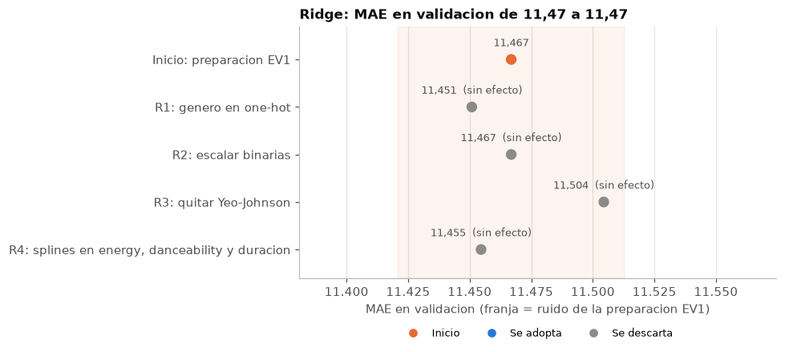

*Ninguno de los cuatro cambios sale de la franja de ruido: la preparacion unica ya era la adecuada para un modelo lineal.*

#### Random Forest

Los arboles requieren "little data preparation" y no necesitan normalizar $_{[13]}$: un corte "variable < umbral" no cambia si la transformacion conserva el orden (razonamiento).

| # | Prueba | Evidencia (MAE validacion) | Veredicto | Costo de no hacerlo |
|---|---|---|---|---|
| F1 | Quitar Yeo-Johnson y escalado | 10,916 a 10,917 (+0,001; ruido 0,054) | Sin efecto: se adopta la version simple, porque la documentacion dice que no hace falta | Ninguno en precision |
| F2 | Genero en one-hot en vez de por objetivo | 10,917 a 10,828 (-0,088; ruido 0,055); mejora en 5 de 5 folds | **Mejora: se adopta.** La hipotesis (que empeoraria) queda refutada | 0,09 puntos; a cambio, 128 columnas y varias veces mas tiempo de entrenamiento |
| F3 | Recuperar `instrumentalness` y `key` | 10,828 a 10,833 (+0,005; ruido 0,079) | Sin efecto: se descarta | Ninguno |

Posible explicacion de F2 (razonamiento, no verificada): la codificacion por objetivo resume cada genero en su popularidad media, y el arbol solo puede cortar por rangos de esa media. Con el one-hot, cada arbol puede separar un genero concreto, y Random Forest prueba todas las columnas en cada corte.

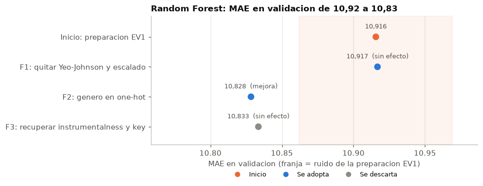

#### XGBoost

Ademas de no necesitar transformaciones, XGBoost puede recibir el genero como categoria: en cada corte busca agrupar "the categories that output similar leaf values" $_{[3]}$.

| # | Prueba | Evidencia (MAE validacion) | Veredicto | Costo de no hacerlo |
|---|---|---|---|---|
| X1 | Quitar Yeo-Johnson y escalado | 11,281 a 11,299 (+0,018; ruido 0,071) | Sin efecto: se adopta la version simple | Ninguno en precision |
| X2 | Genero como categoria nativa | 11,299 a 10,655 (-0,644; ruido 0,058, 11 veces el ruido); mejora en 5 de 5 folds | **Mejora: se adopta.** Es el mayor efecto de todo el trabajo | 0,64 puntos: XGBoost quedaria detras de Random Forest |
| X3 | Recuperar `instrumentalness` y `key` | 10,655 a 10,646 (-0,009; ruido 0,085) | Sin efecto: se descarta | Ninguno |

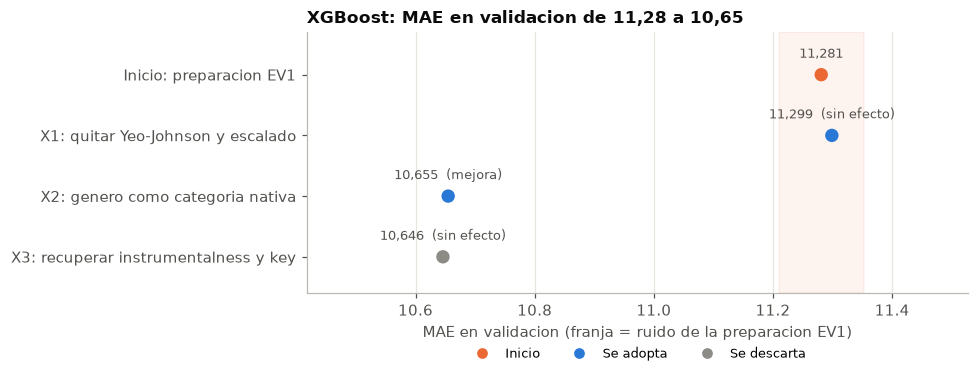

#### Todo junto

El paso a paso descarta un cambio si por separado no supera el ruido, pero varios cambios pequeños podrian sumar. Por eso, al final, cada modelo se probo con todos los cambios propuestos a la vez (en Ridge se dejo fuera R3, porque quitar Yeo-Johnson iba en contra de su hipotesis).

| Modelo | Cambios juntos | MAE paso a paso | MAE todo junto | Diferencia (ruido) | Folds que mejoran | Veredicto |
|---|---|---|---|---|---|---|
| Ridge | R1 + R2 + R4 | 11,467 | 11,433 | -0,034 (0,046) | 5 de 5 | Sin efecto |
| Random Forest | F1 + F2 + F3 | 10,828 | 10,833 | +0,005 (0,079) | 2 de 5 | Sin efecto |
| XGBoost | X1 + X2 + X3 | 10,655 | 10,646 | -0,009 (0,085) | 2 de 5 | Sin efecto |

En Ridge los efectos pequeños si se suman, pero siguen bajo el ruido y Ridge pasaria de 16 a 146 columnas. **Ningun modelo mejora con todo junto**: las preparaciones del paso a paso son las finales.

**Balance.** De 10 cambios, 2 mejoran (F2 y X2, ambos sobre como se entrega el genero), 8 no tienen efecto y ninguno empeora mas que el ruido.

---

## 6. Justificacion de la seleccion de modelos

Se eligieron tres familias distintas, para que la comparacion diga algo sobre los datos y no solo sobre un algoritmo.

| | **Ridge** | **Random Forest** | **XGBoost** |
|---|---|---|---|
| Familia | Lineal regularizado | Arboles en paralelo (bagging) | Arboles en secuencia (boosting) |
| Como aprende | Minimiza el error cuadratico mas un castigo a los coeficientes grandes $_{[6]}$ | Promedia arboles entrenados con muestras al azar de las filas $_{[5]}$ | Cada arbol corrige el error de los anteriores, con un termino que castiga arboles complejos $_{[8]}$ |
| Por que encaja en este caso | Es la referencia interpretable; el castigo hace los coeficientes "more robust to collinearity" $_{[2]}$, util con `energy`, `loudness` y `acousticness` correlacionadas | Capta las relaciones no lineales del EDA (la U invertida) sin programarlas | Acepta el genero como categoria $_{[3]}$, el predictor dominante |
| Que necesita de los datos | Escalas comparables y el genero como numero | Casi nada: los cortes no cambian si la transformacion conserva el orden | Casi nada, y puede recibir categorias |
| Limitacion | Solo relaciones lineales en lo que recibe | Con `max_depth=None` los arboles crecen sin limite y tienden a memorizar $_{[5]}$ | Por defecto no esta ajustado a estos datos |

**Configuracion de partida (parametros por defecto de la EV2; la EV3 los ajusta en la seccion 10).** Ridge con `alpha = 1`. Random Forest con 100 arboles, sin limite de profundidad y todas las variables en cada corte. XGBoost con 100 arboles, `eta = 0,3`, `max_depth = 6` y perdida cuadratica; con 113 generos usa la particion de categorias, porque supera `max_cat_to_onehot = 4` $_{[4]}$. Semilla 42 en todos.

---

## 7. Detalles y caracteristicas de las variables finales por modelo

Las 15 variables que no son el genero son las mismas en todos los casos; cambia el formato.

- **Continuas (11):** `danceability`, `energy`, `loudness`, `speechiness`, `acousticness`, `liveness`, `valence`, `tempo`, `n_generos`, `duracion_min`, `n_artistas`.
- **Binarias (4):** `explicit`, `mode`, `es_instrumental`, `compas_4_4`.
- **Genero (1):** `track_genre`.

| Grupo | Preparacion unica (los tres) | Ridge propio | Random Forest propio | XGBoost propio |
|---|---|---|---|---|
| Continuas (11) | Yeo-Johnson en 6 + estandarizadas | Igual a la unica | Sin transformar | Sin transformar |
| Binarias (4) | Sin tocar | Sin tocar | Sin tocar | Sin tocar |
| Genero (1) | 1 columna por objetivo, estandarizada | Igual a la unica | 113 columnas one-hot | 1 columna categorica |
| **Columnas** | **16** | **16** | **128** | **16** |

---

## 8. Implementacion de los modelos

- **Pipelines.** Cada preparacion se encadena con su modelo en un `Pipeline` (`ColumnTransformer` + modelo). En cada fold, el escalado, Yeo-Johnson y la codificacion del genero se ajustan solo con las filas de entrenamiento de ese fold.
- **Validacion.** `GroupKFold` de 5 folds dentro del entrenamiento, con grupos = cancion: cada grupo aparece una sola vez en validacion $_{[1]}$, asi que las versiones de una misma cancion nunca quedan separadas.
- **Bitacora.** Una funcion prueba cada cambio contra la preparacion vigente, aplica la regla de decision y anota el resultado. Se evaluaron 17 preparaciones en validacion cruzada.
- **Prueba.** Las seis configuraciones finales (cada modelo con la preparacion unica y con la suya) se entrenan con todo el entrenamiento y se evaluan juntas, **una sola vez**.
- **Control.** La preparacion unica rearmada dentro del notebook es identica a los archivos de la EV1 (diferencia maxima de 4e-15) y da en prueba exactamente lo mismo que un modelo entrenado con esos archivos.
- **Precauciones.** Identificadores y textos fuera del modelo; codificacion por objetivo con *cross fitting*; ninguna decision tomada mirando la prueba; semilla fija en todo paso aleatorio.
- **Ajuste (EV3).** `GridSearchCV` y `RandomizedSearchCV` reciben el modelo y la tabla que la EV2 dejo preprocesada para el, con los mismos 5 folds agrupados; cada busqueda se guarda en `data/processed/ev3/busquedas/` (secciones 10.3 y 10.4).

---

## 9. Evaluacion con parametros por defecto (EV2)

Esta seccion conserva lo que dejo la EV2, con los tres modelos en sus parametros por defecto. La evaluacion final de los modelos ya ajustados, los ensambles y la seleccion de la solucion optima estan en las secciones 10 y 11.

### 9.1 Tabla comparativa (prueba)

| Modelo | Preparacion | MAE valid. | MAE test | RMSE test | R² test | R² train | MAE exitos |
|---|---|---|---|---|---|---|---|
| Linea base | - | - | 16,83 | 20,15 | 0,00 | - | 41,19 |
| Ridge | Unica | 11,47 | 11,52 | 16,27 | 0,35 | 0,36 | 32,82 |
| Ridge | Propia (igual a la unica) | 11,47 | 11,52 | 16,27 | 0,35 | 0,36 | 32,82 |
| Random Forest | Unica | 10,92 | 10,99 | 15,86 | 0,38 | 0,84 | 30,89 |
| Random Forest | Propia | 10,83 | 10,85 | **15,76** | **0,39** | 0,92 | 29,95 |
| XGBoost | Unica | 11,28 | 11,30 | 16,04 | 0,37 | 0,54 | 30,86 |
| **XGBoost** | **Propia** | **10,66** | **10,64** | 15,79 | **0,39** | 0,65 | **29,36** |

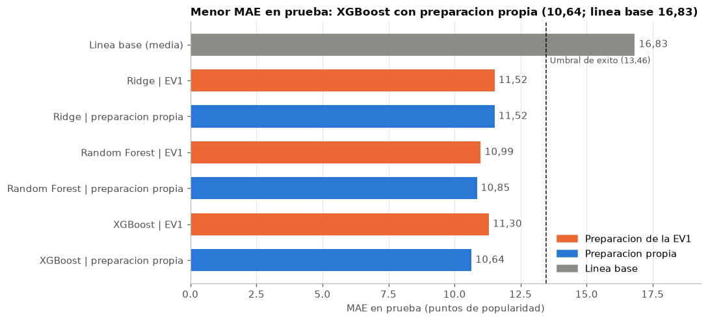

*Todos superan a la linea base y cumplen el umbral de MAE (13,46). Los dos modelos de arboles mejoran con su preparacion propia; Ridge queda igual.*

### 9.2 ¿Valio la pena adaptar la preparacion?

| Modelo | Cambios adoptados | Cambio en MAE validacion | Cambio en MAE test | ¿Valio la pena? |
|---|---|---|---|---|
| Ridge | Ninguno | 0,000 | 0,000 | No hacia falta: la preparacion unica ya era adecuada |
| Random Forest | F1, F2 | -0,087 | -0,144 | Si, poco |
| XGBoost | X1, X2 | **-0,626** | **-0,656** | Si |

**El orden de los modelos cambia con la preparacion.** Con la preparacion unica gana Random Forest (10,99 en prueba; luego XGBoost con 11,30 y Ridge con 11,52). Con la propia gana XGBoost (10,64; luego Random Forest con 10,85 y Ridge con 11,52). Con una sola preparacion para todos, XGBoost se habria descartado por error.

### 9.3 Donde se equivoca

| Segmento (prueba) | Canciones | MAE linea base | MAE XGBoost propio |
|---|---|---|---|
| Popularidad 0 | 1.316 | 34,3 | 25,3 |
| Popularidad 1 a 69 | 15.182 | 14,3 | 8,6 |
| Popularidad ≥ 70 (exitos) | 657 | 41,2 | 29,4 |

| Error medido en puntos | Linea base | XGBoost propio |
|---|---|---|
| Error mediano | 14,3 | **6,4** |
| Canciones con error ≤ 5 puntos | 14,7% | 41,8% |
| Canciones con error ≤ 10 puntos | 32,4% | 64,5% |
| Canciones con error ≤ 20 puntos | 64,9% | 83,8% |
| Canciones con error > 30 puntos | 17,0% | 7,8% |

El error medio (10,6) es mayor que el mediano porque unas pocas canciones, sobre todo los exitos, tienen errores grandes.

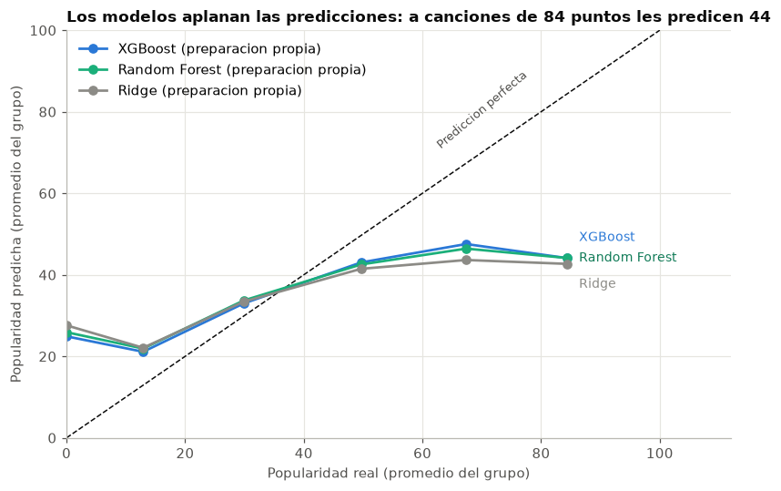

*Los modelos aplanan las predicciones hacia el centro. A canciones con popularidad real de 84 en promedio, XGBoost les predice 44; a las de popularidad 0, les predice 25. Los exitos se subestiman en unos 29 puntos. Hipotesis (no verificada): el audio y el genero describen la popularidad tipica de un tipo de cancion, no lo que hace destacar a una en particular.*

**Equidad.** La brecha de MAE entre cuartiles de genero es de 6,1 en la linea base y queda entre 3,8 y 4,4 en los seis modelos (4,0 en XGBoost propio). Todos cumplen.

### 9.4 Criterios de exito

| Criterio | Umbral | XGBoost propio | ¿Cumple? | Mejor de los seis |
|---|---|---|---|---|
| MAE en prueba | ≤ 13,46 | 10,64 | Si | 10,64 (los seis cumplen) |
| RMSE en prueba | ≤ 15,51 | 15,79 | No | 15,76 (ninguno cumple) |
| R² en prueba | ≥ 0,40 | 0,386 | No | 0,388 (ninguno cumple) |
| MAE en exitos | ≤ 20 | 29,36 | No | 29,36 (ninguno cumple) |
| Brecha de R² | ≤ 0,05 | 0,265 | No | 0,009 (solo Ridge cumple) |
| Brecha de MAE entre generos | ≤ 5 | 3,98 | Si | 3,79 (los seis cumplen) |

R² y RMSE son la misma exigencia vista de dos formas, por eso fallan juntos. **La preparacion propia aumenta el sobreajuste de los arboles:** la brecha de R² de Random Forest pasa de 0,459 a 0,533 y la de XGBoost de 0,178 a 0,265. Las variables mejor entregadas tambien le permiten al arbol memorizar mas; controlarlo corresponde al ajuste de hiperparametros.

### 9.5 Protocolo de seleccion aplicado

| Paso | Resultado |
|---|---|
| 1. ¿Alguna preparacion propia cumple los seis criterios? | Ninguna |
| 2. Menor MAE en validacion | XGBoost, 10,655 |
| 3. ¿Empate? (tolerancia: el ruido del lider = 0,085) | No: Random Forest queda a 0,174 y Ridge a 0,812 |
| 4. Veredicto | **Ningun modelo es apto. XGBoost con preparacion propia es el mejor candidato** para la etapa de ajuste |

La prueba confirma la eleccion: XGBoost tambien tiene el menor MAE en prueba.

### 9.6 Escenario cancion inedita

`n_generos` (en cuantos generos aparecia la cancion en las busquedas de Spotify) solo existe cuando la cancion ya esta publicada, y el uso de negocio es justamente decidir antes. Se repitio la preparacion final sin esa variable, con los mismos folds.

| | MAE validacion | MAE test | RMSE test | R² test | MAE exitos |
|---|---|---|---|---|---|
| XGBoost con `n_generos` | 10,655 | 10,64 | 15,79 | 0,386 | 29,36 |
| XGBoost sin `n_generos` (cancion inedita) | 10,903 | 10,84 | 15,93 | 0,374 | 29,31 |

Sin `n_generos` la candidata pierde 0,25 puntos en validacion (2,9 veces el ruido). Random Forest pierde algo parecido (0,27) y Ridge casi nada (0,006), y XGBoost sigue siendo el mejor (10,903 contra 11,102 de Random Forest y 11,472 de Ridge). Para canciones aun no publicadas, la version sin `n_generos` es la que corresponde.

### 9.7 Interpretacion del modelo candidato

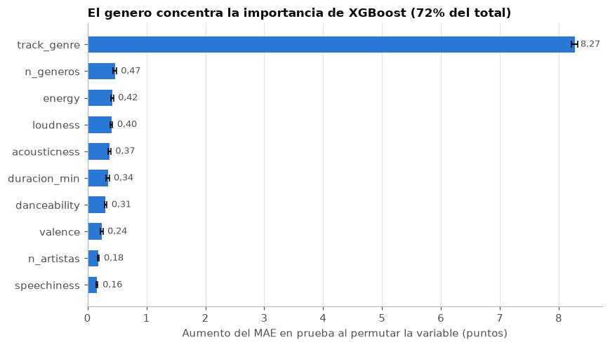

*La importancia por permutacion es cuanto empeora la metrica al desordenar una variable $_{[11]}$. Desordenar el genero empeora el MAE en 8,27 puntos: el 72% de toda la importancia. Le sigue `n_generos` (0,47), unas 18 veces menos.*

**Anatomia de una prediccion.** XGBoost entrega el aporte de cada variable con valores SHAP, cuya suma es la prediccion $_{[12]}$. En promedio, el genero mueve cada prediccion en 9,4 puntos; ninguna otra variable pasa de 0,9.

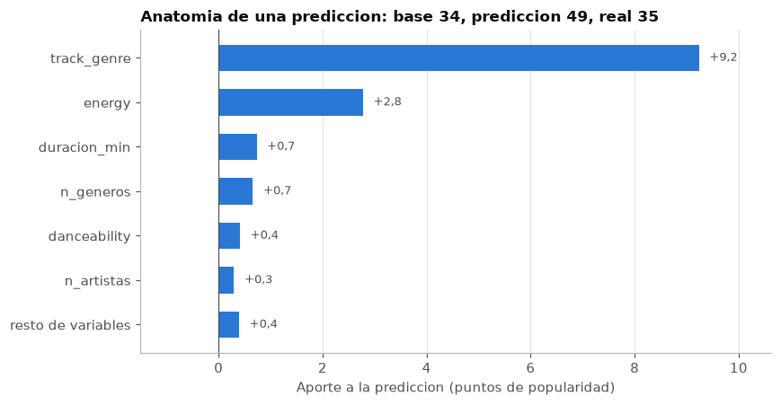

*If the World Was Ending - Acoustic (Jonah Baker y Celine, genero `acoustic`) tiene popularidad 35 y el modelo predice 48,8. Desde un valor base de 34,3, el genero suma 9,2 y `energy` 2,8. Casi todo el exceso viene del genero: el modelo le asigna la popularidad tipica de las versiones acusticas, no la de esta cancion.*

**Lectura para el negocio (asociacion, no causa).** La popularidad se asocia mucho mas con el genero en que se lista una cancion que con como suena. Predecir el exito de una cancion concreta requiere datos que el audio no tiene: artista, promocion, momento del lanzamiento.

---

## 10. Optimizacion de hiperparametros, ensambles y validacion cruzada (EV3)

La EV2 comparo los tres modelos con sus parametros por defecto y su mejor candidato (XGBoost) no cumplia los seis criterios de exito: fallaba R², RMSE, brecha de R² y MAE en exitos, y los arboles sobreajustaban mucho (R² de entrenamiento 0,92 contra 0,39 en prueba en Random Forest). Esta etapa responde una sola pregunta:

> **Con los mismos tres modelos y los mismos datos preparados, ¿se pueden encontrar hiperparametros que cumplan los seis criterios de exito, y que cuesta lograrlo?**

Es un trabajo de investigacion: cada decision se prueba antes de darse por buena, cada hipotesis se escribe **antes de medir** y se responde despues con los resultados, y se anota tambien lo que no funciona. Respaldo completo, con todas las salidas: `ev3/notebook_ev3.ipynb`, un documento separado de la EV1 y la EV2 que no repite su EDA ni vuelve a probar como preparar los datos: parte de las tablas que la EV2 dejo preprocesadas para cada modelo. Esta seccion sigue el mismo orden que el notebook: diseño (10.1 a 10.3), busqueda de hiperparametros (10.4), aporte de los ensambles (10.5), prueba de los finalistas (10.6), experimentos (10.7) y capacidad de generalizacion (10.8). Su resultado alimenta la seleccion de la seccion 11.

### 10.1 Diseño del experimento

| Elemento | Decision |
|---|---|
| **Entrada** | Lo que exporta la EV2 en `data/processed/ev2/`: para cada modelo, la tabla de entrenamiento y la de prueba **ya preprocesadas** con la preparacion final que la EV2 eligio (Ridge: Yeo-Johnson, estandarizacion y genero por media de popularidad, 16 columnas; Random Forest: genero en one-hot, 128 columnas; XGBoost: genero como categoria nativa, 15 variables mas el genero), los mismos 5 folds, los criterios y las metricas por defecto |
| **Validacion** | Los mismos 5 folds agrupados por cancion de la EV2 (`GroupKFold`): dos versiones de una misma cancion nunca quedan a los dos lados de un fold |
| **Estrategia de busqueda** | Primero un **Random Search amplio** que explora muchos hiperparametros a la vez, y despues un **Grid Search acotado** alrededor del mejor candidato, que lo afina. Ambos buscan todos los hiperparametros a la vez, no uno por uno, porque interactuan |
| **Regla para elegir una combinacion** | Cada candidato se mide en validacion contra los seis criterios; gana el que cumple mas criterios y, en empate, el de menor MAE de validacion. Se fijo antes de buscar. Como contar criterios es una regla tosca, a la prueba pasa tambien el candidato de menor MAE |
| **Prueba** | No participa en ninguna eleccion de las busquedas: se usa una sola vez por candidato, al final, para confirmar |
| **Hardware** | XGBoost entrena y busca en la GPU (`device='cuda'`, una RTX 3060). Ridge y Random Forest de scikit-learn no tienen version para GPU y usan la CPU (Random Forest limitado a 6 de 12 hilos) |

**La metrica principal es el MAE, y la perdida del modelo es otra cosa.** Comparamos candidatos con el MAE como metrica principal porque asi lo fijamos en la EV1: se lee directo en puntos de popularidad y no se deja dominar por unos pocos errores enormes. Eso no obliga a que el modelo minimice el MAE al entrenar: la funcion de perdida (lo que el modelo optimiza) y la metrica de comparacion (con la que lo juzgamos) son cosas distintas. Ademas, el RMSE y el R² tambien cuentan en la regla, porque son dos de los seis criterios, y el MAE solo desempata. Mirando el RMSE en lugar del MAE, el orden de los candidatos y las conclusiones son los mismos.

**Hipotesis.** Se plantean como preguntas antes de medir, **en el punto del notebook donde nacen**, y se responden despues de ver sus resultados. Las dos primeras salen de lo que dejo la EV2:

| # | Hipotesis (planteada como pregunta) | Donde se responde |
|---|---|---|
| H1 | ¿Ajustar los hiperparametros mejora el error de validacion de los tres modelos respecto de sus valores por defecto, mas que el ruido entre folds? | 10.4 y 10.6 |
| H2 | ¿Algun modelo ajustado llega a cumplir los seis criterios de exito? | 10.4, 10.6 y 11 |

Las demas aparecen donde corresponden: H3 y H4 en la busqueda (10.4), H5 en la prueba de los finalistas (10.6) y H6 y H7 en los experimentos (10.7). La tabla completa de respuestas esta en la seccion 13.

### 10.2 Los tres modelos: diferencias tecnicas

| | **Ridge** | **Random Forest** | **XGBoost** |
|---|---|---|---|
| Familia | Modelo lineal con castigo | Ensamble de arboles en paralelo: **bagging** | Ensamble de arboles en secuencia: **boosting** |
| Como aprende | Minimiza el error cuadratico mas `alpha` por la suma de los coeficientes al cuadrado | Cada arbol se entrena con una muestra al azar (con reemplazo) y en cada corte mira solo algunas variables; la prediccion es el promedio | Cada arbol nuevo corrige el error de los anteriores y se suma con un peso pequeño (`learning_rate`) |
| Que reduce | Varianza, a costa de sesgo | **Varianza**: promediar arboles distintos compensa sus errores | **Sesgo**: cada arbol agrega lo que faltaba |
| Riesgo principal | No capta relaciones no lineales | Cada arbol memoriza su muestra | Sobreajuste al ruido si hay muchos arboles o son muy profundos |
| Donde corre | CPU | CPU | **GPU** |
| Dificultad de ajuste | Una dimension | Moderada | Alta: muchos hiperparametros que interactuan |

**Hiperparametros que se ajustan.** Los rangos salen de la documentacion de cada modelo y del diagnostico de la EV2 (donde estaba el sobreajuste), se fijaron antes de buscar y las variables multiplicativas se muestrean en escala logaritmica.

| Modelo | Hiperparametros | Por que |
|---|---|---|
| Ridge | `alpha` (10⁻³ a 10³) | Un solo hiperparametro; su efecto es multiplicativo |
| Random Forest | `max_depth`, `min_samples_leaf`, `max_features`, `max_samples` | La EV2 mostro arboles que memorizan; con 128 columnas (113 de genero), mirar menos variables por corte los vuelve mas distintos entre si |
| XGBoost | `n_estimators` y `learning_rate`, `max_depth`, `min_child_weight`, `subsample`, `colsample_bytree`, `reg_lambda`, `reg_alpha` | Los dos primeros van juntos (pasos chicos necesitan mas arboles); el resto controla el sobreajuste |

Dos decisiones de diseño. **La funcion de perdida de XGBoost no se busca aqui**: se deja la cuadratica por defecto y se prueba la absoluta como experimento aparte (10.7.1). Y Random Forest usa **100 arboles** en todas las busquedas, igual que la EV2: se compara el efecto de los demas hiperparametros, no el de agregar arboles.

### 10.3 La entrada y un control

Las tablas de la EV2 ya vienen preparadas para cada modelo, asi que la EV3 no transforma nada. Los modelos por defecto, que son el punto de partida, **se vuelven a medir aqui** y no solo se copian sus cifras: la EV2 exporto para la validacion solo el MAE, el RMSE y el ruido entre folds, y la busqueda necesita, para cada candidato, las seis medidas de los criterios (incluidas la brecha de R² entre entrenamiento y validacion, el error en exitos y la equidad por genero). Para que los valores por defecto entren en la misma tabla que los demas candidatos, se miden con la misma maquinaria. Como control, se compara con lo que midio la EV2 y deben coincidir:

| Modelo | MAE de validacion (aqui) | MAE de validacion (EV2) | Diferencia | Ruido entre folds |
|---|---|---|---|---|
| Ridge | 11,469 | 11,467 | 0,002 | 0,046 |
| Random Forest | 10,828 | 10,828 | 0,000 | 0,079 |
| XGBoost | 10,655 | 10,655 | 0,000 | 0,085 |

Coinciden con diferencias de 0,002 o menos, muy por debajo del ruido. Ademas, en la prueba los modelos por defecto reproducen exactamente lo que midio la EV2 (MAE 11,516, 10,846 y 10,643), lo que confirma que el traspaso de datos entre las dos etapas esta bien. Tambien se comprobo que ninguna cancion esta en entrenamiento y prueba a la vez y que ninguna queda a los dos lados de un fold.### 10.4 Busqueda de hiperparametros

### 10.4 Busqueda de hiperparametros

**Por que Random y despues Grid.**

| Caracteristica | Grid Search | Random Search |
|---|---|---|
| Enfoque | Exhaustivo: todas las combinaciones de una malla fija | Muestrea combinaciones al azar de distribuciones |
| Costo | Crece de forma exponencial con cada hiperparametro nuevo | Lo fija el analista (`n_iter`) |
| Riesgo | Saltarse el optimo que queda entre dos puntos de la malla | No garantiza el mejor absoluto |

El Random explora un espacio grande con un presupuesto fijo y dice en que zona esta lo bueno; el Grid, con una malla chica alrededor de lo mejor que encontro el Random, afina esa zona. La malla del Grid **no se escribe a mano** para no ajustarla a lo que se ve: se arma sola alrededor del mejor candidato del Random (cada hiperparametro continuo toma el valor y sus dos vecinos multiplicativos; la profundidad, el valor y sus vecinos enteros; el numero de arboles, el 70%, 100% y 140%).

**Punto de partida (valores por defecto, en validacion).**

| Modelo | MAE | Ruido | RMSE | R² | Brecha R² | MAE en exitos | Equidad | Criterios |
|---|---|---|---|---|---|---|---|---|
| Ridge | 11,469 | 0,046 | 16,130 | 0,353 | 0,000 | 32,769 | 4,142 | 3 |
| Random Forest | 10,828 | 0,079 | 15,622 | 0,393 | 0,528 | 30,014 | 3,613 | 2 |
| XGBoost | 10,655 | 0,085 | 15,663 | 0,390 | 0,288 | 29,002 | 3,752 | 2 |

#### Fase 1: Random Search (20, 16 y 40 candidatos)

**Hipotesis H3 (pregunta, antes de buscar).** ¿Se puede reducir el sobreajuste que mostro el Random Forest en la EV2, con una brecha de R² de 0,53 usando los parametros por defecto, sin que el error suba? Los arboles por defecto crecen sin limite y por eso la brecha es alta; para bajarla hay que restringirlos, y restringirlos suele aumentar el error. Importa porque decide como se elige al ganador: si bajar la brecha cuesta error, ningun modelo puede ser a la vez poco sobreajustado y el mas preciso.


*Cada punto es un candidato del Random Search (la estrella es el valor por defecto) y el color indica cuantos criterios cumple. A la izquierda del umbral de brecha, los candidatos de Random Forest tienen el MAE mas alto.*

**Ridge.** Los 20 candidatos dan el mismo MAE, 11,469; los cinco mejores son identicos hasta el tercer decimal. Ridge tiene un solo hiperparametro y una brecha de R² de 0,000: no sobreajusta, su error viene de ser un modelo demasiado simple para esta relacion, y eso `alpha` no lo arregla.

**XGBoost.** De 40 candidatos, el MAE va de 10,369 a 11,507 (por defecto: 10,655). Ninguno cumple 5 criterios; el maximo es 4. El mejor segun la regla tiene MAE 10,369, R² 0,421, RMSE 15,255, brecha 0,286, error en exitos 29,199 y equidad 3,557: cumple R², RMSE, MAE y equidad, y le fallan la brecha y los exitos. Es un modelo de profundidad 9, con 810 arboles, tasa de aprendizaje de 0,019 y `min_child_weight` de 36. Entre los cinco mejores se repite un patron: `colsample_bytree` alto (entre 0,71 y 0,90) y tasa de aprendizaje baja (entre 0,019 y 0,029), o sea, muchos arboles que aprenden de a poco. Respecto del valor por defecto, el MAE bajo 0,286, unas 3,4 veces el ruido entre folds (0,085).

**Random Forest.** De 16 candidatos, el MAE va de 11,005 a 14,612, y ninguno supera al Random Forest por defecto (10,828). La regla elige un bosque podado (profundidad 22) que cumple la brecha (0,047) pero tiene MAE 12,613.

**Respuesta a H3: se cumple.** Cumplir la brecha cuesta MAE, y cuanto depende del modelo. En Random Forest, 11 de los 16 candidatos cumplen la brecha y el mejor de ellos tiene MAE 12,613, que es **1,785 mas** que el mejor sin esa restriccion (10,828); ademas la correlacion entre brecha y MAE es de −0,86: cuanto menos sobreajusta un bosque, mas se equivoca. En XGBoost, 5 de los 40 candidatos cumplen la brecha y el mejor de ellos tiene MAE 10,971, **0,602 mas** que el mejor general (10,369). Esto tiene sentido: los arboles aprenden memorizando parte del entrenamiento, y limitarlos para que no lo hagan tambien limita lo que pueden predecir.

#### Fase 2: Grid Search acotado

**Hipotesis H4 (pregunta, antes de buscar).** Cuando el Random Search ya encontro la zona buena, ¿el Grid acotado agrega una mejora que valga lo que cuesta? Esperamos que afine algo, pero menos de lo que aporto el Random.

Mallas: Ridge, 5 valores de `alpha`; XGBoost, 81 combinaciones (profundidad 8 a 10, tasa de aprendizaje de 0,0125 a 0,028, 567 a 1.134 arboles y `min_child_weight` de 12 a 109); Random Forest, 9 combinaciones (poda y fraccion de variables).

**Ridge.** Las 5 combinaciones dan el mismo MAE, 11,469. Ni con Random ni con Grid `alpha` cambia nada.

**XGBoost.** El mejor del Grid (MAE 10,346) mejora al del Random (10,369) en 0,023, que es **0,3 veces el ruido** entre folds (0,073): afinar alrededor del mejor punto no aporta nada medible. Peor aun, la brecha de R² sube de 0,286 a 0,401, porque la malla se centro en arboles de profundidad 8 a 10 y ninguna de sus 81 combinaciones cumple la brecha (la menor es 0,104). Y salio caro: el Grid tardo 62 minutos contra 15 del Random, porque las 81 combinaciones son modelos grandes (hasta 1.134 arboles de profundidad 10).

**Random Forest.** El mejor punto del Grid es el mismo del Random, porque es el centro de la malla, y ninguna de las 9 combinaciones cumple mas de 3 criterios. El detalle de la tabla muestra el mecanismo: con hojas de 6 canciones la brecha queda sobre el limite (0,066 a 0,068); con 13 cumple (0,046 a 0,048); con 26 baja a 0,031, pero la equidad pasa de 5 en dos de las tres combinaciones (5,011 y 5,022) y se pierde otro criterio. El MAE casi no se mueve (12,59 a 12,67) y el R² queda cerca de 0,30. En este modelo, la poda cumple la brecha destruyendo la capacidad de predecir.

**Respuesta a H4: se cumple.** El Grid afina menos de lo que aporto el Random: en XGBoost la diferencia (−0,023) queda dentro del ruido, y en Random Forest y Ridge es cero. Con esta malla, el Grid fue la fase mas cara y la que menos aporto.

#### Todas las fases juntas

Cada **candidato** es una combinacion de hiperparametros: en la fase 0 hay uno solo (el de fabrica) y en las demas, tantos como se probaron. La fila de cada fase muestra los resultados del **mejor** candidato de esa fase segun la regla de la seccion 1.2, no un promedio.

| Modelo | Fase | Candidatos | MAE | Ruido | RMSE | R² | Brecha R² | Criterios | Cambio de MAE vs defecto | Veredicto |
|---|---|---|---|---|---|---|---|---|---|---|
| Ridge | 0 defecto | 1 | 11,469 | 0,046 | 16,130 | 0,353 | 0,000 | 3 | | |
| | 1 Random | 20 | 11,469 | 0,046 | 16,130 | 0,353 | 0,000 | 3 | 0,000 | sin efecto |
| | 2 Grid | 5 | 11,469 | 0,046 | 16,130 | 0,353 | 0,000 | 3 | 0,000 | sin efecto |
| Random Forest | 0 defecto | 1 | 10,828 | 0,079 | 15,622 | 0,393 | 0,528 | 2 | | |
| | 1 Random | 16 | 12,613 | 0,043 | 16,742 | 0,303 | 0,047 | 3 | +1,784 | empeora |
| | 2 Grid | 9 | 12,613 | 0,043 | 16,742 | 0,303 | 0,047 | 3 | +1,784 | empeora |
| XGBoost | 0 defecto | 1 | 10,655 | 0,085 | 15,663 | 0,390 | 0,288 | 2 | | |
| | 1 Random | 40 | 10,369 | 0,074 | 15,255 | 0,421 | 0,286 | 4 | −0,286 | mejora |
| | 2 Grid | 81 | 10,346 | 0,073 | 15,303 | 0,417 | 0,401 | 4 | −0,309 | mejora |


*Izquierda: MAE de validacion en cada fase, con el ruido entre folds. Derecha: criterios cumplidos. Ridge no se mueve, Random Forest empeora al podarse y XGBoost baja el error y sube de 2 a 4 criterios.*


*MAE de validacion en cada uno de los 5 folds, por defecto (punteado) y ajustado (solido).*

**Que paso con cada modelo.**

- **Ridge:** las tres fases dan 11,469. Ajustar no cambia nada que se distinga del ruido (0,046).
- **Random Forest:** el candidato que elige la regla empeora el MAE de 10,828 a 12,613 (+1,784, unas 41 veces el ruido de 0,043) a cambio de bajar la brecha de R² de 0,528 a 0,047. Ni siquiera el menor MAE de las busquedas (11,005 en el Random y 12,591 en el Grid) supera a los hiperparametros por defecto: el mejor Random Forest que encontramos es el que ya venia de fabrica.
- **XGBoost:** el MAE baja de 10,655 a 10,369 con el Random y a 10,346 con el Grid (−0,309 en total, unas 3,6 veces el ruido de 0,085), y sube de 2 a 4 los criterios cumplidos: el R² (de 0,390 a 0,417) y el RMSE (de 15,663 a 15,303) pasan sus umbrales. Lo que empeora es la brecha de R², de 0,288 a 0,401.

**Estabilidad por fold.** El XGBoost ajustado queda por debajo del XGBoost por defecto en los 5 folds (por ejemplo, 10,47 contra 10,79 en el primero y 10,32 contra 10,56 en el ultimo), asi que su mejora no depende de una particion favorable. El Random Forest podado queda por encima del por defecto en los 5 folds, y Ridge ajustado coincide con Ridge por defecto en todos. Las lineas de cada modelo suben y bajan juntas: el MAE depende de lo dificil que sea cada fold mas que del modelo.

**Respuesta a H1: se cumple solo en XGBoost.** Ajustar los hiperparametros mejoro el error de validacion mas que el ruido en XGBoost, no cambio nada en Ridge, y en Random Forest empeoro el resultado (cuando se busca cumplir criterios) o lo dejo igual (cuando se busca el menor MAE). Es lo mas importante que dejo la busqueda: **para dos de los tres modelos, los hiperparametros por defecto ya eran buenos**.

**Respuesta a H2: no se cumple.** Ningun candidato de ningun modelo cumple 5 o mas criterios en validacion; el maximo es 4, con XGBoost. A los de XGBoost les faltan siempre la brecha de R² y el error en exitos.


### 10.5 Aporte de los ensambles: un arbol solo contra bosque y boosting

Random Forest (bagging) y XGBoost (boosting) son ensambles de arboles. Para mostrar que combinar arboles aporta algo, los comparamos con **un arbol de decision solo**, ajustado con el mismo cuidado (Grid Search sobre profundidad y tamaño de hoja, mismos 5 folds, misma tabla que Random Forest). No busca elegir entre modelos: busca mostrar el aporte del ensamble.

| Modelo (MAE de validacion) | MAE | Ruido | RMSE | R² | Brecha R² | Menos MAE que el arbol solo |
|---|---|---|---|---|---|---|
| Arbol de decision solo (mejor de 15 combinaciones) | 11,906 | 0,079 | 16,814 | 0,296 | 0,153 | |
| Random Forest, por defecto | 10,828 | 0,079 | 15,622 | 0,393 | 0,528 | 9,0% |
| XGBoost, por defecto | 10,655 | 0,085 | 15,663 | 0,390 | 0,288 | 10,5% |
| XGBoost (mejor de sus busquedas) | 10,346 | 0,073 | 15,303 | 0,417 | 0,401 | 13,1% |


*MAE (con el ruido entre folds) y RMSE de validacion. Los dos ensambles bajan el error frente a un arbol solo; XGBoost buscado lo baja un 13,1% en MAE.*

El arbol solo llega a un MAE de 11,906 (R² 0,296). Los dos ensambles lo bajan: el bosque (bagging) a 10,828, un 9,0% menos, y XGBoost (boosting) a 10,655 por defecto (10,5% menos) y a 10,346 tras buscar (13,1% menos). El RMSE va en la misma direccion: de 16,814 en el arbol solo a 15,622 en el bosque y a 15,303 en XGBoost buscado. Cada ensamble reduce algo distinto: promediar arboles distintos compensa sus errores y reduce la varianza (bagging), y que cada arbol corrija lo que faltaba en los anteriores reduce el sesgo (boosting). Lo que mas baja el error es el boosting con hiperparametros buscados; el Random Forest buscado no mejora al de fabrica, por eso sus dos barras son iguales.

Esta comparacion no busca elegir entre modelos, sino mostrar que combinar arboles reduce el error frente a un arbol solo.

### 10.6 Prueba de los finalistas

De todos los candidatos (defecto, Random y Grid) pasan a la prueba, por modelo, el que cumple **mas criterios** y el de **menor MAE** de validacion; si son el mismo, uno solo. Son cuatro finalistas: Ridge (alpha ≈ 0,0001, practicamente el valor de fabrica), Random Forest podado (el de la regla), Random Forest por defecto (el de menor MAE: ninguna de las 25 combinaciones lo mejoro) y XGBoost (profundidad 10, tasa de aprendizaje de 0,0125, 1.134 arboles). Cada uno se entrena con **todo** el entrenamiento y se mide una sola vez.

**Hipotesis H5 (pregunta, antes de mirar la prueba).** El candidato ganador se eligio como el mejor entre decenas de combinaciones, comparadas con las mismas canciones de validacion. ¿Sus resultados se mantienen en la prueba, o estan algo inflados por haberlo elegido entre tantos? Esperamos que en la prueba salgan algo peores y que los criterios cumplidos por poco no se mantengan.

| Candidato (prueba) | R² | RMSE | MAE | Brecha R² | MAE en exitos | Equidad | Criterios | No cumple |
|---|---|---|---|---|---|---|---|---|
| *Umbral* | *≥ 0,40* | *≤ 15,51* | *≤ 13,46* | *≤ 0,05* | *≤ 20* | *≤ 5* | | |
| Ridge, por defecto | 0,348 | 16,267 | 11,516 | 0,005 | 32,821 | 4,408 | 3 | 1, 2, 5 |
| Ridge, optimizado | 0,348 | 16,267 | 11,516 | 0,005 | 32,821 | 4,408 | 3 | 1, 2, 5 |
| Random Forest, por defecto | 0,388 | 15,756 | 10,846 | 0,533 | 29,950 | 3,940 | 2 | 1, 2, 4, 5 |
| Random Forest, optimizado (regla) | 0,296 | 16,896 | 12,735 | 0,045 | 34,515 | 5,458 | 2 | 1, 2, 5, 6 |
| XGBoost, por defecto | 0,386 | 15,788 | 10,643 | 0,265 | 29,360 | 3,984 | 2 | 1, 2, 4, 5 |
| **XGBoost, optimizado** | **0,410** | **15,468** | **10,438** | 0,388 | 29,036 | 3,751 | **4** | 4, 5 |

**Que muestra la prueba.**

- **Los hiperparametros por defecto reproducen exactamente lo que midio la EV2** (MAE 11,516, 10,846 y 10,643 en la prueba), asi que el traspaso de datos entre las dos etapas esta bien.
- **XGBoost optimizado es el unico que mejora.** Pasa de cumplir 2 criterios a cumplir 4: R² de 0,386 a 0,410 y RMSE de 15,788 a 15,468 cruzan sus umbrales, y el MAE baja de 10,643 a 10,438 (−0,205). Le fallan la brecha de R² (0,388, peor que el 0,265 que tenia por defecto) y el error en exitos (29,036).
- **Ridge no cambia** (MAE 11,516 y 3 criterios).
- **Random Forest podado** (el de la regla) es el peor: R² 0,296 y MAE 12,735, y pasa de 3 criterios en validacion a 2 en la prueba. **El de menor MAE es el que ya teniamos por defecto** (MAE 10,846 y 2 criterios).
- **Ningun finalista cumple los seis criterios.** El maximo es 4, y es XGBoost.

**Respuesta a H5: se cumple en lo esperado.** Las cifras del ganador empeoran un poco al pasar de validacion a prueba: en XGBoost el MAE sube de 10,346 a 10,438 (+0,092), el RMSE de 15,303 a 15,468 (+0,165) y el R² baja de 0,417 a 0,410. Aun asi, sus 4 criterios se mantienen, porque los cumplia con margen (el RMSE con 0,21 de holgura en validacion, y todavia con 0,045 en la prueba). El Random Forest podado, en cambio, pierde un criterio: cumplia la equidad por apenas 0,077 (4,923 contra un limite de 5) y en la prueba da 5,458. O sea que los criterios que se cumplen por poco no sobreviven a canciones nuevas y los que tienen margen si.

**Respuesta a H1 en la prueba.** Se confirma lo de validacion: de los tres modelos, solo XGBoost mejoro al optimizar.

### 10.7 Experimentos: perdida absoluta y artista

La busqueda dejo a los tres modelos ajustados. Pero hay dos preguntas que ningun Random ni Grid contesta, porque no son hiperparametros: **que error minimiza el modelo** (la funcion de perdida) y **que informacion le damos para aprender**. Cada experimento tiene su razon y su expectativa escritas antes de medir, se mide primero en validacion cruzada y pasa a la prueba una sola vez. Una diferencia de MAE menor que el ruido entre folds se considera "sin efecto".

#### 10.7.1 Perdida absoluta (H6)

El XGBoost de la busqueda minimizo el error cuadratico: equivocarse por 20 puntos cuesta cuatro veces mas que equivocarse por 10, y la mejor prediccion para ese costo es la **media**. El MAE, en cambio, cuenta cada punto de error por igual, y la mejor prediccion para ese costo es la **mediana**. En la popularidad hay muchas canciones con valor 0 y unos pocos exitos de 80 o 90, asi que media y mediana se separan bastante.

**Hipotesis H6 (pregunta, antes de medir).** ¿Optimizar directamente el MAE, con la perdida absoluta, logra menos error que la cuadratica, y que se pierde a cambio? Esperamos menos MAE pero peor R² y RMSE, porque esas dos medidas se calculan con errores al cuadrado y castigan los errores grandes, que es justo lo que la perdida absoluta deja de castigar. Tambien esperamos mas sobreajuste. Para que la comparacion sea justa, la perdida absoluta se busca con el **mismo procedimiento**: Random Search con el mismo espacio y las mismas 40 combinaciones, y un Grid acotado alrededor de su mejor resultado.

| Candidato (validacion) | MAE | R² | RMSE | Brecha R² | Criterios |
|---|---|---|---|---|---|
| A, cuadratica (la mejor) | 10,346 | 0,417 | 15,303 | 0,401 | 4 |
| B, absoluta, menor MAE | **9,831** | 0,398 | 15,551 | 0,160 | 2 |
| B, absoluta, la que elige la regla | 10,002 | 0,374 | 15,859 | **0,048** | 3 |

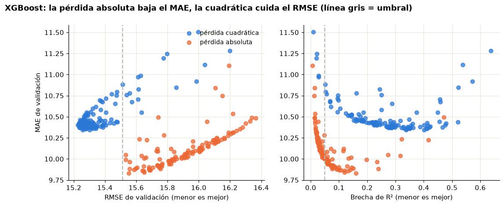

*Cada punto es un candidato de XGBoost de cualquier fase. Los naranjas (perdida absoluta) quedan mas abajo (menos MAE) y mas a la derecha (mas RMSE) que los azules (cuadratica).*

**Que mostro la comparacion.**

| | MAE | R² | RMSE | Brecha R² | Criterios |
|---|---|---|---|---|---|
| A (cuadratica), la mejor | 10,346 | 0,417 | 15,303 | 0,401 | 4 |
| B (absoluta), menor MAE | **9,831** | 0,398 | 15,551 | 0,160 | 2 |
| B (absoluta), la que elige la regla | 10,002 | 0,374 | 15,859 | **0,048** | 3 |

La perdida absoluta si baja el MAE: 0,515 menos que A, unas 6 veces el ruido (0,088). Pero pierde R² (−0,019) y RMSE (+0,248): cada perdida cuida lo que optimiza. En el grafico, los puntos naranjas (absoluta) quedan abajo (menos MAE) y mas a la derecha (mas RMSE) que los azules (cuadratica). En la prueba pasa lo mismo: B tiene el menor MAE de todos los modelos (9,926), pero R² 0,383 y RMSE 15,819, y cumple solo 2 criterios contra los 4 de A.

**Respuesta a H6: se cumple en lo principal y no en una parte.** El MAE baja y R² y RMSE empeoran, como esperabamos. Lo que no se cumplio es que la absoluta sobreajustara mas: la brecha de B (0,159) es menor que la de A (0,388). La razon es que el mejor A de la busqueda es un modelo muy grande (profundidad 10, 1.134 arboles) y el mejor B es mas pequeño y mas regularizado (profundidad 8, `reg_lambda` de 10,8). Es un resultado de los mejores candidatos de cada busqueda, no una propiedad de la perdida: con otra malla el orden podria cambiar.

**Por que la cuadratica es la que conviene aqui.** Dos de nuestros seis criterios, el R² y el RMSE, se calculan con los errores al cuadrado: castigan mucho mas equivocarse por 40 puntos que por 10. La perdida cuadratica entrena al modelo para minimizar justo eso, asi que le va mejor en esas dos medidas, y por eso cumple mas criterios. La perdida absoluta trata todos los errores igual y deja pasar los grandes, y por eso gana en MAE y pierde en R² y RMSE. Si el exito del proyecto se midiera solo con el MAE, ganaria la absoluta; como lo medimos con seis criterios, entre ellos dos cuadraticos, gana la cuadratica.

Un hallazgo que vale la pena anotar: con perdida absoluta si se puede cumplir la brecha (B de la regla: 0,048) con un MAE de 10,002, mejor que el de A. Con perdida cuadratica, el mejor candidato que cumple la brecha tiene MAE 10,971.

#### 10.7.2 Diagnostico del artista: lo que mas limita al modelo (H7)

En el EDA el artista explicaba mas variacion que el genero (η² de 0,51 contra 0,35) y se dejo fuera del modelo por el posible efecto superestrella y por privacidad. Este diagnostico mide cuanto costo esa decision: **no es una solucion que propongamos**, es una forma de ver que informacion le falta al modelo. El artista principal (el primero de los creditos) se codifica con su popularidad media **dentro de cada fold**, usando solo las demas canciones del artista en el entrenamiento, para no filtrar la respuesta de la cancion evaluada.

**Hipotesis H7 (pregunta, antes de medir).** ¿Cuanto mejoraria el modelo si conociera al artista, y esa mejora depende de que el artista tenga historial? Esperamos una mejora grande, mayor que la de cualquier ajuste de hiperparametros, pero que dependa de que el artista tenga otras canciones en el entrenamiento.

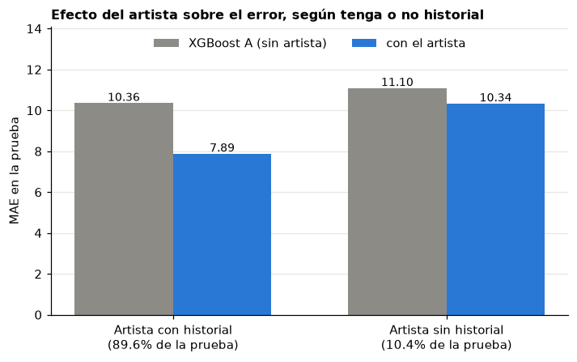

*MAE en la prueba segun si el artista tiene o no canciones en el entrenamiento.*

**Resultado.** El artista es **el cambio mas grande de todo el trabajo**, mayor que cualquier ajuste de hiperparametros:

| | R² | RMSE | MAE | MAE en exitos | Equidad | Criterios (prueba) |
|---|---|---|---|---|---|---|
| XGBoost A | 0,410 | 15,468 | 10,438 | 29,036 | 3,751 | 4 |
| Con el artista | **0,558** | **13,388** | **8,140** | **22,762** | **2,520** | 4 |

En validacion el MAE baja de 10,346 a 8,084 (−2,262, unas 30 veces el ruido). En la prueba baja 2,298 puntos, contra los 0,205 que aporto toda la optimizacion de hiperparametros. El error en exitos baja a 22,8, lo mas cerca del limite de 20 que hemos estado. Siguen fallando la brecha (0,288) y los exitos.

**Respuesta a H7: se cumple, con un matiz.** El 89,6% de las canciones de prueba (15.377 de 17.155) tiene un artista con otras canciones en el entrenamiento, y para ellas el MAE baja de 10,362 a 7,885 (−2,477). Para las 1.778 restantes, artistas sin historial, el MAE baja de 11,096 a 10,339 (−0,757): una mejora tres veces menor. La ganancia sale sobre todo de conocer al artista.

**Que significa esto, y que no.** Que conocer al artista sea tan informativo nos dice que, en estos datos, **el nombre del artista pesa por si solo en la popularidad de una cancion**: el modelo con artista predice, en buena parte, la fama del artista mas que la cancion, y por eso ayuda mucho a quien ya es conocido y poco a quien no. Ese es el efecto superestrella que sospechabamos, y es la razon por la que el artista se habia excluido del modelo (a eso se suma la privacidad). Hay que ser precisos en el alcance: lo que medimos es esa dependencia, no si perjudica a los artistas nuevos en una decision real. Para eso habria que revisar el error del modelo por nivel de fama del artista, y no lo hicimos. Tampoco podemos decir que el nombre cause la popularidad: es una señal de todo lo que el artista trae (fama, seguidores, promocion). Por eso el artista queda como diagnostico y no como parte de la solucion: decidir si se usa es una decision de negocio y de etica, no un ajuste del modelo.

### 10.8 Validacion cruzada y capacidad de generalizacion

La validacion cruzada agrupada por cancion sirvio para cuatro cosas, y cada una dejo una conclusion:

- **Comparar candidatos con un ruido conocido.** El ruido (la desviacion del MAE entre los 5 folds, entre 0,04 y 0,09) fue la vara para decidir si una diferencia es real: la mejora de XGBoost (−0,309) esta sobre el ruido y la del Grid (−0,023) no.
- **Ver que las mejoras son consistentes.** XGBoost ajustado supera al de fabrica en los 5 folds.
- **Medir la capacidad de generalizacion.** La brecha de R² entre entrenamiento y prueba va de 0,005 en Ridge, que casi no aprende, a 0,533 en el Random Forest por defecto, que memoriza. Cumplir la brecha cuesta error (H3): los modelos que mejor predicen son tambien los que mas se alejan entre entrenamiento y prueba.
- **Detectar el optimismo del ganador.** Un candidato elegido entre decenas rinde algo peor en la prueba que en validacion (XGBoost: +0,092 de MAE y +0,165 de RMSE), y los criterios cumplidos por poco se pierden. Por eso la prueba se uso una sola vez y no para elegir.

---

## 11. Evaluacion con metricas y seleccion de la solucion optima

### 11.1 Comparacion final: hiperparametros por defecto contra optimizados

Esta tabla contesta la pregunta central: **¿mejoraron los modelos al optimizar sus hiperparametros?** Cada modelo aparece con sus hiperparametros por defecto (los de la EV2) y con los optimizados, medidos con las mismas tablas, los mismos folds y la misma prueba: la diferencia entre sus filas es el efecto de los hiperparametros y de nada mas. Se agrega el XGBoost de perdida absoluta del experimento 10.7.1 como comparacion.

| Modelo | Version | MAE valid. | MAE prueba | R² prueba | RMSE prueba | Brecha R² | MAE en exitos | Equidad | Criterios (prueba) |
|---|---|---|---|---|---|---|---|---|---|
| *Umbral* | | | *≤ 13,46* | *≥ 0,40* | *≤ 15,51* | *≤ 0,05* | *≤ 20* | *≤ 5* | |
| Ridge | por defecto | 11,469 | 11,516 | 0,348 | 16,267 | 0,005 | 32,821 | 4,408 | 3 |
| Ridge | optimizado | 11,469 | 11,516 | 0,348 | 16,267 | 0,005 | 32,821 | 4,408 | 3 |
| Random Forest | por defecto | 10,828 | 10,846 | 0,388 | 15,756 | 0,533 | 29,950 | 3,940 | 2 |
| Random Forest | optimizado (regla) | 12,613 | 12,735 | 0,296 | 16,896 | 0,045 | 34,515 | 5,458 | 2 |
| XGBoost | por defecto | 10,655 | 10,643 | 0,386 | 15,788 | 0,265 | 29,360 | 3,984 | 2 |
| **XGBoost** | **optimizado** | 10,346 | 10,438 | 0,410 | 15,468 | 0,388 | 29,036 | 3,751 | **4** |
| XGBoost, perdida absoluta (B) | optimizado | 9,831 | 9,926 | 0,383 | 15,819 | 0,159 | 29,273 | 4,124 | 2 |

Para Random Forest, el "optimizado de menor MAE" es el mismo de fabrica, por eso no tiene fila propia.

**Cuanto cambio cada modelo (prueba).**

| Modelo | Cambio de MAE | Cambio de R² | Cambio de RMSE | Cambio de brecha | Criterios |
|---|---|---|---|---|---|
| Ridge | 0,000 | 0,000 | 0,000 | 0,000 | 3 → 3 |
| Random Forest (regla) | +1,889 | −0,092 | +1,140 | −0,488 | 2 → 2 |
| XGBoost | −0,205 | +0,025 | −0,320 | +0,123 | 2 → 4 |

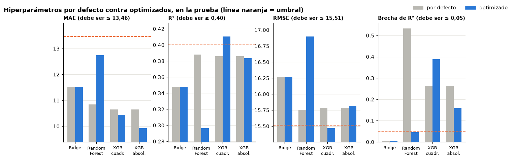

*Las mismas medidas en barras, por defecto (gris) y optimizado (azul), con el umbral en naranja. Solo XGBoost cuadratico cruza a la vez los umbrales de R² y RMSE.*

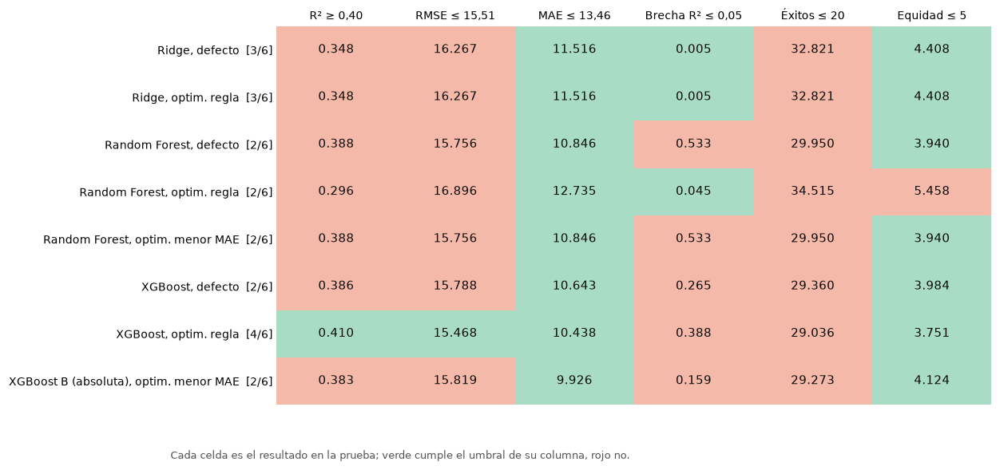

*Resultado de cada candidato en la prueba; verde cumple el umbral de su columna, rojo no.*

**Que cambio al optimizar, modelo por modelo.**

- **Ridge: nada.** Mismo MAE en validacion (11,469) y en prueba (11,516), y los mismos 3 criterios.
- **Random Forest: empeora o queda igual.** La version que elige la regla baja la brecha de R² de 0,533 a 0,045, pero el MAE de prueba sube de 10,846 a 12,735 (+1,889) y los criterios siguen en 2 (gana la brecha y pierde la equidad). La version de menor MAE es la de fabrica, o sea que no hay nada mejor que lo que ya teniamos.
- **XGBoost de perdida cuadratica: mejora, pero poco.** El MAE de validacion baja de 10,655 a 10,346 (−0,309, unas 3,6 veces el ruido) y el de prueba de 10,643 a 10,438 (−0,205, un 2%). El R² sube de 0,386 a 0,410 y el RMSE baja de 15,788 a 15,468, con lo que cruza esos dos umbrales y pasa de 2 a 4 criterios. Lo que empeora es la brecha de R² (de 0,265 a 0,388).
- **XGBoost de perdida absoluta (B)**, como comparacion, tiene el menor MAE de todos (9,926) pero R² y RMSE fuera de sus umbrales: 2 criterios.

**Lectura de las figuras.** En las barras, el unico cambio grande entre gris y azul es el del Random Forest, y es para peor. En XGBoost cuadratico la mejora se ve, pero es chica, y la barra de la brecha sube. En el mapa de criterios, **R² y RMSE estan en verde solo para XGBoost optimizado**; la brecha de R² esta en verde solo para Ridge y para el Random Forest podado (que la cumplen porque no memorizan, no porque predigan bien); el error en exitos esta en rojo en todas las filas, sin excepcion; y el MAE esta en verde en todas.

**¿Valio la pena optimizar?** Para dos de los tres modelos, no: Ridge no cambio y el Random Forest no pudo mejorar a su version de fabrica. Para XGBoost, la mejora es real pero modesta: 2% de MAE y dos criterios mas, que se cumplen por margenes cortos (0,010 en R² y 0,045 en RMSE). Eso tambien es un resultado: nos dice que los valores por defecto ya estaban cerca de lo que estos datos permiten, y que el techo no esta en los hiperparametros.

### 11.2 Decision y justificacion

**Se elige el XGBoost de perdida cuadratica con los hiperparametros que dejo la busqueda** (profundidad 10, tasa de aprendizaje de 0,0125, 1.134 arboles). Es un solo modelo. Como se llego a esa decision:

**Es el que cumple mas criterios, en validacion y en la prueba.** La regla de la seccion 1.2 se fijo antes de buscar: gana el que cumple mas criterios y, en un empate, el de menor MAE de validacion. En validacion cumple 4; en la prueba tambien 4 (R², RMSE, MAE y equidad). Ningun otro candidato pasa de 3: Ridge cumple 3 (MAE, brecha y equidad), el Random Forest 2 y el XGBoost de perdida absoluta 2. La prueba no se uso para elegir, solo para confirmar.

**Por que no la perdida absoluta.** El XGBoost B tiene mejor MAE (9,926 contra 10,438), pero incumple R² y RMSE, dos de los seis criterios, y como esas dos medidas castigan los errores grandes y la perdida absoluta no, es lo esperable (seccion 7.1). Si el criterio fuera solo el MAE, ganaria B; con los seis criterios que fijamos al inicio, gana la cuadratica.

**Por que no Ridge, aunque cumple 3.** Cumple la brecha de R² (0,005) porque casi no aprende: su R² es 0,348 y no alcanza el umbral. Un criterio cumplido no es lo mismo que predecir bien, y Ridge no cruza los umbrales de R² ni de RMSE.

**Lo que hay que decir con honestidad.**

- **La mejora frente al XGBoost por defecto es chica.** El MAE baja 0,2 (un 2%) y se ganan dos criterios que se cumplen por margenes cortos: R² por 0,010 y RMSE por 0,045. Con otros datos podrian quedar fuera.
- **Cuesta complejidad y empeora la brecha.** El modelo por defecto usa 100 arboles de profundidad 6; el elegido, 1.134 de profundidad 10, y su brecha de R² es 0,388 contra 0,265. Para quien prefiera la simplicidad, el XGBoost por defecto (MAE 10,643, 2 criterios) es una alternativa defendible.
- **No cumple dos criterios.** La brecha de R² (0,388) y el error en canciones de popularidad ≥ 70 (29,0), y ningun candidato, ni los de los experimentos, cumple los seis.
- **Hay optimismo en la validacion.** Se eligio entre 122 candidatos de XGBoost, asi que sus cifras de validacion estan algo infladas: en la prueba el MAE sube 0,09 y el RMSE 0,17. La prueba, usada una sola vez, es la cifra a reportar.

En la tabla de abajo (seccion 11) se pueden ver los seis criterios del modelo elegido.

### 11.3 Criterios de exito de la solucion final

| Criterio (prueba) | Umbral | Resultado | ¿Cumple? |
|---|---|---|---|
| R² | ≥ 0,40 | 0,410 | Si (por 0,010) |
| RMSE | ≤ 15,51 | 15,468 | Si (por 0,045) |
| MAE | ≤ 13,46 | 10,438 | Si |
| Brecha de R² | ≤ 0,05 | 0,388 | No |
| MAE en exitos (≥ 70) | ≤ 20 | 29,036 | No |
| Brecha de MAE entre cuartiles de genero | ≤ 5 | 3,751 | Si |

**Cumple 4 de 6.** Frente a la linea base (MAE 16,83) el error baja un 38%; frente al XGBoost de la EV2 con parametros por defecto (MAE 10,643, R² 0,386), el MAE baja a 10,438 y el R² sube a 0,410. Hiperparametros de la solucion: profundidad 10, tasa de aprendizaje de 0,0125, 1.134 arboles, `min_child_weight` de 12,1, `colsample_bytree` de 0,84, `subsample` de 0,99, `reg_lambda` de 0,33 y `reg_alpha` de 0,008.

### 11.4 Criterios practicos (clase 3.3)

| Candidato | Interpretabilidad | Complejidad |
|---|---|---|
| Ridge | Alta (coeficientes) | 1 modelo |
| Random Forest | Media | 1 modelo (100 arboles) |
| **XGBoost cuadratico (solucion)** | Media (importancia de variables) | 1 modelo (1.134 arboles de profundidad 10) |
| XGBoost absoluto | Media | 1 modelo (970 arboles) |

La **equidad** se cumple en la solucion (brecha de 3,751 entre cuartiles de genero, contra el umbral de 5). El modelo guardado pesa unos 15 MB.### 11.5 Errores de la solucion final

| Segmento (prueba) | Canciones | MAE linea base | MAE XGBoost por defecto | MAE solucion | Sesgo de la solucion (pred − real) |
|---|---|---|---|---|---|
| Popularidad 0 | 1.316 | 34,323 | 25,278 | 25,711 | +25,691 |
| Popularidad 1 a 69 | 15.182 | 14,254 | 8,564 | 8,309 | −0,586 |
| Popularidad ≥ 70 (exitos) | 657 | 41,194 | 29,360 | 29,036 | −29,024 |

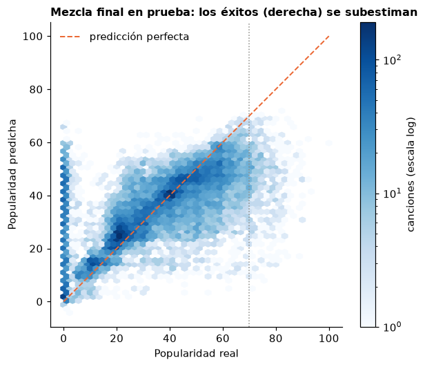

*Los exitos (a la derecha de la linea punteada) quedan por debajo de la diagonal: se subestiman casi sin excepcion.*


*Izquierda: MAE por segmento de popularidad; los exitos son lo mas dificil para todos. Derecha: variables que mas usa la solucion (ganancia en los arboles).*

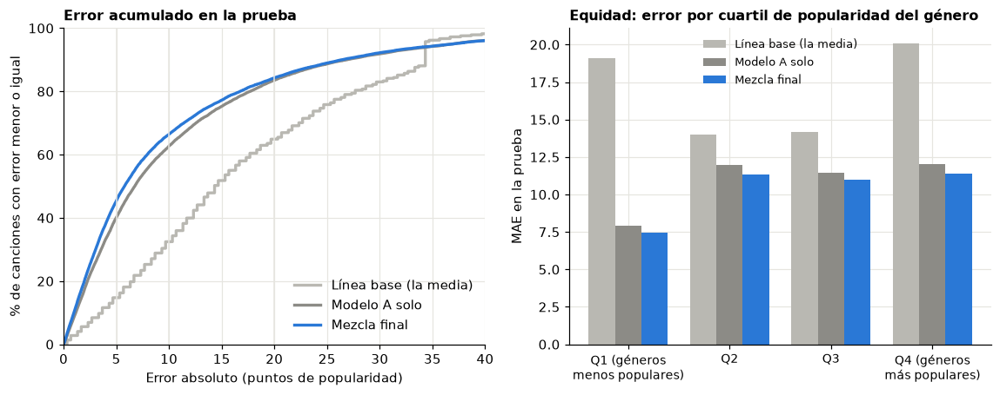

*Izquierda: porcentaje de canciones con error menor o igual a cada valor (42,4% a 5 puntos o menos, 65,3% a 10, 84,1% a 20). Derecha: MAE por cuartil de popularidad del genero; la solucion es mas pareja que la linea base.*

**Donde se equivoca (9.1).** La solucion baja el error frente a la linea base en los tres segmentos, y frente al XGBoost por defecto solo en las canciones de popularidad media (8,564 a 8,309) y en los exitos (29,360 a 29,036); en las de popularidad 0 queda un poco peor (25,278 a 25,711). El patron de fondo es el de siempre:

- En las canciones de **popularidad 0** (1.316) predice demasiado alto: sesgo de +25,7 puntos, y sobrestima el 98,3% de ellas.
- En las de **1 a 69** (15.182, el grueso) hace bien su trabajo: MAE 8,309 contra 14,254 de la linea base, con un sesgo casi nulo (−0,6).
- En los **exitos** (657) el sesgo es de −29,0, casi igual al MAE: **subestima el 99,4% de los exitos**. Es lo que impide cumplir el criterio 5, y ningun hiperparametro lo arregla, porque el modelo tiende hacia la media y los exitos estan en la cola.

En puntos: el error mediano es 6,26, el 42,4% de las canciones queda a 5 puntos o menos, el 65,3% a 10 o menos y el 84,1% a 20 o menos, y el 7,4% se equivoca en mas de 30. En el grafico de equidad, la brecha entre el cuartil de generos con mayor error y el de menor es 3,751 (bajo el umbral de 5), contra 6,077 de la linea base y 3,984 del XGBoost por defecto. Los generos menos populares (Q1) son los que mejor predice (MAE 7,84); los otros tres cuartiles quedan entre 11,0 y 11,6.

**Que usa el modelo (9.2).** El genero concentra casi la quinta parte de la importancia (19,9%), seguido de `es_instrumental` (13,5%), `explicit` (8,9%), `n_generos` (8,9%) y `n_artistas` (6,1%); las variables de audio aportan entre 4,1% y 4,4% cada una. La importancia por ganancia indica que variables usa el modelo para dividir, no que causen la popularidad. La conclusion de la EV1, que el genero pesa mucho y el audio poco, se mantiene. Una advertencia practica: `n_generos` solo existe cuando la cancion ya esta publicada, asi que para decidir antes del lanzamiento habria que reentrenar sin ella.

### 11.6 Que explica la prediccion

Por ganancia de cada variable en los arboles, el **genero concentra el 19,9%** de la importancia y `es_instrumental` el 13,5%; siguen `explicit` (8,9%), `n_generos` (8,9%), `n_artistas` (6,1%) y las variables de audio, entre 4,1% y 4,4% cada una (`acousticness` 4,4%, `loudness` 4,3%, `energy` 4,2%, `duracion_min` 4,1%, `danceability` 4,1%). La importancia por ganancia indica que variables usa el modelo para dividir, no que causen la popularidad. `n_generos` solo existe cuando la cancion ya esta publicada: para decidir antes del lanzamiento habria que reentrenar sin ella (la EV2 midio un costo de 0,25 puntos con parametros por defecto; no se repitio con la solucion final).

---

## 12. Sesgos, etica y privacidad

*Nota de la EV3: la auditoria por catalogo del artista (12.2) y el escenario de cancion inedita (9.6) se hicieron con el candidato de la EV2 (XGBoost con parametros por defecto) y no se repitieron con la solucion final de la EV3. La brecha de MAE entre cuartiles de genero si se midio con la solucion final: 3,751 (seccion 11.3).*

### 12.1 Sesgos presentes en los datos

| Sesgo | Evidencia | Medida |
|---|---|---|
| **Muestreo artificial por genero** | 1.000 canciones por genero, que no representan el catalogo real. Tras deduplicar, los generos masivos quedan subrepresentados: `reggaeton` pierde el 69% y `tango` conserva sus 1.000 | Genero conservado elegido al azar; documentar que el modelo no representa al catalogo real |
| **Seleccion por busqueda** | Las canciones son las que devolvio la busqueda de Spotify, que favorece contenido popular: las canciones en 2 o 3 generos tienen 6 a 8 puntos mas de popularidad | Interpretar `n_generos` como posible artefacto; evaluar el modelo sin ella (9.6) |
| **Efecto superestrella** | El artista explica mas que el genero: exceso de η² sobre el azar de 0,51, frente a 0,35 del genero. El 1% de artistas con mas canciones concentra el 15,3% del dataset | Artista excluido del modelo; auditar el error por catalogo del artista (12.2) |
| **Factores no observados** | Marketing, playlists editoriales, fama previa y redes sociales no estan en los datos | Expectativas moderadas en los criterios de exito |
| **Alcance de Spotify** | La popularidad es popularidad *dentro de Spotify*, una plataforma con penetracion desigual por pais. Solo incluye musica que ya logro entrar a la plataforma | Documentado como limite de lo que mide `popularity` |

### 12.2 Auditoria de sesgos con el modelo

Con el modelo ya entrenado se reviso si castiga a los artistas con pocas canciones, como haria si heredara el efecto superestrella.

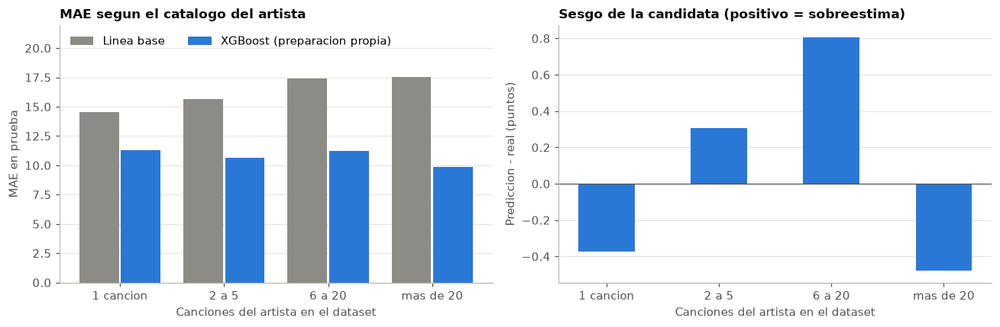

*La candidata se equivoca entre 9,87 puntos (artistas con mas de 20 canciones) y 11,30 (artistas con una sola cancion), sin una direccion fija de sesgo (-0,48 a +0,81). La brecha entre tramos es de 1,43, menos de la mitad que la de la linea base (2,99).*

El modelo no castiga de forma visible a los artistas con pocas canciones. Matiz: tener una sola cancion en el dataset no equivale a ser emergente; esas canciones tienen la popularidad media mas alta (39,0), por la seleccion por busqueda. El efecto de fondo (promocion, seguidores, fama) sigue fuera de los datos: el modelo no lo hereda de forma visible, pero tampoco lo corrige.

### 12.3 Privacidad y condiciones de uso

- **Datos personales.** No hay datos de usuarios: la popularidad es un indicador agregado. Si hay nombres de artistas (31.437), que son figuras publicas en su actividad profesional; no hay datos sensibles en el sentido de la Ley 19.628 (actualizada por la Ley 21.719) ni del RGPD. Aun asi, el artista se excluye del modelo y los resultados no deberian publicarse por artista sin contexto.
- **Terminos de Spotify.** Desde mayo de 2023, los terminos para desarrolladores de Spotify prohiben usar su contenido para entrenar modelos de Machine Learning. El dataset se publica con fines educativos y este proyecto es academico, pero **un uso comercial requeriria revisar la licencia o un acuerdo con Spotify**.
- **Reproducibilidad del despliegue.** Desde el 27 de noviembre de 2024, Spotify restringio el acceso de nuevas aplicaciones a las caracteristicas de audio. No es posible obtener estas variables para canciones nuevas por la API publica; una alternativa seria calcularlas con librerias abiertas como `librosa` o Essentia.

### 12.4 Riesgos eticos y uso responsable

- **Uso dual.** El modelo puede apoyar decisiones de promocion, pero usado como filtro automatico para fichar o descartar artistas replicaria los sesgos de genero, mercado y artista descritos. Perjudicaria sobre todo a la musica no anglosajona, a los generos de nicho y a los artistas emergentes.
- **Explicabilidad como responsabilidad.** Las predicciones pueden afectar el sustento de un artista. Por eso cada prediccion debe acompañarse de su anatomia (aporte de cada variable) y del error esperado de su genero, para que quien decide entienda por que el modelo llego a ese numero.
- **Precision contra interpretabilidad.** Ridge es transparente en sus coeficientes; XGBoost es mas preciso pero mas dificil de auditar. Los valores SHAP reducen esa distancia y el protocolo de seleccion da prioridad al modelo interpretable en caso de empate.

---

## 13. Conclusiones y recomendaciones

### 13.1 Lo que se concluye

1. **La calidad de los datos fue el primer desafio.** El archivo parecia limpio, pero escondia 450 duplicados, 24.259 filas repetidas por genero, contenido no musical y 2.856 ceros artificiales. Sin tratarlos, las metricas habrian salido infladas por fuga de datos.
2. **La popularidad depende poco del audio y mucho del contexto.** El genero explica cerca de un tercio de la variacion, el artista aun mas, y el audio aporta relaciones debiles. La solucion final lo confirma: el genero es la variable mas importante (19,9%).
3. **Adaptar la preparacion a cada modelo valio la pena en los arboles** (EV2). La EV3 uso esa preparacion tal cual.
4. **Los ensambles aportan.** Un arbol solo da MAE 11,906; Random Forest (bagging) lo baja a 10,828 y XGBoost (boosting) a 10,346 tras buscar, un 13% menos.
5. **Optimizar hiperparametros mejoro a uno de tres modelos, y por poco.** Ridge no cambio; Random Forest, cuando se le exige cumplir la brecha, empeora (su mejor version es la de fabrica); XGBoost baja el MAE de prueba de 10,643 a 10,438 y pasa de 2 a 4 criterios. El Grid despues del Random afino solo 0,023, a cuatro veces el tiempo.
6. **Ningun modelo cumple los seis criterios.** El maximo es 4 de 6, y siempre fallan la brecha de R² y el error en exitos.
7. **La perdida cuadratica es la que conviene.** La absoluta baja el MAE 0,5, pero pierde R² y RMSE, que se calculan con errores al cuadrado, y cumple la mitad de los criterios.
8. **El nombre del artista pesa por si solo en la popularidad.** Con el artista, el MAE baja de 10,438 a 8,140 y el R² sube a 0,558, mucho mas que toda la optimizacion (0,205). La mejora es mayor para artistas con historial (2,5 puntos) que para los demas (0,8): el modelo con artista predice en buena parte la fama mas que la cancion. Es el efecto superestrella que sospechabamos, y por eso queda fuera de la solucion. Medimos esa dependencia, no si perjudica a los artistas nuevos ni que el nombre cause la popularidad.

**Resultado final en la prueba:** R² 0,410, RMSE 15,468, MAE 10,438 (38% menos que la linea base), brecha de R² 0,388, MAE en exitos 29,036 y brecha entre cuartiles de genero 3,751: **cumple 4 de 6 criterios**.

**¿Es un buen predictor?** Reduce el error un 38% frente a predecir siempre la media (MAE 10,4 contra 16,8), acierta a 10 puntos o menos en dos de cada tres canciones y explica el 41% de la variacion. Sirve para ordenar canciones de popularidad media o baja. No sirve para detectar exitos: subestima el 99,4% de ellos, con unos 29 puntos de error. La causa no esta en los hiperparametros sino en la informacion: toda la optimizacion bajo el MAE 0,2, y agregar el artista lo bajo 2,3. Con solo el audio y el genero, el modelo sabe como suena una cancion pero no quien la canta ni cuanta promocion tiene, y eso explica buena parte de su popularidad.

**Respuesta a cada pregunta de la EV3:**

| # | Pregunta | Respuesta | Evidencia |
|---|---|---|---|
| H1 | ¿Ajustar mejora el error de los tres modelos? | **Solo en XGBoost** | −0,309 de MAE en validacion (3,6 veces el ruido); Ridge sin efecto; Random Forest empeora o queda igual |
| H2 | ¿Algun modelo cumple los seis criterios? | **No** | Maximo de 4 criterios, en validacion y en prueba |
| H3 | ¿Se puede reducir el sobreajuste del Random Forest sin que el error suba? | **No** | Cumplir la brecha cuesta MAE: Random Forest +1,785; XGBoost cuadratico +0,602; con perdida absoluta solo +0,2 |
| H4 | ¿El Grid agrega una mejora que valga lo que cuesta? | **No** | −0,023 de MAE en XGBoost (0,3 veces el ruido), a 4 veces el tiempo |
| H5 | ¿Los resultados del ganador se mantienen en la prueba? | **Casi: salen algo peores** | MAE +0,092 y RMSE +0,165; el Random Forest pierde el criterio que cumplia por 0,077 |
| H6 | ¿La perdida absoluta logra menos error que la cuadratica, y que se pierde? | **Menos MAE, pero pierde R² y RMSE** | MAE −0,5; R² −0,027; su brecha (0,159) resulto menor que la de A (0,388) |
| H7 | ¿Cuanto mejora el modelo si conoce al artista? | **Mucho, y depende del historial** | MAE −2,3 en la prueba; −2,5 con historial y −0,8 sin el |

**Todas las decisiones del proyecto y su efecto medido:**

| Decision | Efecto | ¿Valio la pena? |
|---|---|---|
| Genero como categoria nativa en XGBoost (EV2) | −0,644 de MAE de validacion | Si |
| Genero en one-hot en Random Forest (EV2) | −0,088 | Si, aunque es pequeño |
| Usar un ensamble en vez de un arbol solo | −1,078 (bosque) y −1,560 (XGBoost buscado) | **Si, la mayor mejora de las busquedas** |
| Ajustar `alpha` de Ridge | 0,000 | No |
| Ajustar Random Forest cumpliendo la brecha | +1,784 | No (empeora) |
| **Ajustar XGBoost (perdida cuadratica)** | −0,309 de MAE de validacion; en prueba 10,643 → 10,438 y de 2 a 4 criterios | **Si, la solucion final (mejora modesta)** |
| Grid acotado despues del Random Search | −0,023 | No (dentro del ruido) |
| Perdida absoluta en XGBoost | −0,515 de MAE frente a A; R² −0,019 y RMSE +0,248 | No: pierde dos criterios |
| Agregar el artista (diagnostico) | −2,298 de MAE en prueba | Informativo: no es una solucion |

### 13.2 Recomendaciones

1. **Usarlo para priorizar canciones de popularidad media o baja, no para decidir solo.** El 84,1% de las canciones queda a 20 puntos o menos y el error mediano es de 6,3.
2. **No usarlo para detectar exitos:** subestima el 99,4%. Si ese es el objetivo, plantearlo como clasificacion ("exito si o no") con precision y recall.
3. **Para canciones aun no publicadas, usar una version sin `n_generos`** y repetir la evaluacion.
4. **Mejorar la informacion antes que los hiperparametros** (seguidores, fecha de lanzamiento, playlists). Si se usa al artista, medir antes el error por nivel de fama: reproduce el efecto superestrella y ayuda mucho menos a los artistas nuevos.
5. **Si se prefiere simplicidad,** el XGBoost por defecto (MAE 10,643 y 2 criterios) es casi igual de bueno con un modelo mucho mas chico.

---

## 14. Limitaciones y proximos pasos

**Limitaciones.**

- **Busqueda acotada:** 20, 16 y 40 candidatos en el Random y mallas de tres valores en el Grid. Puede existir una combinacion mejor que no se probo, sobre todo en Random Forest (25 combinaciones y 100 arboles).
- **Un solo conjunto de prueba** (17.155 canciones, 657 exitos) y una sola semilla. Los margenes de R² y RMSE sobre sus umbrales son de centesimas (0,010 y 0,045), y el ganador se eligio entre 122 candidatos, asi que su validacion es algo optimista.
- **La mejora del ajuste es modesta:** 2% de MAE. El modelo ajustado es mas grande que el de fabrica y su brecha de R² es mayor (0,388 contra 0,265).
- **Contar criterios es una regla tosca:** trata igual fallar por 0,003 que por 0,05 y premia a Ridge por un cumplimiento que viene de no aprender.
- **El artista es solo un diagnostico:** no se midio el error por nivel de fama. Tampoco se repitio con la solucion final el escenario de cancion inedita (sin `n_generos`), los valores SHAP ni la auditoria por catalogo del artista de la EV2.
- **Heredado de la EV1 y la EV2:** el EDA se hizo con todo el dataset antes de dividir (fuga leve), el *cross fitting* de `TargetEncoder` no agrupa por cancion, la muestra tiene 1.000 canciones por genero por construccion y las relaciones son asociaciones, no causas.

**Proximos pasos.**

1. **Enriquecer los datos** (seguidores del artista, fecha de lanzamiento, presencia en playlists, caracteristicas de audio abiertas), auditando antes el error por nivel de fama si se incorpora al artista.
2. **Plantear la deteccion de exitos como clasificacion,** con sus propias metricas.
3. **Reentrenar periodicamente:** la popularidad cambia con el tiempo.

---

## 15. Reflexion a nivel de proyecto

La EV3 empezo con una idea simple: tomar los modelos y los datos de la EV2, optimizar los hiperparametros y quedarnos con el mejor. Termino enseñandonos mas sobre el proyecto que sobre los hiperparametros.

### 15.1 Lo que dabamos por sentado

| Lo que asumiamos | Que paso |
|---|---|
| "Optimizar hiperparametros mejora el modelo" | Mejoro uno de tres, y por poco (MAE de prueba −0,205 en XGBoost). En Random Forest, el mejor de 25 combinaciones fue el valor de fabrica |
| "Un arbol sobreajustado se arregla limitando la profundidad" | Podar el bosque bajo la brecha de 0,528 a 0,047, pero subio el MAE 1,8: el "sobreajustado" predecia mejor con canciones nuevas |
| "Lo que ganamos en validacion se mantiene con datos nuevos" | El ganador rindio peor en la prueba (+0,09 de MAE) y el Random Forest podado perdio un criterio que cumplia por 0,077 |
| "Un Grid despues del Random sigue mejorando" | Mejoro 0,023 de MAE, una fraccion del ruido (0,073), y tardo cuatro veces mas |
| "Una GPU hace todo mas rapido" | En este dataset, XGBoost fue algo mas lento en GPU que en CPU (13,2 s contra 9,8 s con 1.500 arboles); la ventaja fue liberar la CPU |
| "Lo que mas mejora un modelo son sus hiperparametros" | Toda la optimizacion bajo el MAE 0,2; agregar el artista lo bajo 2,3 |

Ninguna de estas ideas era absurda; todas salian de la documentacion o de lo que nos enseñaron. Ninguna se podia confirmar leyendo: habia que probarla con estos datos.

### 15.2 Lo que aprendimos

**Medir bien importa mas que optimizar.** La validacion cruzada agrupada por cancion, la prueba usada una sola vez y el ruido entre folds como vara de "cambio real" mostraron lo que la optimizacion sola no: que un candidato que cumple un umbral por poco no sobrevive con datos nuevos, y que el ganador entre decenas viene algo inflado.

**Las metas se fijaron antes de saber cuanta señal habia.** La brecha de R² premia a los modelos que no aprenden, y el criterio de los exitos exige acertar justo donde el modelo no tiene informacion. Cumplirlos no es un problema de busqueda sino de datos. Habria que revisar las metas con una idea de que tan predecible es el problema antes de comprometerse con umbrales.

**La informacion pesa mas que el ajuste, y el nombre del artista pesa por si solo.** Que conocer al artista baje tanto el error significa que la popularidad depende en gran parte de la fama previa de quien canta. Un modelo que lo usara reproduciria ese sesgo, favoreciendo a los artistas establecidos justo cuando se usara para apoyar decisiones. Medimos la dependencia, no cuanto perjudica a los artistas nuevos; por eso lo dejamos como diagnostico.

**Un modelo mejor no siempre es mas util.** El nuestro reduce el error un 38%, pero no detecta exitos: su error es de 29 puntos justo donde importa. Su valor esta en ordenar canciones de popularidad media o baja.

### 15.3 Por que la ciencia de datos no se automatiza por completo

Una busqueda automatica minimiza o maximiza la metrica que se le da. Alguien tuvo que decidir que metrica, que rangos (la poda del bosque parecia razonable y destruyo el modelo), que ideas probar y si un resultado sorprendente es un error de codigo o un hallazgo. Cada vez que el resultado nos sorprendio, la respuesta salio de plantear una pregunta y probarla, no de ejecutar mas codigo. La documentacion describe el caso general, los datos mandan, y la unica forma de saber cual aplica es demostrarlo con una prueba.

### 15.4 Que haremos distinto

1. Estimar que tan predecible es el problema y **revisar los criterios de exito con el equipo** antes de optimizar contra ellos.
2. Fijar un **margen de seguridad** sobre cada umbral y repetir la busqueda con varias semillas.
3. Si se usa informacion de personas o artistas, **auditar primero el error por nivel de fama**.

---

## 16. Estructura del repositorio y reproducibilidad

```
SpotifyTracks/
|-- README.md                       <- este informe
|-- data/
|   |-- raw/
|   |   `-- Spotify_Tracks_Dataset.csv   <- dataset original (Kaggle), sin modificar
|   `-- processed/
|       |-- ev1/                    <- salidas de la EV1 (9 archivos): entradas de la EV2 y objetivo e identificadores de la EV3
|       |-- ev2/                    <- salidas de la EV2 (5 archivos): tablas ya preprocesadas de cada modelo, preprocesadores, folds, criterios y metricas
|       `-- ev3/
|           `-- busquedas/          <- una busqueda guardada por modelo y fase, el arbol solo, la perdida absoluta y el artista
|-- ev1/
|   `-- notebook_ev1.ipynb          <- EDA y preparacion de datos (CRISP-DM 1 a 3)
|-- ev2/
|   |-- notebook_ev2.ipynb          <- preparacion por modelo y evaluacion con parametros por defecto
|   `-- images/                     <- 8 figuras
|-- ev3/
|   |-- notebook_ev3.ipynb          <- optimizacion de hiperparametros, ensambles, validacion cruzada, experimentos y seleccion
|   `-- images/                     <- 11 figuras
|-- models/
|   |-- modelo_final_ev3.joblib     <- solucion final: un XGBoost de perdida cuadratica (15 MB)
|   `-- modelo_final_ev3.json       <- sus hiperparametros, semillas y metricas
|-- ppt/
|   `-- Presentacion_ML_Spotify_EV2.pptx   <- presentacion de la EV2
`-- docs/
    |-- pauta_ev1.pdf               <- instrucciones y rubrica de la EV1
    |-- pauta_ev2.pdf               <- instrucciones y rubrica de la EV2
    `-- pauta_ev3.pdf               <- instrucciones y rubrica de la EV3
```

Los notebooks viven en `ev1/`, `ev2/` y `ev3/`, una carpeta por evaluacion, cada una con sus figuras. Los datos, el modelo final y este informe cumplen la estructura pedida (`data/`, notebooks, `models/`, `images/` y `README.md`).

**Como reproducir**

1. **Instalar las librerias** (Python 3.12 o superior) con las versiones con que se ejecutaron los notebooks. Para usar la GPU en la EV3 hace falta un controlador NVIDIA con CUDA; sin GPU, XGBoost entrena en CPU automaticamente:

   ```bash
   pip install pandas==3.0.5 numpy==2.5.3 scikit-learn==1.9.1 xgboost==3.4.1 matplotlib==3.11.2 seaborn==0.13.2 jupyter==1.1.1 nbconvert==7.17.2
   ```

2. **El dataset** ya esta en `data/raw/Spotify_Tracks_Dataset.csv` (fuente en la seccion 3.1).

3. **Ejecutar la EV1**, que genera `data/processed/ev1/` (aprox. 1 minuto):

   ```bash
   python -m nbconvert --to notebook --execute --inplace ev1/notebook_ev1.ipynb
   ```

4. **Ejecutar la EV2**, que lee `data/processed/ev1/` y genera `data/processed/ev2/` y las figuras de `ev2/images/` (unos 12 minutos, segun el equipo):

   ```bash
   python -m nbconvert --to notebook --execute --inplace ev2/notebook_ev2.ipynb
   ```

5. **Ejecutar la EV3**, que lee `data/processed/ev2/` y `data/processed/ev1/`, guarda las figuras en `ev3/images/` y la solucion final en `models/`:

   ```bash
   python -m nbconvert --to notebook --execute --inplace --ExecutePreprocessor.timeout=-1 ev3/notebook_ev3.ipynb
   ```

   **Tiempo.** Con las busquedas ya guardadas en `data/processed/ev3/busquedas/` (como en este repositorio), el notebook las lee en lugar de repetirlas y tarda unos minutos, casi todo en entrenar de nuevo a los finalistas para medirlos en la prueba. Sin esos archivos repite las busquedas, que tardan bastante mas (mas de dos horas en total, sobre todo por Random Forest en CPU y por el Grid de XGBoost). Con `RECALCULAR = True` en la primera celda de codigo se repiten aunque existan.

Los notebooks tambien se pueden ejecutar celda por celda en Jupyter, desde su carpeta o desde la raiz: calculan las rutas a partir de la carpeta que contiene `data/raw/`. Conviene usar el mismo Python donde se instalaron las librerias. Todos los pasos aleatorios usan la semilla 42; al reejecutar se obtienen las mismas cifras, salvo los segundos de ejecucion y diferencias de milesimas en XGBoost por el orden de los hilos de calculo (y por usar GPU en lugar de CPU).

**Usar la solucion final**

```python
import joblib, pandas as pd
from sklearn.metrics import mean_absolute_error

final = joblib.load("models/modelo_final_ev3.joblib")                      # dict con el XGBoost y la lista de generos
tablas = joblib.load("data/processed/ev2/preprocesado_ev2.joblib")["tablas"]
X = tablas["xgb"]["X_test"]                                                # tabla de XGBoost ya preprocesada (genero como categoria nativa)
prediccion = final["modelo"].predict(X)
y = pd.read_csv("data/processed/ev1/y_test.csv")["popularity"]
print(mean_absolute_error(y, prediccion))                                  # 10.438 (MAE de prueba)
```

Para canciones nuevas hay que aplicar antes el preprocesador de XGBoost exportado en `data/processed/ev2/preprocesadores_ev2.joblib` (`preprocesadores["xgb"]`, con el genero como categoria de la lista `generos`), ajustado con el entrenamiento de la EV2 como se hizo en esa etapa.

---

## 17. Referencias

Documentacion oficial de cada libreria; las citas textuales de scikit-learn se verificaron en la version 1.9.1.

1. scikit-learn. *GroupKFold*. https://scikit-learn.org/stable/modules/generated/sklearn.model_selection.GroupKFold.html
2. scikit-learn. *User Guide: Linear Models, Ridge regression and classification*. https://scikit-learn.org/stable/modules/linear_model.html#ridge-regression-and-classification
3. XGBoost. *Categorical Data*. https://xgboost.readthedocs.io/en/stable/tutorials/categorical.html
4. XGBoost. *XGBoost Parameters*. https://xgboost.readthedocs.io/en/stable/parameter.html
5. scikit-learn. *RandomForestRegressor*. https://scikit-learn.org/stable/modules/generated/sklearn.ensemble.RandomForestRegressor.html
6. scikit-learn. *Ridge*. https://scikit-learn.org/stable/modules/generated/sklearn.linear_model.Ridge.html
7. scikit-learn. *User Guide: Preprocessing data*. https://scikit-learn.org/stable/modules/preprocessing.html
8. XGBoost. *Introduction to Boosted Trees*. https://xgboost.readthedocs.io/en/stable/tutorials/model.html
9. scikit-learn. *PowerTransformer*. https://scikit-learn.org/stable/modules/generated/sklearn.preprocessing.PowerTransformer.html
10. scikit-learn. *TargetEncoder*. https://scikit-learn.org/stable/modules/generated/sklearn.preprocessing.TargetEncoder.html
11. scikit-learn. *permutation_importance*. https://scikit-learn.org/stable/modules/generated/sklearn.inspection.permutation_importance.html
12. XGBoost. *Python API Reference: Booster.predict (`pred_contribs`)*. https://xgboost.readthedocs.io/en/stable/python/python_api.html
13. scikit-learn. *User Guide: Decision Trees*. https://scikit-learn.org/stable/modules/tree.html
14. scikit-learn. *SplineTransformer*. https://scikit-learn.org/stable/modules/generated/sklearn.preprocessing.SplineTransformer.html
15. scikit-learn. *Tuning the hyper-parameters of an estimator* (Grid Search y Random Search). https://scikit-learn.org/stable/modules/grid_search.html
16. scikit-learn. *GridSearchCV* y *RandomizedSearchCV*. https://scikit-learn.org/stable/modules/generated/sklearn.model_selection.GridSearchCV.html y https://scikit-learn.org/stable/modules/generated/sklearn.model_selection.RandomizedSearchCV.html
17. scikit-learn. *User Guide: Ensembles* (bagging y boosting). https://scikit-learn.org/stable/modules/ensemble.html
18. Bergstra, J. y Bengio, Y. (2012). *Random Search for Hyper-Parameter Optimization*. Journal of Machine Learning Research, 13, 281-305. https://jmlr.org/papers/v13/bergstra12a.html
19. Cawley, G. y Talbot, N. (2010). *On Over-fitting in Model Selection and Subsequent Selection Bias in Performance Evaluation*. Journal of Machine Learning Research, 11, 2079-2107. https://jmlr.org/papers/v11/cawley10a.html
20. Material de la unidad 3 de la asignatura: *Optimizacion de parametros* (3.1.1), *Algoritmos de ensamble* (3.2.1) y *Validacion cruzada* (3.3.1).
