# Inteligencia musical: prediccion de la popularidad de canciones de Spotify

**Informe tecnico del proyecto de Machine Learning: EDA, preparacion de datos, modelado, optimizacion de hiperparametros, ensambles y validacion cruzada**

| | |
|---|---|
| **Asignatura** | MLY1101 Machine Learning, DuocUC |
| **Evaluacion** | Parcial Nro. 3: presentacion y defensa tecnica del proyecto (incluye lo desarrollado en las Parciales Nro. 1 y 2) |
| **Equipo** | Grupo 5: Cristian Romero y Rolando Paredes |
| **Caso** | C: inteligencia musical y prediccion de popularidad de canciones (Spotify Tracks) |
| **Metodologia** | CRISP-DM, fases 1 a 5 |
| **Respaldo tecnico** | `ev1/notebook_ev1.ipynb` (EDA y preparacion), `ev2/notebook_ev2.ipynb` (preparacion por modelo y evaluacion) y `ev3/notebook_ev3.ipynb` (optimizacion de hiperparametros, ensambles, validacion cruzada y seleccion). Cada cifra de este informe sale de una celda de esos notebooks |

## Resumen

- **Problema:** estimar la popularidad de una cancion en Spotify (indice de 0 a 100) a partir de su audio, su genero y metadatos basicos. Es una regresion supervisada.
- **Datos:** 114.000 filas del Spotify Tracks Dataset. Tras una limpieza que elimino sobre todo filas repetidas, quedan **85.859 canciones**, divididas por cancion en 68.704 de entrenamiento y 17.155 de prueba.
- **Hallazgo del EDA:** el audio se relaciona poco y de forma no lineal con la popularidad (ninguna correlacion supera 0,13). El genero explica cerca de un tercio de la variacion, y el artista aun mas.
- **EV2: ¿preparar los datos segun lo que necesita cada modelo mejora los resultados?** Si en los dos modelos de arboles, no en Ridge: XGBoost baja su MAE de prueba de 11,30 a 10,64 con el genero como categoria nativa, y Random Forest de 10,99 a 10,85 con el genero en one-hot. Con parametros por defecto.
- **EV3: con los mismos tres modelos y la preparacion dedicada de cada uno, ¿se pueden encontrar hiperparametros que cumplan los seis criterios de exito?** Se busco con **Random Search y despues Grid Search acotado**, con validacion cruzada de 5 folds agrupados por cancion, sin fuga de datos y con XGBoost entrenando en GPU. Los seis criterios se midieron tambien en validacion para decidir, y la prueba se uso una sola vez al final.
- **Hallazgos del ajuste:** los **ensambles aportan** (un arbol solo da MAE 11,91; Random Forest 10,83; XGBoost 9,85 tras buscar, 17% menos). Ajustar no mejora todo por igual: no cambia nada en Ridge, **empeora** a Random Forest cuando se obliga a cumplir la brecha (MAE de 10,83 a 12,61) y en XGBoost baja la brecha de R² de 0,288 a 0,049 al mismo error. El Grid despues del Random solo afino 0,016. Con datos nuevos, el XGBoost elegido paso de 5 criterios en validacion a 2 en la prueba: la validacion fue optimista.
- **Intentos de mejora:** los pesos por popularidad (cumplen el criterio de exitos solo a costa de R² y RMSE) y las variables nuevas a partir del genero **no sirvieron**. **Mezclar XGBoost de perdida cuadratica y absoluta si sirvio:** mejora R², RMSE y MAE y cumple 4 criterios en la prueba, porque los cumplia con mas margen. Como extra, agregar el artista sube el R² de prueba de 0,397 a 0,555: es lo que mas limito al modelo, pero solo ayuda a artistas con historial.
- **Veredicto:** ningun modelo cumple los seis criterios. **La solucion elegida es la mezcla A + B** (5 XGBoost de perdida cuadratica y 3 de perdida absoluta): en la prueba tiene MAE 10,27 (39% menos que la linea base), R² 0,408, RMSE 15,50 y brecha entre generos 3,96; **cumple 4 de 6 criterios** y le fallan la brecha de R² (0,170) y el MAE en exitos (29,97, no baja de 27,5 con ningun candidato). Costos explicitos: ocho modelos, un RMSE que pasa el umbral por 0,014 y un pequeño sesgo de seleccion porque se adopto despues de ver la prueba. El techo esta en los datos, no en los hiperparametros.

## Indice

1. Descripcion del problema de negocio
2. Objetivos del proyecto
3. Descripcion de las fuentes de datos utilizadas
4. Analisis exploratorio de los datos (EDA)
5. Preparacion y transformacion de los datos
6. Justificacion de la seleccion de modelos
7. Detalles y caracteristicas de las variables finales por modelo
8. Implementacion de los modelos
9. Evaluacion con parametros por defecto (EV2)
10. Optimizacion de hiperparametros, ensambles y validacion cruzada (EV3)
11. Evaluacion con metricas y seleccion de la solucion optima
12. Sesgos, etica y privacidad
13. Conclusiones y recomendaciones
14. Limitaciones y proximos pasos
15. Reflexion a nivel de proyecto
16. Estructura del repositorio y reproducibilidad
17. Referencias

---

## 1. Descripcion del problema de negocio

### 1.1 Contexto

En la industria discografica y en las plataformas de streaming, artistas, sellos y equipos de marketing invierten en produccion y promocion sin certeza del retorno. Un sello o una plataforma decide cada semana en que canciones invertir: cuales promocionar, cuales proponer para playlists y con que artistas trabajar. Muchas veces lo decide cuando el exito ya ocurrio.

Spotify calcula para cada cancion un indice de **popularidad** (0 a 100), basado principalmente en sus reproducciones recientes, y un conjunto de **caracteristicas de audio** obtenidas de la señal sonora: que tan bailable es, su energia, su tempo, su positividad, entre otras.

### 1.2 Problema

> **¿Es posible estimar la popularidad que alcanzara una cancion a partir de sus caracteristicas musicales y de metadatos basicos (genero, contenido explicito, duracion, colaboraciones)?**

Una estimacion asi serviria para priorizar canciones en campañas de promocion, detectar canciones con potencial no aprovechado y entender que atributos se asocian con el exito en cada genero.

### 1.3 Tipo de problema

Es un problema de **aprendizaje supervisado de regresion**: la variable objetivo `popularity` es numerica y hay ejemplos con su valor conocido. Se descarto convertirlo en una clasificacion (popular / no popular) para no imponer un umbral arbitrario y conservar toda la escala.

### 1.4 Metodologia

| Fase CRISP-DM | Aplicacion en el proyecto | Donde |
|---|---|---|
| 1. Comprension del negocio | Problema, objetivos y criterios de exito | Secciones 1 y 2; EV1 |
| 2. Comprension de los datos | Calidad de datos y EDA | Secciones 3 y 4; EV1 |
| 3. Preparacion de los datos | Limpieza, variables nuevas, division y preparacion por modelo | Seccion 5; EV1 y EV2 |
| 4. Modelado | Ridge, Random Forest y XGBoost; ajuste de hiperparametros y ensambles | Secciones 6 a 8 y 10; EV2 y EV3 |
| 5. Evaluacion | Criterios de exito, validacion cruzada, protocolo de seleccion y sesgos | Secciones 9, 11 y 12; EV2 y EV3 |
| 6. Despliegue | Fuera del alcance | - |

CRISP-DM es iterativo: varias decisiones de preparacion nacieron de hallazgos del EDA, y en el modelado se volvio a la preparacion para adaptarla a cada modelo.

---

## 2. Objetivos del proyecto

### 2.1 Objetivo general

Desarrollar, evaluar y seleccionar un modelo de regresion que estime la popularidad de una cancion en Spotify a partir de sus caracteristicas musicales y metadatos, con datos preparados sin fuga de informacion y con criterios de exito fijados de antemano.

### 2.2 Objetivos especificos

1. Caracterizar el dataset e identificar sus problemas de calidad: nulos, duplicados, valores invalidos y outliers.
2. Identificar con un EDA las variables y los patrones que se relacionan con la popularidad.
3. Construir una preparacion reproducible (limpieza, ingenieria de caracteristicas, division, codificacion, transformacion y escalado) que evite la fuga de datos.
4. Revisar en la documentacion que necesita cada modelo y probar, una por una, hipotesis de preparacion para Ridge, Random Forest y XGBoost.
5. Comparar cada modelo con la preparacion unica y con la suya, contra una linea base y seis criterios de exito.
6. Explicar que aprendio el modelo, donde se equivoca y que sesgos y riesgos eticos tiene su uso.
7. Optimizar los hiperparametros de cada modelo con Random Search y Grid Search, con validacion cruzada y sin fuga de datos, y comprobar si algun modelo cumple los seis criterios de exito.
8. Demostrar el aporte de los ensambles (bagging y boosting contra un arbol solo), medir la capacidad de generalizacion y seleccionar y justificar la solucion optima.

**Alcance del modelado.** En la EV2 los tres modelos usan sus parametros y su funcion de perdida por defecto; el ajuste de hiperparametros, con la eleccion de la perdida de XGBoost, se hace en la EV3 (seccion 10).

### 2.3 Metricas y su justificacion

| Metrica | Que mide | Por que se usa |
|---|---|---|
| **MAE** (principal) | Puntos de popularidad que se equivoca el modelo en promedio | Se lee directo en la escala del negocio y no se deja dominar por unos pocos errores grandes |
| **RMSE** | Como el MAE, pero castiga mas los errores grandes | Un error de 40 puntos en una cancion importa mucho mas que varios errores chicos |
| **R²** | Parte de la variacion de la popularidad que explica el modelo (0 = predecir la media) | Permite comparar contra lo que ya explica el genero por si solo |

No se usa **MAPE**: el 7,6% de las canciones tiene popularidad 0 y el MAPE divide por el valor real.

### 2.4 Criterios de exito

Se fijaron en la EV1, antes de entrenar, y no se cambian. Varios se expresan contra una **linea base** que predice siempre la popularidad media de entrenamiento (MAE 16,83, RMSE 20,15 y R² 0,00 en prueba).

| Criterio (en prueba) | Umbral | Que controla |
|---|---|---|
| R² | ≥ 0,40 | Superar lo que explica el genero solo (cerca de 0,35) |
| RMSE | ≤ 15,51 (77% de la linea base) | Errores grandes |
| MAE | ≤ 13,46 (80% de la linea base) | Error tipico, en puntos |
| Brecha de R² entre entrenamiento y prueba | ≤ 0,05 | Sobreajuste |
| MAE en canciones con popularidad ≥ 70 | ≤ 20 (la linea base comete 41,2) | El segmento que mas le importa al negocio |
| Brecha de MAE entre cuartiles de genero | ≤ 5 (la linea base tiene 6,1) | Equidad: que el error no se concentre en algunos generos |

**Justificacion de los umbrales.** R² ≥ 0,40 y RMSE ≤ 77% de la linea base son la misma exigencia vista de dos formas (la raiz de 0,60 es 0,77). El umbral es moderado a proposito: el genero solo ya explica cerca de 0,35, y la popularidad depende de factores que no estan en los datos (fama, marketing, playlists). El criterio de exitos existe porque un buen error promedio puede esconder que el modelo falla justo donde el negocio invierte, y el de equidad porque la linea base ya comete errores desiguales entre generos.

### 2.5 Protocolo de seleccion

| Paso | Regla |
|---|---|
| 1 | Una configuracion es **apta** solo si cumple los seis criterios en prueba |
| 2 | Entre las aptas gana la de menor MAE en **validacion**, no en prueba |
| 3 | Si otra queda a menos del ruido del lider, se consideran empatadas y gana la mas interpretable |
| 4 | Los umbrales no se bajan. Si ninguna es apta, la ganadora queda como **mejor candidata** para la etapa siguiente, no como modelo listo para usar |

---

## 3. Descripcion de las fuentes de datos utilizadas

### 3.1 Dataset

| Atributo | Valor |
|---|---|
| Nombre | Spotify Tracks Dataset |
| Fuente | Kaggle, usuario *maharshipandya*: https://www.kaggle.com/datasets/maharshipandya/-spotify-tracks-dataset |
| Origen | Web API de Spotify, consultada por genero (datos de plataforma, no de encuesta) |
| Licencia | "Database: Open Database, Contents: (c) Original Authors" |
| Tamaño | 114.000 filas y 21 columnas, en CSV |
| Construccion | Aprox. 1.000 canciones por cada uno de 114 generos |
| Unidad de observacion | Una cancion recuperada al buscar un genero |
| Variable objetivo | `popularity`, entero de 0 a 100 |

Un detalle de construccion condiciona todo el analisis: como las canciones se recuperaron **por genero**, una misma cancion aparece varias veces si pertenece a mas de un genero.

### 3.2 Glosario de variables

| Variable | Descripcion | Tipo | Rango / valores | Rol en el proyecto |
|---|---|---|---|---|
| `Unnamed: 0` | Indice de fila exportado junto al CSV | Identificador (artefacto) | 0 a 113.999 | Eliminada |
| `track_id` | Identificador de un lanzamiento en Spotify | Identificador | Texto de 22 caracteres | Trazabilidad; excluida del modelo |
| `artists` | Artista(s), separados por `;` | Texto libre | 31.437 valores | Agrupa la division y la validacion; origen de `n_artistas` |
| `album_name` | Album en que aparece la cancion | Texto libre | 46.589 valores | Excluida del modelo |
| `track_name` | Titulo de la cancion | Texto libre | 73.608 valores | Agrupa la division y la validacion |
| `popularity` | Popularidad calculada por Spotify, segun reproducciones recientes | Numerica discreta | 0 a 100 | **Variable objetivo** |
| `duration_ms` | Duracion en milisegundos | Numerica continua | > 0 | Reemplazada por `duracion_min` |
| `explicit` | Letras explicitas | Binaria | True / False | Predictor (0/1) |
| `danceability` | Que tan apta es para bailar | Numerica continua | 0,0 a 1,0 | Predictor |
| `energy` | Intensidad percibida | Numerica continua | 0,0 a 1,0 | Predictor |
| `key` | Tonalidad (0 = Do ... 11 = Si) | Categorica nominal | 0 a 11 | Excluida (sin relacion con la popularidad) |
| `loudness` | Volumen promedio en dB | Numerica continua | Aprox. -60 a 0 | Predictor |
| `mode` | Mayor (1) o menor (0) | Binaria | 0 / 1 | Predictor |
| `speechiness` | Presencia de palabra hablada | Numerica continua | 0,0 a 1,0 | Predictor; definio un filtro |
| `acousticness` | Confianza de que sea acustica | Numerica continua | 0,0 a 1,0 | Predictor |
| `instrumentalness` | Probabilidad de que no tenga voz | Numerica continua | 0,0 a 1,0 | Reemplazada por `es_instrumental` |
| `liveness` | Probabilidad de que sea en vivo | Numerica continua | 0,0 a 1,0 | Predictor |
| `valence` | Positividad musical | Numerica continua | 0,0 a 1,0 | Predictor |
| `tempo` | Tempo en BPM | Numerica continua | > 0 | Predictor |
| `time_signature` | Compas estimado | Categorica ordinal | Documentado de 3 a 7 | Reemplazada por `compas_4_4` |
| `track_genre` | Genero con que se recupero la cancion | Categorica nominal | 114 (113 tras unificar `songwriter`) | Predictor; cada modelo lo recibe distinto |

### 3.3 Archivos derivados

El notebook de la EV1 deja en `data/processed/` los datos que usa el modelado, todos sobre la misma division y con el mismo orden de filas:

| Archivo | Contenido |
|---|---|
| `X_train_base.csv`, `X_test_base.csv` | 16 variables limpias, con el genero como texto y sin transformar: punto de partida de la preparacion de cada modelo |
| `X_train_procesado_ev1.csv`, `X_test_procesado_ev1.csv` | La preparacion unica completa (seccion 5.6) |
| `y_train.csv`, `y_test.csv` | `popularity` |
| `ids_train.csv`, `ids_test.csv` | `track_id`, artista, titulo, album y grupo de cancion |
| `metadatos_preprocesamiento.json` | Semilla, listas de columnas y linea base |

La EV2 exporta a `data/processed/ev2/` solo lo que necesita la EV3: las entradas sin transformar (`X_train_modelado.csv`, `X_test_modelado.csv`), los tres preprocesadores finales sin ajustar (`preprocesadores_ev2.joblib`), los folds de validacion (`folds_validacion_cruzada.csv`), los criterios de exito (`criterios_exito.json`) y las metricas por defecto (`metricas_ev2.json`). La EV3 guarda en `data/processed/ev3/busquedas/` el resultado de cada busqueda.

---

## 4. Analisis exploratorio de los datos (EDA)

### 4.1 Calidad de los datos

El archivo parecia limpio (una sola fila con nulos y "0 duplicados"), pero el analisis revelo problemas ocultos:

| Problema | Magnitud | Tratamiento |
|---|---|---|
| Indice exportado (`Unnamed: 0`) que escondia duplicados | 1 columna; al quitarla aparecen 450 duplicados exactos | Eliminar ambos |
| Fila con nulos y duracion 0 | 1 fila | Eliminar |
| Etiqueta de genero duplicada | `songwriter` y `singer-songwriter` comparten sus 1.000 canciones | Unificar |
| Misma cancion en varios generos | 24.259 filas extra (21,3% del archivo); 16.299 canciones en mas de un genero, algunas hasta en 9 | Una fila por cancion |
| Versiones de una misma cancion (single, album, recopilatorio) | 13.054 canciones con otra version de igual artista y titulo | Division agrupada por cancion |
| `tempo = 0` | 157 filas, el 88% del genero `sleep` (ruido blanco) | Eliminar |
| Contenido casi solo hablado (`speechiness > 0,66`) | 876 filas, el 87% de `comedy` (stand-up y sketches) | Eliminar |
| `popularity = 0` | 16.020 filas (14%) | Analizar antes de decidir (4.2) |

Las copias por genero son la misma grabacion: en el 100% de los casos sus caracteristicas de audio son identicas y solo cambia la etiqueta de genero. Esto muestra tambien que el genero viene de resultados de busqueda y no de una clasificacion musical rigurosa (por ejemplo, `reggae` y `reggaeton` comparten 804 canciones).

### 4.2 Variable objetivo y canciones con popularidad 0

- **Distribucion.** Con una fila por cancion (89.741), la popularidad tiene media 33,2, mediana 33 y desviacion 20,6, con asimetria casi nula (0,07). El 50% central esta entre 19 y 49 puntos. No necesita transformacion.
- **Pico en 0.** Hay 9.448 canciones con popularidad 0 (10,5%), separadas del resto de la distribucion.
- **Ceros artificiales.** El **30,3% de esas canciones (2.867) tiene otra version con popularidad positiva.** Ejemplo: *93 Million Miles* de Jason Mraz tiene popularidad 67 en su album original y 0 en un recopilatorio, con la misma grabacion. Spotify concentra las reproducciones en una version, y la otra queda en 0 aunque la cancion sea un exito.
- **Ceros por genero.** En el archivo original, `jazz` (68%), `iranian` (66%) y `romance` (64%) tienen mas de la mitad de sus canciones con popularidad 0.

### 4.3 Caracteristicas de audio

| Variable | Forma | Implicancia |
|---|---|---|
| `danceability`, `energy`, `valence` | Razonablemente simetricas (asimetria entre -0,56 y 0,13) | Sin transformacion |
| `acousticness` | Forma de U: 21% bajo 0,01 y otro grupo cerca de 1 | Se conserva |
| `instrumentalness` | Bimodal: 68% bajo 0,01 (con voz) y un grupo entre 0,8 y 1 | Resumir en `es_instrumental` |
| `speechiness` (4,5), `liveness` (2,1), `loudness` (-2,0) | Colas largas | Yeo-Johnson |
| `duration_ms` (11,1) | La mas asimetrica: la mayoria dura 2 a 6 minutos, pero hay pistas de mas de una hora | Yeo-Johnson |

Entre las discretas, `explicit` esta muy desbalanceada (8,6% explicitas), `mode` tiene 63,7% en tonalidad mayor y `time_signature` esta dominada por el 4/4 (88,6%), por eso se resume en una variable binaria.

### 4.4 Generos musicales

La popularidad media va de **2,2 (`iranian`) a 59,3 (`pop-film`)**, con un gradiente continuo y la mayoria de los generos entre 25 y 45 puntos. Los mas populares se asocian a streaming masivo o bandas sonoras (`pop-film`, `k-pop`, `chill`); los menos, a mercados regionales, nichos electronicos y catalogos antiguos (`iranian`, `detroit-techno`, `classical`, `honky-tonk`).

### 4.5 Relacion de las variables con la popularidad

- **El audio se relaciona poco.** Ninguna caracteristica de audio supera una correlacion de 0,13. La mas alta es `instrumentalness` (Spearman -0,12).
- **Pero de forma no lineal.** `energy`, `danceability` y la duracion tienen **forma de U invertida**: las canciones con valores intermedios son las mas populares (cerca de 35 puntos) y las de ambos extremos caen a 28 o 29. Por eso la correlacion de `energy` es casi 0 aunque la diferencia entre deciles llega a 7 puntos.
- **El genero domina.** Explica el 32,6% de la variacion de la popularidad (η² = 0,326; 0,351 con los datos limpios). `time_signature`, `explicit`, `key` y `mode` explican menos de 0,01 cada una.

**Implicancia:** no descartar variables por su correlacion lineal baja, preferir modelos no lineales y fijar expectativas moderadas de R².

### 4.6 Multicolinealidad

Solo tres pares superan |0,5|, todos sobre la "intensidad" de la produccion: `energy` y `loudness` (0,76), `energy` y `acousticness` (-0,73) y `loudness` y `acousticness` (-0,58). Con el conjunto final de variables, todos los VIF quedan bajo 5 (maximo `energy`, 4,34): hay colinealidad moderada, no severa.

### 4.7 Outliers

Con el criterio IQR aparecen muchos valores atipicos, pero son **variacion real entre tipos de contenido**, no errores: las pistas de mas de 10 minutos son sesiones de `detroit-techno`, `chicago-house` o musica clasica; los volumenes muy bajos son de `sleep`, `ambient` y `piano`; las grabaciones en vivo se concentran en generos brasileños. En `loudness`, 5 generos acumulan el 52% de los atipicos. Eliminarlos quitaria generos completos, por lo que se conservan.

### 4.8 Sintesis: del EDA a las decisiones

| Hallazgo | Decision |
|---|---|
| Canciones repetidas por genero y etiquetas solapadas | Unificar etiquetas y dejar una fila por cancion |
| Ceros artificiales en versiones duplicadas | Eliminar esas versiones |
| Contenido no musical (`tempo = 0`, casi solo habla) | Eliminar |
| Audio con relacion debil y no lineal | Conservar todas las variables de audio; probar modelos no lineales |
| El genero es el predictor dominante | Cuidar como se entrega a cada modelo |
| `key` sin efecto; `instrumentalness` bimodal; `time_signature` dominada por 4/4 | Eliminar `key`; crear `es_instrumental` y `compas_4_4` |
| Asimetria fuerte y escalas muy distintas | Yeo-Johnson y `StandardScaler` en la preparacion unica |
| Outliers legitimos | Conservar |

---

## 5. Preparacion y transformacion de los datos

### 5.1 Regla contra la fuga de datos

Todo lo que **no** aprende parametros de los datos se aplica antes de dividir. Todo lo que **si** aprende (codificacion por objetivo, transformaciones y escalado) se ajusta solo con entrenamiento. En el modelado se va un paso mas alla: esa preparacion se reajusta dentro de cada fold de la validacion cruzada.

### 5.2 Limpieza

| Paso | Filas afectadas | Filas restantes | Por que |
|---|---|---|---|
| Archivo original | - | 114.000 | |
| Fila con nulos | -1 | 113.999 | Faltan artista, album y titulo, y su duracion es 0: no se puede imputar |
| Duplicados exactos | -450 | 113.549 | No aportan informacion y duplican el peso de esas canciones |
| Unificacion de `songwriter` | -1.000 | 112.549 | Es la misma etiqueta que `singer-songwriter` |
| Una fila por cancion | -22.809 | 89.740 | Evita fuga, sobrerrepresentacion y objetivos contradictorios |
| `tempo = 0` | -157 | 89.583 | Ruido blanco y sonidos ambientales: no es musica y su audio no es confiable |
| Contenido casi solo hablado | -868 | 88.715 | Umbral de la documentacion de Spotify para palabra hablada |
| Ceros artificiales | -2.856 | **85.859** | Su 0 no refleja el interes de los oyentes |

Detalles de las decisiones:

- **Popularidad = promedio entre copias.** Solo 720 canciones tenian popularidades distintas entre copias, con una diferencia mediana de 1 punto.
- **Genero conservado elegido al azar** (semilla fija). El archivo esta ordenado alfabeticamente: conservar la primera aparicion habria dejado a `reggaeton` con 74 canciones. Al azar, el genero mas reducido conserva 371.
- **`time_signature = 0` restantes:** 5 filas imputadas con la moda (4).
- **Se conservan** `time_signature = 1` (compas irregular), `loudness > 0 dB` (masterizaciones muy comprimidas) y los outliers.

El resultado es el **75,3% del archivo original**. La reduccion corresponde casi toda a filas repetidas, no a informacion perdida.

### 5.3 Ingenieria de caracteristicas

| Variable nueva | Calculo | Que aporta |
|---|---|---|
| `duracion_min` | `duration_ms / 60000` | La misma informacion en una unidad legible |
| `n_artistas` | Artistas separados por `;` | Las colaboraciones combinan audiencias |
| `n_generos` | Generos en que aparecia la cancion antes de dejar una fila | Canciones que cruzan generos llegan a mas gente: las que aparecen en 2 generos promedian 41,3 puntos, frente a 33,3 las de uno |
| `es_instrumental` | `instrumentalness > 0,5` (umbral de Spotify) | Resume una variable bimodal; las instrumentales tienen unos 8 puntos menos |
| `compas_4_4` | 1 si `time_signature == 4` | Las demas categorias tienen muy pocos casos |
| `explicit` | Booleano a 0/1 | Formato numerico |

### 5.4 Seleccion de variables

| Variable | Decision | Justificacion |
|---|---|---|
| `track_id`, `album_name` | Excluir | Identificador y texto libre sin valor predictivo generalizable |
| `artists`, `track_name` | Excluir del modelo | Solo agrupan la division y se usan en el analisis de sesgos |
| `instrumentalness` | Excluir | Junto a `es_instrumental` su VIF supera 13 |
| `key` | Excluir | Sin relacion con la popularidad (η² = 0,0006) y necesitaria 11 columnas one-hot |
| `energy`, `loudness`, `acousticness` | Conservar | Correlacionadas, pero con VIF bajo 5; cada una aporta un matiz |

Quedan **16 variables**: 11 continuas, 4 binarias y el genero.

### 5.5 Division en entrenamiento y prueba

Se usa `GroupShuffleSplit` con grupos = artista + titulo, para que todas las versiones de una misma cancion queden del mismo lado. El resultado: **68.704 canciones de entrenamiento y 17.155 de prueba (20%)**, sin canciones compartidas. La popularidad queda equilibrada entre ambos conjuntos (media 34,32 y 34,67).

### 5.6 Preparacion unica (EV1)

| Paso | Herramienta | Por que |
|---|---|---|
| Genero | `TargetEncoder` con *cross fitting* | Reemplaza cada genero por su popularidad media en una sola columna; cada fila se codifica con medias calculadas en otros pliegues, para no filtrar su propia popularidad. El label encoding impondria un orden falso y el one-hot crearia mas de 100 columnas |
| Asimetria | Yeo-Johnson en 6 variables con asimetria > 1 en entrenamiento (`loudness`, `speechiness`, `liveness`, `n_generos`, `duracion_min`, `n_artistas`) | Admite ceros; la duracion pasa de 11,7 a -0,04 |
| Escala | `StandardScaler` en las continuas | Las escalas son muy distintas (BPM, dB, minutos, proporciones) |
| Binarias | Sin tocar | Ya estan en 0/1 |

Esta preparacion fue pensada sobre todo para un modelo lineal. La pregunta del modelado es si sirve igual para todos.

### 5.7 Preparacion propia de cada modelo (EV2)

**Metodo: una hipotesis a la vez.** Para cada modelo, partiendo de la preparacion unica: se plantea una **hipotesis** de lo que podria necesitar, segun su documentacion oficial o una idea propia del EDA; se cambia **una sola cosa**; se mide con validacion cruzada agrupada; y se decide. Al final se prueban **todos los cambios juntos**, por si suman aunque por separado no hicieran nada. La prueba no participa en ninguna decision.

**Regla de decision.** El ruido es la desviacion del MAE entre los 5 folds de validacion (0,05 a 0,09 puntos).

| Resultado del cambio | Veredicto | Decision |
|---|---|---|
| Baja el MAE en mas que el ruido | Mejora | Se adopta |
| Sube el MAE en mas que el ruido | Empeora | Se descarta |
| Cambia menos que el ruido | Sin efecto | Se mantiene la preparacion vigente, salvo que la documentacion diga que el paso que se quita no hace falta |

**Hipotesis y veredictos**

| # | Modelo | Hipotesis | Fuente | Veredicto |
|---|---|---|---|---|
| R1 | Ridge | El genero en one-hot rinde igual que codificado por objetivo | Documentacion | Confirmada |
| R2 | Ridge | Escalar las binarias mejora el resultado | Documentacion | No confirmada |
| R3 | Ridge | Quitar Yeo-Johnson empeora el resultado | Documentacion | Parcial |
| R4 | Ridge | Splines en las variables con forma de U invertida mejoran el resultado | Propia (EDA) | No confirmada |
| F1 | Random Forest | Quitar Yeo-Johnson y escalado no cambia el resultado | Documentacion | Confirmada |
| F2 | Random Forest | El genero en one-hot empeora el resultado | Documentacion | Refutada: mejora |
| F3 | Random Forest | Recuperar `instrumentalness` y `key` mejora el resultado | Propia (EV1) | No confirmada |
| X1 | XGBoost | Quitar Yeo-Johnson y escalado no cambia el resultado | Documentacion | Confirmada |
| X2 | XGBoost | El genero como categoria nativa mejora el resultado | Documentacion | Confirmada |
| X3 | XGBoost | Recuperar `instrumentalness` y `key` mejora el resultado | Propia (EV1) | No confirmada |
| T | Los tres | Todos los cambios propuestos juntos mejoran a algun modelo | Propia | No confirmada |

#### Ridge

La documentacion dice que los regularizadores de los modelos lineales suponen variables con "variance in the same order" $_{[7]}$, y que el one-hot es "better suited for low cardinality" $_{[10]}$.

| # | Prueba | Evidencia (MAE validacion, ruido 0,046) | Veredicto | Costo de no hacerlo |
|---|---|---|---|---|
| R1 | Genero en one-hot (113 columnas) | 11,467 a 11,451 (-0,016); mejora en 5 de 5 folds, pero bajo el ruido | Sin efecto: se mantiene la codificacion por objetivo (1 columna) | Ninguno |
| R2 | Escalar las 4 binarias | 11,467 a 11,467 (0,000) | Sin efecto: con `alpha = 1` y 68.704 filas el castigo es muy debil (razonamiento) | Ninguno con los parametros por defecto |
| R3 | Quitar Yeo-Johnson | 11,467 a 11,504 (+0,038); empeora en 5 de 5 folds | Sin efecto, en la direccion esperada: se mantiene Yeo-Johnson | 0,04 puntos |
| R4 | Splines en `energy`, `danceability` y duracion | 11,467 a 11,455 (-0,012); mejora en 5 de 5 folds | Sin efecto: Ridge ya seguia casi toda la U, que le llega a traves del genero | Ninguno |


*Ninguno de los cuatro cambios sale de la franja de ruido: la preparacion unica ya era la adecuada para un modelo lineal.*

#### Random Forest

Los arboles requieren "little data preparation" y no necesitan normalizar $_{[13]}$: un corte "variable < umbral" no cambia si la transformacion conserva el orden (razonamiento).

| # | Prueba | Evidencia (MAE validacion) | Veredicto | Costo de no hacerlo |
|---|---|---|---|---|
| F1 | Quitar Yeo-Johnson y escalado | 10,916 a 10,917 (+0,001; ruido 0,054) | Sin efecto: se adopta la version simple, porque la documentacion dice que no hace falta | Ninguno en precision |
| F2 | Genero en one-hot en vez de por objetivo | 10,917 a 10,828 (-0,088; ruido 0,055); mejora en 5 de 5 folds | **Mejora: se adopta.** La hipotesis (que empeoraria) queda refutada | 0,09 puntos; a cambio, 128 columnas y varias veces mas tiempo de entrenamiento |
| F3 | Recuperar `instrumentalness` y `key` | 10,828 a 10,833 (+0,005; ruido 0,079) | Sin efecto: se descarta | Ninguno |

Posible explicacion de F2 (razonamiento, no verificada): la codificacion por objetivo resume cada genero en su popularidad media, y el arbol solo puede cortar por rangos de esa media. Con el one-hot, cada arbol puede separar un genero concreto, y Random Forest prueba todas las columnas en cada corte.


#### XGBoost

Ademas de no necesitar transformaciones, XGBoost puede recibir el genero como categoria: en cada corte busca agrupar "the categories that output similar leaf values" $_{[3]}$.

| # | Prueba | Evidencia (MAE validacion) | Veredicto | Costo de no hacerlo |
|---|---|---|---|---|
| X1 | Quitar Yeo-Johnson y escalado | 11,281 a 11,299 (+0,018; ruido 0,071) | Sin efecto: se adopta la version simple | Ninguno en precision |
| X2 | Genero como categoria nativa | 11,299 a 10,655 (-0,644; ruido 0,058, 11 veces el ruido); mejora en 5 de 5 folds | **Mejora: se adopta.** Es el mayor efecto de todo el trabajo | 0,64 puntos: XGBoost quedaria detras de Random Forest |
| X3 | Recuperar `instrumentalness` y `key` | 10,655 a 10,646 (-0,009; ruido 0,085) | Sin efecto: se descarta | Ninguno |


#### Todo junto

El paso a paso descarta un cambio si por separado no supera el ruido, pero varios cambios pequeños podrian sumar. Por eso, al final, cada modelo se probo con todos los cambios propuestos a la vez (en Ridge se dejo fuera R3, porque quitar Yeo-Johnson iba en contra de su hipotesis).

| Modelo | Cambios juntos | MAE paso a paso | MAE todo junto | Diferencia (ruido) | Folds que mejoran | Veredicto |
|---|---|---|---|---|---|---|
| Ridge | R1 + R2 + R4 | 11,467 | 11,433 | -0,034 (0,046) | 5 de 5 | Sin efecto |
| Random Forest | F1 + F2 + F3 | 10,828 | 10,833 | +0,005 (0,079) | 2 de 5 | Sin efecto |
| XGBoost | X1 + X2 + X3 | 10,655 | 10,646 | -0,009 (0,085) | 2 de 5 | Sin efecto |

En Ridge los efectos pequeños si se suman, pero siguen bajo el ruido y Ridge pasaria de 16 a 146 columnas. **Ningun modelo mejora con todo junto**: las preparaciones del paso a paso son las finales.

**Balance.** De 10 cambios, 2 mejoran (F2 y X2, ambos sobre como se entrega el genero), 8 no tienen efecto y ninguno empeora mas que el ruido.

---

## 6. Justificacion de la seleccion de modelos

Se eligieron tres familias distintas, para que la comparacion diga algo sobre los datos y no solo sobre un algoritmo.

| | **Ridge** | **Random Forest** | **XGBoost** |
|---|---|---|---|
| Familia | Lineal regularizado | Arboles en paralelo (bagging) | Arboles en secuencia (boosting) |
| Como aprende | Minimiza el error cuadratico mas un castigo a los coeficientes grandes $_{[6]}$ | Promedia arboles entrenados con muestras al azar de las filas $_{[5]}$ | Cada arbol corrige el error de los anteriores, con un termino que castiga arboles complejos $_{[8]}$ |
| Por que encaja en este caso | Es la referencia interpretable; el castigo hace los coeficientes "more robust to collinearity" $_{[2]}$, util con `energy`, `loudness` y `acousticness` correlacionadas | Capta las relaciones no lineales del EDA (la U invertida) sin programarlas | Acepta el genero como categoria $_{[3]}$, el predictor dominante |
| Que necesita de los datos | Escalas comparables y el genero como numero | Casi nada: los cortes no cambian si la transformacion conserva el orden | Casi nada, y puede recibir categorias |
| Limitacion | Solo relaciones lineales en lo que recibe | Con `max_depth=None` los arboles crecen sin limite y tienden a memorizar $_{[5]}$ | Por defecto no esta ajustado a estos datos |

**Configuracion de partida (parametros por defecto de la EV2; la EV3 los ajusta en la seccion 10).** Ridge con `alpha = 1`. Random Forest con 100 arboles, sin limite de profundidad y todas las variables en cada corte. XGBoost con 100 arboles, `eta = 0,3`, `max_depth = 6` y perdida cuadratica; con 113 generos usa la particion de categorias, porque supera `max_cat_to_onehot = 4` $_{[4]}$. Semilla 42 en todos.

---

## 7. Detalles y caracteristicas de las variables finales por modelo

Las 15 variables que no son el genero son las mismas en todos los casos; cambia el formato.

- **Continuas (11):** `danceability`, `energy`, `loudness`, `speechiness`, `acousticness`, `liveness`, `valence`, `tempo`, `n_generos`, `duracion_min`, `n_artistas`.
- **Binarias (4):** `explicit`, `mode`, `es_instrumental`, `compas_4_4`.
- **Genero (1):** `track_genre`.

| Grupo | Preparacion unica (los tres) | Ridge propio | Random Forest propio | XGBoost propio |
|---|---|---|---|---|
| Continuas (11) | Yeo-Johnson en 6 + estandarizadas | Igual a la unica | Sin transformar | Sin transformar |
| Binarias (4) | Sin tocar | Sin tocar | Sin tocar | Sin tocar |
| Genero (1) | 1 columna por objetivo, estandarizada | Igual a la unica | 113 columnas one-hot | 1 columna categorica |
| **Columnas** | **16** | **16** | **128** | **16** |

---

## 8. Implementacion de los modelos

- **Pipelines.** Cada preparacion se encadena con su modelo en un `Pipeline` (`ColumnTransformer` + modelo). En cada fold, el escalado, Yeo-Johnson y la codificacion del genero se ajustan solo con las filas de entrenamiento de ese fold.
- **Validacion.** `GroupKFold` de 5 folds dentro del entrenamiento, con grupos = cancion: cada grupo aparece una sola vez en validacion $_{[1]}$, asi que las versiones de una misma cancion nunca quedan separadas.
- **Bitacora.** Una funcion prueba cada cambio contra la preparacion vigente, aplica la regla de decision y anota el resultado. Se evaluaron 17 preparaciones en validacion cruzada.
- **Prueba.** Las seis configuraciones finales (cada modelo con la preparacion unica y con la suya) se entrenan con todo el entrenamiento y se evaluan juntas, **una sola vez**.
- **Control.** La preparacion unica rearmada dentro del notebook es identica a los archivos de la EV1 (diferencia maxima de 4e-15) y da en prueba exactamente lo mismo que un modelo entrenado con esos archivos.
- **Precauciones.** Identificadores y textos fuera del modelo; codificacion por objetivo con *cross fitting*; ninguna decision tomada mirando la prueba; semilla fija en todo paso aleatorio.
- **Ajuste (EV3).** `GridSearchCV` y `RandomizedSearchCV` reciben el `Pipeline` completo y los mismos 5 folds agrupados; cada busqueda se guarda en `data/processed/ev3/busquedas/` (seccion 10.3).

---

## 9. Evaluacion con parametros por defecto (EV2)

Esta seccion conserva lo que dejo la EV2, con los tres modelos en sus parametros por defecto. La evaluacion final de los modelos ya ajustados, los ensambles y la seleccion de la solucion optima estan en las secciones 10 y 11.

### 9.1 Tabla comparativa (prueba)

| Modelo | Preparacion | MAE valid. | MAE test | RMSE test | R² test | R² train | MAE exitos |
|---|---|---|---|---|---|---|---|
| Linea base | - | - | 16,83 | 20,15 | 0,00 | - | 41,19 |
| Ridge | Unica | 11,47 | 11,52 | 16,27 | 0,35 | 0,36 | 32,82 |
| Ridge | Propia (igual a la unica) | 11,47 | 11,52 | 16,27 | 0,35 | 0,36 | 32,82 |
| Random Forest | Unica | 10,92 | 10,99 | 15,86 | 0,38 | 0,84 | 30,89 |
| Random Forest | Propia | 10,83 | 10,85 | **15,76** | **0,39** | 0,92 | 29,95 |
| XGBoost | Unica | 11,28 | 11,30 | 16,04 | 0,37 | 0,54 | 30,86 |
| **XGBoost** | **Propia** | **10,66** | **10,64** | 15,79 | **0,39** | 0,65 | **29,36** |


*Todos superan a la linea base y cumplen el umbral de MAE (13,46). Los dos modelos de arboles mejoran con su preparacion propia; Ridge queda igual.*

### 9.2 ¿Valio la pena adaptar la preparacion?

| Modelo | Cambios adoptados | Cambio en MAE validacion | Cambio en MAE test | ¿Valio la pena? |
|---|---|---|---|---|
| Ridge | Ninguno | 0,000 | 0,000 | No hacia falta: la preparacion unica ya era adecuada |
| Random Forest | F1, F2 | -0,087 | -0,144 | Si, poco |
| XGBoost | X1, X2 | **-0,626** | **-0,656** | Si |

**El orden de los modelos cambia con la preparacion.** Con la preparacion unica gana Random Forest (10,99 en prueba; luego XGBoost con 11,30 y Ridge con 11,52). Con la propia gana XGBoost (10,64; luego Random Forest con 10,85 y Ridge con 11,52). Con una sola preparacion para todos, XGBoost se habria descartado por error.

### 9.3 Donde se equivoca

| Segmento (prueba) | Canciones | MAE linea base | MAE XGBoost propio |
|---|---|---|---|
| Popularidad 0 | 1.316 | 34,3 | 25,3 |
| Popularidad 1 a 69 | 15.182 | 14,3 | 8,6 |
| Popularidad ≥ 70 (exitos) | 657 | 41,2 | 29,4 |

| Error medido en puntos | Linea base | XGBoost propio |
|---|---|---|
| Error mediano | 14,3 | **6,4** |
| Canciones con error ≤ 5 puntos | 14,7% | 41,8% |
| Canciones con error ≤ 10 puntos | 32,4% | 64,5% |
| Canciones con error ≤ 20 puntos | 64,9% | 83,8% |
| Canciones con error > 30 puntos | 17,0% | 7,8% |

El error medio (10,6) es mayor que el mediano porque unas pocas canciones, sobre todo los exitos, tienen errores grandes.


*Los modelos aplanan las predicciones hacia el centro. A canciones con popularidad real de 84 en promedio, XGBoost les predice 44; a las de popularidad 0, les predice 25. Los exitos se subestiman en unos 29 puntos. Hipotesis (no verificada): el audio y el genero describen la popularidad tipica de un tipo de cancion, no lo que hace destacar a una en particular.*

**Equidad.** La brecha de MAE entre cuartiles de genero es de 6,1 en la linea base y queda entre 3,8 y 4,4 en los seis modelos (4,0 en XGBoost propio). Todos cumplen.

### 9.4 Criterios de exito

| Criterio | Umbral | XGBoost propio | ¿Cumple? | Mejor de los seis |
|---|---|---|---|---|
| MAE en prueba | ≤ 13,46 | 10,64 | Si | 10,64 (los seis cumplen) |
| RMSE en prueba | ≤ 15,51 | 15,79 | No | 15,76 (ninguno cumple) |
| R² en prueba | ≥ 0,40 | 0,386 | No | 0,388 (ninguno cumple) |
| MAE en exitos | ≤ 20 | 29,36 | No | 29,36 (ninguno cumple) |
| Brecha de R² | ≤ 0,05 | 0,265 | No | 0,009 (solo Ridge cumple) |
| Brecha de MAE entre generos | ≤ 5 | 3,98 | Si | 3,79 (los seis cumplen) |

R² y RMSE son la misma exigencia vista de dos formas, por eso fallan juntos. **La preparacion propia aumenta el sobreajuste de los arboles:** la brecha de R² de Random Forest pasa de 0,459 a 0,533 y la de XGBoost de 0,178 a 0,265. Las variables mejor entregadas tambien le permiten al arbol memorizar mas; controlarlo corresponde al ajuste de hiperparametros.

### 9.5 Protocolo de seleccion aplicado

| Paso | Resultado |
|---|---|
| 1. ¿Alguna preparacion propia cumple los seis criterios? | Ninguna |
| 2. Menor MAE en validacion | XGBoost, 10,655 |
| 3. ¿Empate? (tolerancia: el ruido del lider = 0,085) | No: Random Forest queda a 0,174 y Ridge a 0,812 |
| 4. Veredicto | **Ningun modelo es apto. XGBoost con preparacion propia es el mejor candidato** para la etapa de ajuste |

La prueba confirma la eleccion: XGBoost tambien tiene el menor MAE en prueba.

### 9.6 Escenario cancion inedita

`n_generos` (en cuantos generos aparecia la cancion en las busquedas de Spotify) solo existe cuando la cancion ya esta publicada, y el uso de negocio es justamente decidir antes. Se repitio la preparacion final sin esa variable, con los mismos folds.

| | MAE validacion | MAE test | RMSE test | R² test | MAE exitos |
|---|---|---|---|---|---|
| XGBoost con `n_generos` | 10,655 | 10,64 | 15,79 | 0,386 | 29,36 |
| XGBoost sin `n_generos` (cancion inedita) | 10,903 | 10,84 | 15,93 | 0,374 | 29,31 |

Sin `n_generos` la candidata pierde 0,25 puntos en validacion (2,9 veces el ruido). Random Forest pierde algo parecido (0,27) y Ridge casi nada (0,006), y XGBoost sigue siendo el mejor (10,903 contra 11,102 de Random Forest y 11,472 de Ridge). Para canciones aun no publicadas, la version sin `n_generos` es la que corresponde.

### 9.7 Interpretacion del modelo candidato


*La importancia por permutacion es cuanto empeora la metrica al desordenar una variable $_{[11]}$. Desordenar el genero empeora el MAE en 8,27 puntos: el 72% de toda la importancia. Le sigue `n_generos` (0,47), unas 18 veces menos.*

**Anatomia de una prediccion.** XGBoost entrega el aporte de cada variable con valores SHAP, cuya suma es la prediccion $_{[12]}$. En promedio, el genero mueve cada prediccion en 9,4 puntos; ninguna otra variable pasa de 0,9.


*If the World Was Ending - Acoustic (Jonah Baker y Celine, genero `acoustic`) tiene popularidad 35 y el modelo predice 48,8. Desde un valor base de 34,3, el genero suma 9,2 y `energy` 2,8. Casi todo el exceso viene del genero: el modelo le asigna la popularidad tipica de las versiones acusticas, no la de esta cancion.*

**Lectura para el negocio (asociacion, no causa).** La popularidad se asocia mucho mas con el genero en que se lista una cancion que con como suena. Predecir el exito de una cancion concreta requiere datos que el audio no tiene: artista, promocion, momento del lanzamiento.

---

## 10. Optimizacion de hiperparametros, ensambles y validacion cruzada (EV3)

La EV2 comparo los tres modelos con sus parametros por defecto y su mejor candidato (XGBoost) no cumplia los seis criterios de exito: fallaba R², RMSE, brecha de R² y MAE en exitos, y los arboles sobreajustaban mucho (R² de entrenamiento 0,92 contra 0,39 en prueba en Random Forest). Esta etapa responde una sola pregunta:

> **Con los mismos tres modelos y la misma preparacion de datos, ¿se pueden encontrar hiperparametros que cumplan los seis criterios de exito, y que cuesta lograrlo?**

Es un trabajo de investigacion: cada decision se prueba antes de darse por buena y se anota tambien lo que no funciona. Respaldo completo, con todas las salidas: `ev3/notebook_ev3.ipynb`, un documento separado de la EV1 y la EV2 que parte solo de lo que esa etapa exporta. Esta seccion sigue el mismo orden que el notebook: primero el ajuste de hiperparametros (10.1 a 10.5), despues la prueba de los finalistas (10.6) y despues los intentos de mejora (10.7), cuyo resultado alimenta la seleccion de la seccion 11.

### 10.1 Diseño del experimento

| Elemento | Decision |
|---|---|
| **Entrada** | Lo que exporta la EV2 en `data/processed/ev2/`: las entradas sin transformar, los **tres preprocesadores finales de cada modelo sin ajustar** (Ridge: Yeo-Johnson, estandarizacion y genero por media de popularidad; Random Forest: genero en one-hot; XGBoost: genero como categoria nativa), los folds, los criterios y las metricas por defecto |
| **Validacion** | Los mismos 5 folds agrupados por cancion de la EV2. La preparacion se reajusta dentro de cada fold (seccion 10.3) |
| **Estrategia de busqueda** | Primero un **Random Search amplio** que explora muchos hiperparametros a la vez, y despues un **Grid Search acotado** alrededor del mejor candidato, que lo afina |
| **Regla para elegir una combinacion** | Cada candidato se mide en validacion contra los seis criterios; gana el que cumple mas criterios y, en empate, el de menor MAE de validacion. Se fijo antes de buscar |
| **Prueba** | No participa en ninguna eleccion de las busquedas: se usa una sola vez por candidato, al final, para confirmar |
| **Hardware** | XGBoost entrena y busca en la GPU (`device='cuda'`, una RTX 3060). Ridge y Random Forest de scikit-learn no tienen version para GPU y usan la CPU (Random Forest limitado a 6 de 12 hilos) |

**Hipotesis.** H1 a H5 se escribieron antes de medir, a partir de la EV2. H6 a H9 se plantearon **despues de ver los resultados de la seccion 10.6 y antes de medir** cada intento de mejora (10.7).

| # | Hipotesis | Veredicto |
|---|---|---|
| H1 | Ajustar mejora el MAE de validacion mas que el ruido en XGBoost y casi nada en Ridge | **A medias:** en Ridge no cambia nada; en XGBoost el MAE baja 0,810 solo si se busca el MAE (perdida absoluta), y con la regla de criterios no mejora (+0,074) |
| H2 | En Random Forest, regularizar baja el sobreajuste pero no el error | **Se cumple, con mas fuerza:** la brecha baja de 0,528 a 0,047 y el MAE **sube** de 10,828 a 12,613 |
| H3 | El Grid acotado afina menos de lo que aporto el Random Search | **Se cumple:** XGBoost mejora 0,016 (ruido 0,054); Random Forest no cambia |
| H4 | Algun modelo cumple los seis criterios en validacion | **No se cumple:** el maximo es 5 (XGBoost solo); la mezcla cumple 4 |
| H5 | Cumplir la brecha (≤ 0,05) cuesta MAE | **Se cumple:** +1,784 en Random Forest; en XGBoost el candidato con brecha 0,049 tiene MAE 10,729 y el de menor MAE 9,845 (brecha 0,273) |
| H6 | Dar mas peso a los exitos cumple el criterio 5 sin romper los demas | **No se cumple** (10.7.1) |
| H7 | Variables derivadas del genero mejoran el modelo | **No se cumple** (10.7.2) |
| H8 | Mezclar XGBoost cuadratico y absoluto mejora R², RMSE y MAE a la vez | **Se cumple** (10.7.3) |
| H9 | El artista es lo que mas limita al modelo, y depende de que tenga historial | **Se cumple** (10.7.4) |

### 10.2 Los tres modelos: diferencias tecnicas

| | **Ridge** | **Random Forest** | **XGBoost** |
|---|---|---|---|
| Familia | Lineal con castigo | Ensamble en paralelo: **bagging** | Ensamble en secuencia: **boosting** |
| Como aprende | Minimiza el error cuadratico mas `alpha` por la suma de los coeficientes al cuadrado | Cada arbol usa una muestra al azar y en cada corte mira solo algunas variables; promedia | Cada arbol nuevo corrige el error de los anteriores y se suma con un peso pequeño |
| Que reduce | Varianza, a costa de sesgo | **Varianza**: promediar arboles distintos compensa sus errores | **Sesgo**: cada arbol agrega lo que faltaba |
| Riesgo principal | No capta relaciones no lineales | Cada arbol memoriza su muestra | Sobreajuste al ruido con muchos arboles o muy profundos |
| Donde corre | CPU | CPU | **GPU** |
| Dificultad de ajuste | Una dimension | Moderada | Alta: muchos hiperparametros que interactuan |

**Parametros contra hiperparametros.** Los parametros (coeficientes, cortes de los arboles) los aprende el modelo minimizando el error de entrenamiento; los hiperparametros los fija quien disena el experimento antes de entrenar y se eligen midiendo en validacion, nunca en entrenamiento.

**Espacios del Random Search**, fijados antes de buscar y con rangos que salen de la documentacion y del diagnostico de la EV2:

| Modelo | Hiperparametros | Rango | Candidatos |
|---|---|---|---|
| Ridge | `alpha` | 10⁻³ a 10³, escala logaritmica | 20 |
| Random Forest (100 arboles) | `max_depth`; `min_samples_leaf`; `max_features`; `max_samples` | 8, 12, 16, 22, 30 o sin limite; 1 a 15; 0,2 a 0,9; 0,5 a 1,0 | 16 |
| XGBoost | `n_estimators`; `learning_rate`; `max_depth`; `min_child_weight`; `subsample`; `colsample_bytree`; `reg_lambda`; `reg_alpha`; `objective` | 200 a 999; 0,01 a 0,2 (log); 3 a 9; 1 a 60 (log); 0,5 a 1,0; 0,4 a 1,0; 0,1 a 100 (log); 0,001 a 10 (log); perdida cuadratica o absoluta | 40 |

El **Grid Search** se arma solo alrededor del mejor candidato del Random Search: tres valores por hiperparametro (el del candidato y sus vecinos), con los demas fijos. Resultado: 5 combinaciones en Ridge, 9 en Random Forest y 81 en XGBoost (profundidad, tasa de aprendizaje, numero de arboles y peso minimo de hoja).

### 10.3 Como se evito la fuga de datos

- **La preparacion va dentro del `Pipeline`.** `GridSearchCV` y `RandomizedSearchCV` reciben el pipeline completo, asi que en cada fold el escalado, Yeo-Johnson y la codificacion del genero aprenden solo de las canciones de entrenamiento de ese fold. Los preprocesadores se exportan **sin ajustar** justamente para eso: ajustarlos con todo el entrenamiento antes de dividir habria hecho que cada fold de validacion influyera en la preparacion.
- **Folds agrupados por cancion.** Ninguna cancion queda a la vez en entrenamiento y validacion (verificado en el notebook), ni en entrenamiento y prueba.
- **La prueba no participa en las busquedas.** Los seis criterios se miden tambien en validacion para decidir, y la prueba se usa una sola vez por candidato al final.
- **Las variables nuevas y la mezcla** (10.7) tambien se calculan dentro del `Pipeline` y por fold; los pesos de la mezcla son fijos y nadie los ajusto mirando los datos.
- **Traspaso verificado.** Con los hiperparametros por defecto, el notebook reproduce el MAE de validacion de la EV2 en los tres modelos con diferencia de 0,000 (Ridge 11,467; Random Forest 10,828; XGBoost 10,655).

### 10.4 Resultados fase por fase

MAE de validacion (5 folds). Cada fase muestra el candidato que cumple mas criterios y, entre parentesis, el menor MAE de esa fase. El ruido es la desviacion del MAE entre los 5 folds: una diferencia menor que el ruido no se considera real.

| Modelo | Fase | Candidatos | MAE | Ruido | R² | Brecha R² | Criterios |
|---|---|---|---|---|---|---|---|
| Ridge | Defecto | 1 | 11,467 | 0,046 | 0,352 | 0,005 | 3 |
| | Random | 20 | 11,467 | 0,046 | 0,352 | 0,005 | 3 |
| | Grid | 5 | 11,467 | 0,046 | 0,352 | 0,005 | 3 |
| Random Forest | Defecto | 1 | 10,828 | 0,079 | 0,393 | 0,528 | 2 |
| | Random | 16 | 12,613 (11,005) | 0,043 | 0,303 | 0,047 | 3 |
| | Grid | 9 | 12,613 (12,596) | 0,043 | 0,303 | 0,047 | 3 |
| XGBoost | Defecto | 1 | 10,655 | 0,085 | 0,390 | 0,288 | 2 |
| | Random | 40 | 10,745 (9,845) | 0,069 | 0,407 | 0,048 | **5** |
| | Grid | 81 | 10,729 (10,487) | 0,054 | 0,407 | 0,049 | **5** |

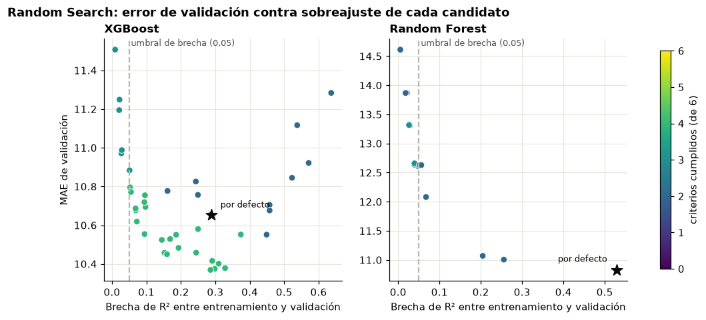

*Cada punto es un candidato del Random Search. Los que tienen poca brecha (a la izquierda del umbral de 0,05) casi siempre tienen un MAE mayor.*

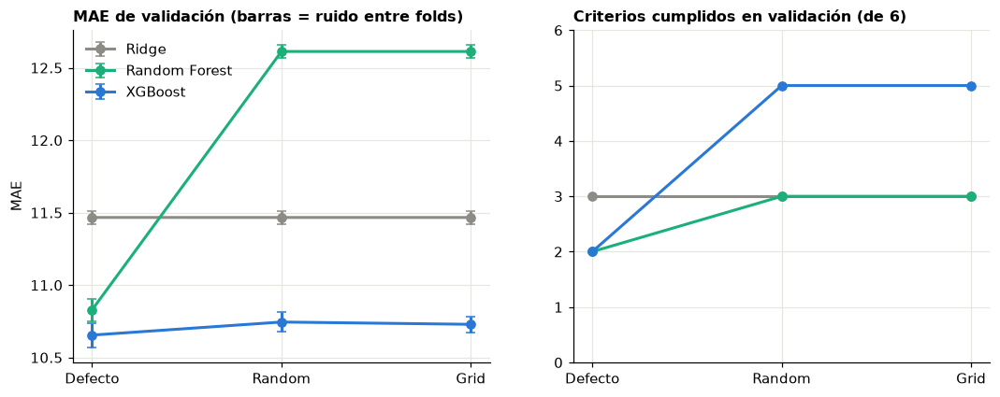

*Izquierda: MAE de validacion en cada fase, con el ruido entre folds. Derecha: criterios cumplidos. Ridge no se mueve; Random Forest empeora al podarse; XGBoost no baja el error pero sube de 2 a 5 criterios.*

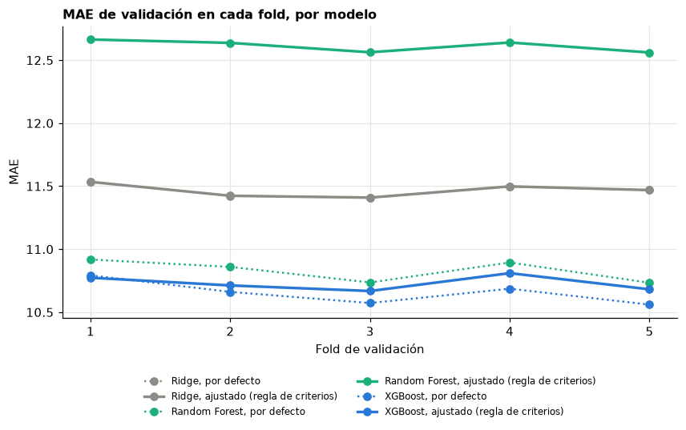

*MAE de validacion en cada uno de los 5 folds, por defecto (punteado) y ajustado (solido). Las lineas casi no se cruzan: el MAE varia con la dificultad de cada fold y no con el modelo, y ningun modelo pierde su lugar.*

- **Ridge:** las tres fases dan 11,467. Con un solo hiperparametro y una brecha de 0,005, el modelo no sobreajusta: su error viene de ser demasiado simple y `alpha` no lo corrige.
- **Random Forest:** la regla elige un bosque muy podado (profundidad 22, hojas de al menos 13 canciones) que cumple la brecha (0,047) pero **empeora el MAE de 10,828 a 12,613** (+1,784, unas 40 veces el ruido). Ningun candidato de las 25 combinaciones probadas supera el MAE de los parametros por defecto. Con el genero en one-hot (113 columnas), el arbol necesita cortes profundos para aislar un genero; podarlo lo deja sin esa capacidad.
- **XGBoost:** de 40 candidatos del Random Search, solo uno cumple 5 criterios (profundidad 3, 350 arboles, tasa de 0,076, perdida cuadratica). El Grid acotado lo afina en 0,016 de MAE, mucho menos que el ruido (0,054), y 9 de sus 81 combinaciones cumplen 5 criterios. Aqui el ajuste no compra menos error: compra **menos sobreajuste al mismo error** (brecha de 0,288 a 0,049).
- **Costo.** La busqueda total (con los intentos de mejora) tardo 66 minutos: Random Forest consumio el 52% (34 min, en CPU) y XGBoost el 46% (30 min, en GPU). El Grid de XGBoost fue barato (370 s por 81 combinaciones) porque trabaja alrededor de arboles de profundidad 2 a 4.

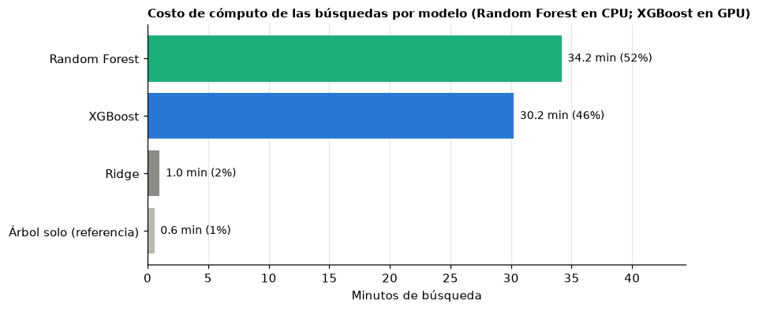

*Random Forest (CPU) y XGBoost (GPU) concentran casi todo el tiempo de busqueda; Ridge y el arbol solo cuestan un par de minutos.*

### 10.5 Aporte de los ensambles: un arbol solo contra bosque y boosting

Para demostrar que el ensamble aporta algo hay que compararlo con **un arbol de decision solo**, ajustado con su propio Grid Search (15 combinaciones, misma preparacion y mismos folds que Random Forest):

| Modelo | MAE de validacion | Ruido | R² | MAE menos que el arbol solo |
|---|---|---|---|---|
| Arbol de decision solo (profundidad sin limite, hojas de 40) | 11,906 | 0,079 | 0,296 | (referencia) |
| Random Forest (bagging), por defecto | 10,828 | 0,079 | 0,393 | 9,0% |
| XGBoost (boosting), por defecto | 10,655 | 0,085 | 0,390 | 10,5% |
| **XGBoost, tras buscar el menor MAE** | **9,845** | 0,069 | 0,407 | **17,3%** |

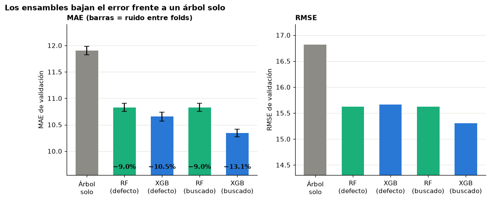

*MAE de validacion (barras = ruido entre folds). Los dos ensambles bajan el error frente a un arbol solo; XGBoost buscado lo baja un 17,3%.*

El bosque baja el error porque promedia muchos arboles distintos (reduce varianza); el boosting lo baja mas porque cada arbol corrige lo que faltaba (reduce sesgo), y la busqueda agrega todavia mas. Es la mejora mas grande de las busquedas, y no viene de los hiperparametros sino de usar un ensamble. Dos matices: el ensamble **no** estabiliza el error entre folds (la desviacion del MAE es 0,079 en el arbol y en el bosque), y el bosque sobreajusta mas el entrenamiento (brecha 0,528 contra 0,153 del arbol con hojas de 40) y aun asi predice mejor en validacion.

### 10.6 Prueba de los finalistas

De todos los candidatos probados pasan a la prueba, por modelo, dos: el que cumple **mas criterios** y el de **menor MAE** de validacion (si son el mismo, uno). Cada finalista se entrena con todo el entrenamiento y se mide **una sola vez** en la prueba (17.155 canciones).

| Finalista | R² | RMSE | MAE | Brecha R² | MAE exitos | Brecha generos | Criterios (de 6) |
|---|---|---|---|---|---|---|---|
| Umbral | ≥ 0,40 | ≤ 15,51 | ≤ 13,46 | ≤ 0,05 | ≤ 20 | ≤ 5 | |
| Linea base (media) | 0,00 | 20,15 | 16,83 | | 41,19 | 6,1 | |
| Ridge | 0,348 | 16,267 | 11,516 | **0,009** | 32,821 | 4,408 | **3** |
| Random Forest, mas criterios (podado) | 0,296 | 16,896 | 12,735 | 0,045 | 34,515 | 5,458 | 2 |
| Random Forest, menor MAE (= por defecto) | 0,388 | 15,756 | 10,846 | 0,533 | 29,950 | 3,940 | 2 |
| **XGBoost, mas criterios** | **0,397** | **15,645** | 10,839 | 0,054 | 31,534 | 4,075 | 2 |
| XGBoost, menor MAE (perdida absoluta) | 0,393 | 15,688 | **9,946** | 0,263 | **28,435** | 4,004 | 2 |

**Ningun finalista cumple los seis criterios.** Dos hallazgos:

- **De 5 criterios en validacion a 2 en la prueba.** El XGBoost tenia R² 0,407, RMSE 15,431 y brecha 0,049 en validacion; en la prueba tiene 0,397, 15,645 y 0,054. Los tres criterios se cumplian por margenes de 0,007, 0,082 y 0,001 y la prueba los dejo afuera por 0,003, 0,132 y 0,004. El candidato se eligio por ser el mejor de 121 en validacion, asi que su cifra de validacion es algo optimista (la prueba se separo justamente para detectar esto).
- **Respecto de la EV2** (mismo conjunto de prueba): Ridge no cambia (MAE 11,516); el Random Forest podado empeora de 10,846 a 12,735; el XGBoost sube su MAE de 10,643 a 10,839 pero mejora la generalizacion: la brecha de R² baja de 0,265 a 0,054, el R² sube de 0,386 a 0,397 y el RMSE baja de 15,788 a 15,645. Con la regla elegida el ajuste no compro menos error, compro un modelo que generaliza mejor.

### 10.7 Intentos de mejora

El XGBoost elegido por la regla cumple 2 criterios y deja otros tres a milesimas (R² por 0,003, RMSE por 0,132, brecha por 0,004); el criterio de exitos queda lejos. Antes de cerrar la seleccion se plantean cuatro intentos de mejora. Cada uno tiene una razon y una expectativa que se escribe **antes de medir**, y todos se miden primero en validacion cruzada, con los hiperparametros del modelo elegido sin volver a buscarlos; a la prueba pasa una sola vez cada idea medida.

| Intento | Por que se prueba | Que se espera |
|---|---|---|
| **10.7.1 Pesos por popularidad** (H6) | El criterio de exitos falla porque los exitos son el 1% de las canciones y casi no pesan en el error que se minimiza | Que baje el error en exitos, a costa de R² y RMSE, que ya estan justos |
| **10.7.2 Variables nuevas** (H7) | El genero es lo que mas usa el modelo; su media y cuanto se aleja la cancion de su genero podrian aprovecharse mejor | Poco o nada: los arboles ya forman esas combinaciones |
| **10.7.3 Mezcla de modelos** (H8) | Los dos XGBoost se equivocan distinto: el de perdida cuadratica predice la media y el de absoluta la mediana | Que el promedio mejore R², RMSE y MAE a la vez, y que la brecha suba |
| **10.7.4 Extra: el artista** (H9) | El artista explicaba mas variacion que el genero y se excluyo del modelo | Una mejora grande que dependa de que el artista tenga historial |

#### 10.7.1 Pesos por popularidad (no sirvio)

Se les da mas peso a las canciones con popularidad ≥ 70 al entrenar (`sample_weight`). **No es un hiperparametro:** cambia como se define el problema, asi que se trata como exploracion y se mide solo en validacion.

| Peso extra por exito | Error en exitos (criterio 5) | R² | RMSE | Criterios cumplidos |
|---|---|---|---|---|
| 0 (sin pesos) | 31,370 | 0,407 | 15,431 | 5 |
| 2 | 23,910 | 0,371 | 15,899 | 2 |
| 5 | **18,805** | 0,307 | 16,688 | 3 |
| 10 | 14,854 | 0,226 | 17,635 | 3 |
| 20 | 11,347 | 0,114 | 18,872 | 3 |

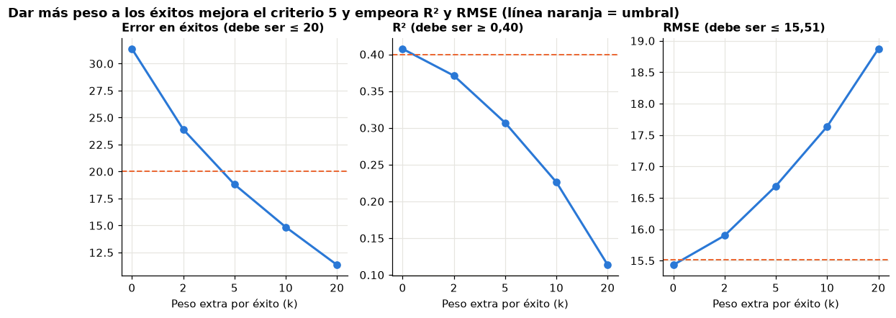

*Cada panel muestra una medida segun el peso extra de los exitos; la linea naranja es el umbral. El error en exitos cruza el umbral con k = 5, pero R² y RMSE se alejan de los suyos desde k = 2.*

Con un peso de 5 el criterio de exitos **si se cumple**, pero el modelo pierde los criterios de R², RMSE y brecha (R² cae a 0,307). Cuanto mas pesan los exitos, mejor se predicen y peor se predice todo lo demas, porque el modelo empieza a decir "exito" para canciones que se le parecen y no lo son. **H6 no se cumple:** con estas variables, el criterio 5 es incompatible con los criterios 1 y 2. Los pesos se descartan.

#### 10.7.2 Variables nuevas a partir del genero (no sirvio)

Se agregaron la popularidad media del genero como variable numerica y, para seis variables de audio, cuanto se aleja la cancion del promedio de su genero. Se calculan dentro del `Pipeline`, por fold. Resultado (el ruido del modelo elegido es 0,054):

| Experimento | MAE | Cambio | Veredicto |
|---|---|---|---|
| Modelo elegido (referencia) | 10,729 | | |
| Media del genero | 10,730 | +0,001 | Sin efecto |
| Desviacion respecto del genero | 10,719 | −0,010 | Sin efecto |
| Las dos | 10,709 | −0,020 | Sin efecto |

En la prueba, la mejor (media del genero) da MAE 10,822 contra 10,839 y los mismos 2 criterios. **H7 no se cumple:** el modelo ya tenia el genero como categoria y las variables de audio, y un arbol puede formar esas combinaciones solo. La idea se descarta con evidencia.

#### 10.7.3 Mezcla de modelos (si sirvio)

**La idea.** Los dos mejores XGBoost de las busquedas se equivocan de forma distinta:

- **A, el elegido (perdida cuadratica):** castiga el error al cuadrado, asi que sus predicciones tienden a la **media**. Cuida R² y RMSE. Es un modelo simple (profundidad 3, 244 arboles) y casi no sobreajusta.
- **B, el de menor MAE (perdida absoluta):** castiga el error tal cual, asi que sus predicciones tienden a la **mediana**. Tiene el mejor MAE, pero es mas profundo (profundidad 9) y memoriza mas el entrenamiento.

La **mezcla es un promedio de predicciones**: `(promedio de A + promedio de B) / 2`. Se usan 5 modelos A y 3 modelos B, cada uno con una semilla distinta (`subsample` y `colsample_bytree` introducen azar, asi que cada semilla da un modelo algo diferente). Promediar varios modelos reduce la varianza; mezclar dos tipos de perdida combina dos formas de equivocarse que no coinciden, y por eso parte del error se compensa. Los 8 modelos se entrenan solo con las canciones de entrenamiento de cada fold, y los pesos son fijos (50% y 50%): no hay fuga de datos.

**Que se espera.** Que la mezcla mejore R², RMSE y MAE a la vez frente a A solo, y que la brecha de sobreajuste suba porque B memoriza mas.

**Resultado en validacion cruzada** (5 folds):

| Variante | MAE | RMSE | R² | Brecha R² | Criterios |
|---|---|---|---|---|---|
| A: modelo elegido (1 semilla) | 10,729 | 15,431 | 0,407 | 0,049 | 5 |
| A: promedio de 5 semillas | 10,707 | 15,403 | 0,410 | 0,049 | 5 |
| B: perdida absoluta (1 semilla) | 9,845 | 15,430 | 0,407 | 0,273 | 4 |
| **A + B: la mezcla** | **10,172** | **15,265** | **0,420** | 0,174 | 4 |

Promediar solo semillas de A no cambia nada (−0,022, dentro del ruido); B solo tiene el mejor MAE pero la mayor brecha; la mezcla es **mejor que A en las tres medidas** (MAE −0,557, unas 10 veces el ruido), como se esperaba, y pierde en la brecha (0,174).

**Resultado en la prueba** (una sola vez):

| | R² | RMSE | MAE | Brecha R² | MAE en exitos | Equidad | Criterios |
|---|---|---|---|---|---|---|---|
| A: modelo elegido | 0,397 | 15,645 | 10,839 | **0,054** | 31,534 | 4,075 | 2 |
| A: promedio de 5 semillas | 0,400 | 15,608 | 10,809 | 0,053 | 31,452 | 4,037 | 2 |
| **A + B (la mezcla)** | **0,408** | **15,499** | **10,271** | 0,170 | **29,966** | **3,963** | **4** |

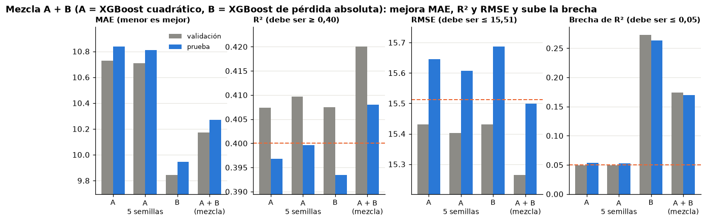

*Validacion (gris) y prueba (azul) de las cuatro variantes; la linea naranja es el umbral. La mezcla A + B es la que mas mejora R² y RMSE en ambos conjuntos; B es el de menor MAE, pero con la mayor brecha.*

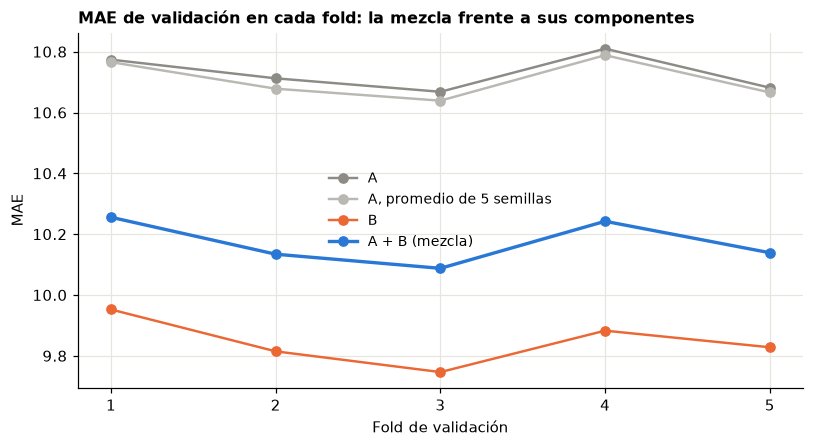

*MAE de validacion en cada fold: la mezcla queda por debajo de A en los 5 folds, asi que la mejora es consistente.*

La mezcla **confirma la expectativa**: mejora R² (+0,011), RMSE (−0,146), MAE (−0,568), error en exitos y equidad, y cumple 4 criterios. **H8 se cumple.** Sobrevivio a la prueba por tener margen: A cumplia R² y RMSE en validacion por 0,007 y 0,082 y los perdio; la mezcla los cumplia por 0,020 y 0,246 y los conservo (aunque pasa el RMSE por solo 0,014). Su costo: ocho modelos y una brecha de sobreajuste de 0,170. La decision de adoptarla se explica en la seccion 11.2.

#### 10.7.4 Extra: el artista, lo que mas nos limito

En el EDA el artista explicaba mas variacion que el genero (η² de 0,51 contra 0,35) y se excluyo del modelo por el efecto superestrella y por privacidad (secciones 12.1 y 12.3). El diagnostico mide cuanto costo esa decision: el artista principal de cada cancion (el primero de los creditos) se codifica con su popularidad media **dentro de cada fold**. **No es una solucion propuesta.**

| | R² | RMSE | MAE | MAE en exitos | Criterios |
|---|---|---|---|---|---|
| Modelo elegido | 0,397 | 15,645 | 10,839 | 31,534 | 2 |
| Con el artista | **0,555** | **13,434** | **8,421** | **24,187** | 4 |

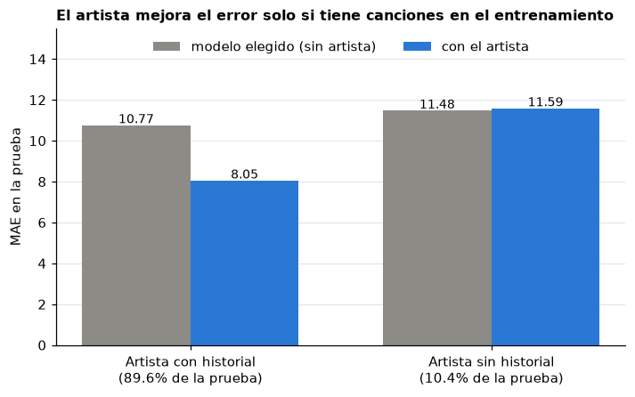

*MAE en la prueba segun si el artista tiene o no canciones en el entrenamiento: la mejora esta toda en el primer grupo.*

Es el cambio mas grande de todo el trabajo, mayor que cualquier hiperparametro, mezcla o variable construida desde el genero. **Pero la ganancia depende de que el artista tenga historial:** el 89,6% de las canciones de prueba (15.377 de 17.155) tiene un artista con otras canciones en el entrenamiento, y para ellas el MAE baja de 10,765 a 8,054; para las 1.778 restantes (artistas sin historial) no mejora (11,482 contra 11,592). Es justamente el caso donde un sello querria apoyarse en el modelo. **H9 se cumple.** Es un techo informativo, no una recomendacion: usar al artista reproduce, es lo esperable, el efecto superestrella (no se midio ese sesgo con este modelo) y decidir si se incorpora es una decision de negocio y de etica.

### 10.8 Validacion cruzada y capacidad de generalizacion

La validacion cruzada se uso en dos roles: para **elegir** hiperparametros (dentro de cada busqueda, solo con el entrenamiento) y para **medir la generalizacion** (brecha entre entrenamiento y validacion, y ruido entre folds). La prueba confirma despues, una sola vez, lo que la validacion indica. El resultado mas importante es que **la validacion fue optimista**: el XGBoost elegido cumplia 5 criterios en validacion y 2 en la prueba. Se eligio entre 121 candidatos por ser el mejor, asi que su cifra de validacion esta algo inflada. La mezcla, que cumplia sus umbrales con mas margen, conservo en la prueba lo que habia ganado en validacion.

---

## 11. Evaluacion con metricas y seleccion de la solucion optima

### 11.1 Todos los candidatos, medidos en la prueba

Se reunen los finalistas de la seccion 10.6 y la mezcla de la seccion 10.7. Todos se entrenaron con todo el entrenamiento y se midieron en la prueba, cada uno una sola vez.

| Candidato | R² | RMSE | MAE | Brecha R² | MAE exitos | Brecha generos | Criterios (de 6) |
|---|---|---|---|---|---|---|---|
| Umbral | ≥ 0,40 | ≤ 15,51 | ≤ 13,46 | ≤ 0,05 | ≤ 20 | ≤ 5 | |
| Linea base (media) | 0,00 | 20,15 | 16,83 | | 41,19 | 6,1 | |
| Ridge | 0,348 | 16,267 | 11,516 | **0,009** | 32,821 | 4,408 | 3 |
| Random Forest, podado | 0,296 | 16,896 | 12,735 | 0,045 | 34,515 | 5,458 | 2 |
| Random Forest, por defecto | 0,388 | 15,756 | 10,846 | 0,533 | 29,950 | 3,940 | 2 |
| XGBoost A, perdida cuadratica | 0,397 | 15,645 | 10,839 | 0,054 | 31,534 | 4,075 | 2 |
| XGBoost B, perdida absoluta | 0,393 | 15,688 | 9,946 | 0,263 | 28,435 | 4,004 | 2 |
| **Mezcla A + B (elegida)** | **0,408** | **15,499** | 10,271 | 0,170 | 29,966 | **3,963** | **4** |

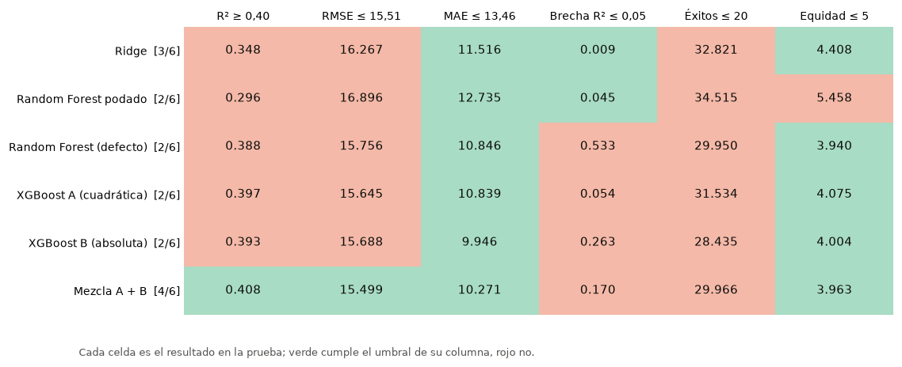

*Resultado de cada candidato en la prueba; verde cumple el umbral de su columna, rojo no. La mezcla es la unica con R² y RMSE en verde a la vez.*

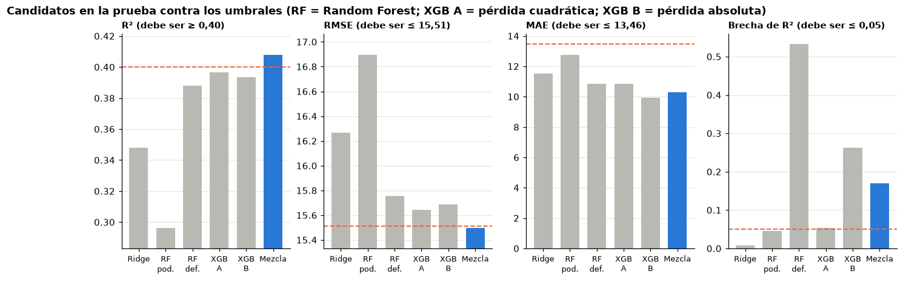

*Las mismas medidas en barras, con el umbral en naranja. La mezcla (azul) supera a todos en R² y RMSE; XGBoost B la gana en MAE; Ridge, Random Forest podado y XGBoost A tienen menos brecha de R².*

### 11.2 Decision y justificacion

**Se elige la mezcla A + B** (promedio de 5 XGBoost de perdida cuadratica y 3 de perdida absoluta). Hay dos candidatos serios y conviene explicar como se llego a la decision.

**Que decia la regla.** La regla de la seccion 10.1 (mas criterios cumplidos en validacion) elegia el XGBoost A solo: 5 criterios contra 4 de la mezcla. Pero contar criterios es una regla tosca: trata igual fallar por 0,003 que por 0,05, y en la prueba el orden cambio (A cumple 2 y la mezcla 4).

**Que dice la evidencia, mirando primero solo la validacion.** Sin usar la prueba, la mezcla tiene mejor R² (0,420 contra 0,407), RMSE (15,265 contra 15,431) y MAE (10,172 contra 10,729, unas 10 veces el ruido), y cumple sus umbrales con mas margen; solo pierde en la brecha de sobreajuste (0,174 contra 0,049) y en simplicidad. La prueba confirma la misma direccion: R² 0,408 contra 0,397, RMSE 15,499 contra 15,645, MAE 10,271 contra 10,839, error en exitos 29,966 contra 31,534 y 4 criterios contra 2.

**Por que se acepta el costo.** La brecha de R² compara el desempeño en el entrenamiento con el de la prueba y sube porque B memoriza mas el entrenamiento. Pero lo que le importa a quien use el modelo es el error con canciones nuevas, y ese baja. A cambio se pierde simplicidad: ocho modelos que guardar y consultar.

**Lo que hay que decir con honestidad:**

- **No hay fuga de datos.** Los ocho modelos se entrenan solo con el entrenamiento, los pesos de la mezcla son fijos (50% y 50%) y la prueba solo se usa para medir.
- **Si hay un pequeño sesgo de seleccion.** La mezcla se planteo como intento de mejora antes de medirla, pero la regla fijada eligio otro modelo y se decidio adoptarla despues de ver que en la prueba tambien ganaba. Su cifra de prueba deja de ser una estimacion perfectamente limpia, aunque el sesgo es acotado: se comparan tres o cuatro opciones, no cientos.
- **Pasa el RMSE por muy poco:** 15,499 contra 15,51 (0,014).
- **Optimismo heredado:** A y B salieron de elegir al mejor entre muchos candidatos, asi que sus cifras de validacion estan algo infladas y la mezcla las hereda.

**Alternativas.** Si se prefiere un modelo simple y explicable: el XGBoost A solo (MAE 10,839, brecha 0,054). Si lo unico que importa es el error absoluto promedio: el XGBoost B solo (MAE 9,946, brecha 0,263).

### 11.3 Criterios de exito de la solucion final

| Criterio (prueba) | Umbral | Resultado | ¿Cumple? |
|---|---|---|---|
| R² | ≥ 0,40 | 0,408 | Si (por 0,008) |
| RMSE | ≤ 15,51 | 15,499 | Si (por 0,014) |
| MAE | ≤ 13,46 | 10,271 | Si |
| Brecha de R² | ≤ 0,05 | 0,170 | No |
| MAE en exitos (≥ 70) | ≤ 20 | 29,966 | No |
| Brecha de MAE entre cuartiles de genero | ≤ 5 | 3,963 | Si |

**Cumple 4 de 6.** Frente a la linea base (MAE 16,83) el error baja un 39%; frente al XGBoost de la EV2 con parametros por defecto (MAE 10,643, R² 0,386) el MAE baja a 10,271 y el R² sube a 0,408.

### 11.4 Criterios practicos (clase 3.3)

| Candidato | Segundos de entrenamiento final | Minutos de busqueda | Interpretabilidad | Complejidad |
|---|---|---|---|---|
| Ridge | 1,0 | 1,0 | Alta (coeficientes) | 1 modelo |
| Random Forest | 25,8 a 57,7 | 34,2 | Media | 1 modelo (100 arboles) |
| XGBoost A | 0,6 | 30,2 (incluye los intentos de mejora) | Media (importancia de variables) | 1 modelo |
| XGBoost B | 11,2 | (incluido) | Media | 1 modelo |
| **Mezcla A + B** | no medido por separado (entrena 5 modelos A y 3 modelos B) | (incluido) | Media-baja (ocho modelos) | **8 modelos** |

*Tiempos de la ejecucion del notebook; varian entre ejecuciones.* El costo de la mezcla es operativo: ocho modelos que guardar y una prediccion que es el promedio de ocho. Los modelos son pequeños (A tiene 244 arboles de profundidad 3), asi que predecir sigue siendo rapido. La **equidad** se cumple en la mezcla (brecha de 3,963 entre cuartiles de genero, contra el umbral de 5).

### 11.5 Errores de la solucion final

| Segmento (prueba) | Canciones | MAE linea base | MAE modelo A solo | MAE mezcla | Sesgo de la mezcla (pred − real) |
|---|---|---|---|---|---|
| Popularidad 0 | 1.316 | 34,323 | 25,876 | 25,503 | +25,493 |
| Popularidad 1 a 69 | 15.182 | 14,254 | 8,640 | 8,098 | −0,897 |
| Popularidad ≥ 70 (exitos) | 657 | 41,194 | 31,534 | 29,966 | −29,966 |


*Los exitos (a la derecha de la linea punteada) quedan por debajo de la diagonal: se subestiman sin excepcion.*

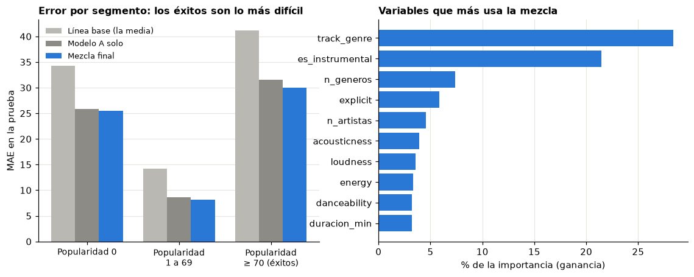

*Izquierda: MAE por segmento de popularidad; los exitos son lo mas dificil para los tres. Derecha: variables que mas usa la mezcla (ganancia en los arboles).*


*Izquierda: porcentaje de canciones con error menor o igual a cada valor (45,4% a 5 puntos o menos, 66,5% a 10, 84,3% a 20). Derecha: MAE por cuartil de popularidad del genero; la mezcla es mas pareja que la linea base.*

En puntos: error medio 10,271, **error mediano 5,773**, el 45,4% de las canciones queda a 5 puntos o menos, el 66,5% a 10 o menos y el 84,3% a 20 o menos; el 7,8% se equivoca en mas de 30. **Donde falla:** en las canciones con popularidad 0 predice demasiado alto (+25,5) y en los exitos el sesgo (−29,966) es igual al MAE, es decir, **subestima los 657 exitos sin excepcion**. El modelo aplana las predicciones hacia el centro. Hipotesis (no verificada): el audio y el genero describen la popularidad tipica de un tipo de cancion, no lo que hace destacar a una en particular.

### 11.6 Que explica la prediccion

Por ganancia de cada variable en los arboles (promediada entre los modelos A y B), el **genero concentra el 28,4%** de la importancia y `es_instrumental` el 21,5%; siguen `n_generos` (7,4%), `explicit` (5,8%), `n_artistas` (4,6%) y las variables de audio, entre 3% y 4% cada una (`acousticness` 3,9%, `loudness` 3,6%, `energy` 3,3%, `danceability` 3,2%, `duracion_min` 3,2%). Los dos tipos de modelo reparten distinto: A usa mucho `es_instrumental` (33,1%) y B poco (9,8%), y B usa mas `n_generos` (9,9% contra 4,9%); esa diferencia es parte de por que se equivocan de forma distinta y la mezcla compensa. La importancia por ganancia indica que variables usa el modelo para dividir, no que causen la popularidad. `n_generos` solo existe cuando la cancion ya esta publicada: para decidir antes del lanzamiento habria que reentrenar sin ella (la EV2 midio un costo de 0,25 puntos con parametros por defecto; no se repitio con la solucion final).

---

## 12. Sesgos, etica y privacidad

*Nota de la EV3: la auditoria por catalogo del artista (12.2) y el escenario de cancion inedita (9.6) se hicieron con el candidato de la EV2 (XGBoost con parametros por defecto) y no se repitieron con la solucion final de la EV3. La brecha de MAE entre cuartiles de genero si se midio con la solucion final: 3,963 (seccion 11.3).*

### 12.1 Sesgos presentes en los datos

| Sesgo | Evidencia | Medida |
|---|---|---|
| **Muestreo artificial por genero** | 1.000 canciones por genero, que no representan el catalogo real. Tras deduplicar, los generos masivos quedan subrepresentados: `reggaeton` pierde el 69% y `tango` conserva sus 1.000 | Genero conservado elegido al azar; documentar que el modelo no representa al catalogo real |
| **Seleccion por busqueda** | Las canciones son las que devolvio la busqueda de Spotify, que favorece contenido popular: las canciones en 2 o 3 generos tienen 6 a 8 puntos mas de popularidad | Interpretar `n_generos` como posible artefacto; evaluar el modelo sin ella (9.6) |
| **Efecto superestrella** | El artista explica mas que el genero: exceso de η² sobre el azar de 0,51, frente a 0,35 del genero. El 1% de artistas con mas canciones concentra el 15,3% del dataset | Artista excluido del modelo; auditar el error por catalogo del artista (12.2) |
| **Factores no observados** | Marketing, playlists editoriales, fama previa y redes sociales no estan en los datos | Expectativas moderadas en los criterios de exito |
| **Alcance de Spotify** | La popularidad es popularidad *dentro de Spotify*, una plataforma con penetracion desigual por pais. Solo incluye musica que ya logro entrar a la plataforma | Documentado como limite de lo que mide `popularity` |

### 12.2 Auditoria de sesgos con el modelo

Con el modelo ya entrenado se reviso si castiga a los artistas con pocas canciones, como haria si heredara el efecto superestrella.


*La candidata se equivoca entre 9,87 puntos (artistas con mas de 20 canciones) y 11,30 (artistas con una sola cancion), sin una direccion fija de sesgo (-0,48 a +0,81). La brecha entre tramos es de 1,43, menos de la mitad que la de la linea base (2,99).*

El modelo no castiga de forma visible a los artistas con pocas canciones. Matiz: tener una sola cancion en el dataset no equivale a ser emergente; esas canciones tienen la popularidad media mas alta (39,0), por la seleccion por busqueda. El efecto de fondo (promocion, seguidores, fama) sigue fuera de los datos: el modelo no lo hereda de forma visible, pero tampoco lo corrige.

### 12.3 Privacidad y condiciones de uso

- **Datos personales.** No hay datos de usuarios: la popularidad es un indicador agregado. Si hay nombres de artistas (31.437), que son figuras publicas en su actividad profesional; no hay datos sensibles en el sentido de la Ley 19.628 (actualizada por la Ley 21.719) ni del RGPD. Aun asi, el artista se excluye del modelo y los resultados no deberian publicarse por artista sin contexto.
- **Terminos de Spotify.** Desde mayo de 2023, los terminos para desarrolladores de Spotify prohiben usar su contenido para entrenar modelos de Machine Learning. El dataset se publica con fines educativos y este proyecto es academico, pero **un uso comercial requeriria revisar la licencia o un acuerdo con Spotify**.
- **Reproducibilidad del despliegue.** Desde el 27 de noviembre de 2024, Spotify restringio el acceso de nuevas aplicaciones a las caracteristicas de audio. No es posible obtener estas variables para canciones nuevas por la API publica; una alternativa seria calcularlas con librerias abiertas como `librosa` o Essentia.

### 12.4 Riesgos eticos y uso responsable

- **Uso dual.** El modelo puede apoyar decisiones de promocion, pero usado como filtro automatico para fichar o descartar artistas replicaria los sesgos de genero, mercado y artista descritos. Perjudicaria sobre todo a la musica no anglosajona, a los generos de nicho y a los artistas emergentes.
- **Explicabilidad como responsabilidad.** Las predicciones pueden afectar el sustento de un artista. Por eso cada prediccion debe acompañarse de su anatomia (aporte de cada variable) y del error esperado de su genero, para que quien decide entienda por que el modelo llego a ese numero.
- **Precision contra interpretabilidad.** Ridge es transparente en sus coeficientes; XGBoost es mas preciso pero mas dificil de auditar. Los valores SHAP reducen esa distancia y el protocolo de seleccion da prioridad al modelo interpretable en caso de empate.

---

## 13. Conclusiones y recomendaciones

### 13.1 El recorrido y lo que se concluye de cada paso

1. **La calidad de los datos era el primer desafio.** El archivo parecia limpio, pero escondia 450 duplicados, 24.259 filas repetidas por genero, etiquetas duplicadas, contenido no musical y 2.856 ceros artificiales. Sin tratarlos, cualquier modelo se habria evaluado con metricas infladas por fuga de datos.
2. **La popularidad depende poco del audio y mucho del contexto.** El genero explica cerca de un tercio de la variacion y el artista aun mas; el audio aporta relaciones debiles y no lineales. La solucion final lo confirma: el genero es la variable con mas importancia (28,4%).
3. **Adaptar la preparacion a cada modelo valio la pena en los arboles** (EV2): con el genero como categoria nativa, XGBoost baja su MAE de prueba de 11,30 a 10,64, y Random Forest de 10,99 a 10,85 con el genero en one-hot. En la EV3 se uso esa preparacion dedicada de cada modelo.
4. **Los ensambles aportan.** Un arbol solo llega a un MAE de validacion de 11,906; Random Forest (bagging) lo baja a 10,828 (9,0% menos) y XGBoost (boosting) a 10,655 por defecto y a 9,845 tras buscar (17,3% menos). Es la mejora mas grande de las busquedas, y no viene de los hiperparametros sino de usar un ensamble.
5. **Ajustar hiperparametros no mejora todo por igual, y depende de que se busque.** En Ridge no cambia nada (11,467 en todas las fases). En Random Forest, cumplir la brecha de R² obliga a podar los arboles y el MAE **sube** de 10,828 a 12,613. En XGBoost, buscar criterios deja el MAE igual (+0,074, dentro del ruido) pero baja la brecha de R² de 0,288 a 0,049; buscar el menor MAE (perdida absoluta) lo baja 0,810 pero deja una brecha de 0,273.
6. **El Random Search seguido de un Grid acotado funciona como division del trabajo:** el Random descubre la zona buena (un candidato de XGBoost con 5 criterios entre 40), y el Grid solo afina (0,016 de MAE, menos que el ruido de 0,054).
7. **Con datos nuevos ningun modelo cumple los seis criterios.** El XGBoost elegido por la regla cumplia 5 criterios en validacion y 2 en la prueba (R² 0,397, RMSE 15,645, brecha 0,054), porque se eligio entre 121 candidatos. La prueba, separada y usada una sola vez, fue lo que permitio verlo.
8. **Los intentos de mejora separaron lo que sirve de lo que no.** Los pesos por popularidad y las variables nuevas no sirvieron: el criterio de exitos es incompatible con R² y RMSE con estas variables, y los arboles ya forman las combinaciones del genero por si solos. **Mezclar XGBoost de perdida cuadratica y absoluta si sirvio:** mejora R², RMSE y MAE en validacion y en la prueba, y cumple 4 criterios en la prueba porque los cumplia con mas margen que el modelo elegido.
9. **Solucion final: la mezcla A + B**, con costos explicitos: ocho modelos, una brecha de sobreajuste de 0,170, un RMSE que pasa el umbral por solo 0,014 y un pequeño sesgo de seleccion, porque se adopto despues de ver que tambien ganaba en la prueba (seccion 11.2).
10. **Lo que mas nos limito fue no usar al artista.** Con el artista principal como variable, el R² de prueba sube de 0,397 a 0,555 y el MAE baja de 10,839 a 8,421, pero solo para artistas con historial (el 89,6% de la prueba); para los demas no mejora. Es un techo informativo, no una recomendacion de usarlo.

**Resultado final en la prueba:** R² 0,408, RMSE 15,499, MAE 10,271 (39% menos que la linea base), brecha de R² 0,170, MAE en exitos 29,966 y brecha entre cuartiles de genero 3,963: **cumple 4 de 6 criterios**. El error mediano es de 5,8 puntos y el 84,3% de las canciones queda a 20 puntos o menos.

**Todas las decisiones del proyecto y su efecto medido:**

| Decision | Efecto | ¿Valio la pena? |
|---|---|---|
| Genero como categoria nativa en XGBoost (EV2, X2) | −0,644 de MAE de validacion | Si |
| Genero en one-hot en Random Forest (EV2, F2) | −0,088 | Si, aunque es pequeño y suma 112 columnas |
| Quitar Yeo-Johnson y escalado en los arboles (EV2) | +0,001 y +0,018 | Si, como simplificacion |
| Cambios descartados en Ridge (EV2, R1 a R4) y recuperar `instrumentalness` y `key` (F3, X3) | Dentro del ruido | No |
| Usar un ensamble en vez de un arbol solo | −1,078 (bosque) y −2,061 (XGBoost buscado) | **Si, la mayor mejora de las busquedas** |
| Ajustar `alpha` de Ridge | 0,000 | No |
| Ajustar Random Forest cumpliendo la brecha | +1,784 | No (empeora) |
| Ajustar XGBoost buscando criterios | +0,074 de MAE, brecha 0,288 → 0,049 | Si, para generalizar |
| Ajustar XGBoost buscando el menor MAE (perdida absoluta) | −0,810 | Si, si importa solo el MAE |
| Grid acotado despues del Random Search | −0,016 | No (dentro del ruido) |
| Pesos por popularidad | Exitos 31,4 → 18,8, pero R² 0,407 → 0,307 | No |
| Variables nuevas a partir del genero | −0,010 a +0,001 de MAE (ruido 0,054) | No |
| Promedio de 5 semillas | −0,022 | No |
| **Mezcla de perdida cuadratica y absoluta (A + B)** | **−0,557 de MAE de validacion, R² 0,407 → 0,420; en prueba MAE 10,839 → 10,271** | **Si, la solucion final** |
| Agregar el artista (diagnostico) | −2,427 de MAE de validacion | Informativo: no sirve para artistas sin historial |

### 13.2 Recomendaciones

1. **Usar la solucion como estimacion de referencia para priorizar, no para decidir sola.** El 84,3% de las canciones queda a 20 puntos o menos y el error mediano es de 5,8, pero el error medio es de 10,3.
2. **No usarla para detectar exitos:** los subestima sin excepcion (sesgo de −30,0). Si encontrar exitos es el objetivo, plantearlo como una **clasificacion** ("exito si o no") con precision y recall, que es la forma correcta de medir ese problema.
3. **Si se necesita un modelo unico y explicable**, usar el XGBoost A solo (MAE 10,839, brecha 0,054); si importa solo el error absoluto promedio, el XGBoost B (MAE 9,946, brecha 0,263).
4. **Para canciones aun no publicadas, usar una version sin `n_generos`** (en la EV2 costo 0,25 puntos) y repetir la evaluacion.
5. **Sumar datos de fama y promocion** (seguidores, fecha de lanzamiento, playlists) antes de exigir mas precision: es donde esta el techo. Si se acepta que el modelo dependa del historial del artista, medirlo con cuidado: mejora mucho para artistas conocidos (MAE de 10,765 a 8,054) y nada para artistas nuevos, y reproduce el efecto superestrella. Es una decision de negocio y de etica.
6. **Volver a ajustar periodicamente:** la popularidad cambia con el tiempo y estas busquedas deben repetirse con datos nuevos.

---

## 14. Limitaciones y proximos pasos

**Limitaciones.**

- **Un solo conjunto de prueba** (17.155 canciones, 657 exitos) y **una sola semilla** base (42): no se midio cuanto varian los resultados al repetir.
- **Sesgo de seleccion de la mezcla:** se adopto despues de ver que tambien ganaba en la prueba, asi que su cifra no es una estimacion perfectamente limpia. Las cifras de validacion de A y B heredan el optimismo de elegir al mejor entre muchos candidatos.
- **El RMSE de la mezcla pasa el umbral por 0,014**, un margen fragil, y su **brecha de sobreajuste es 0,170** (la de A solo es 0,054); ademas exige ocho modelos.
- **Los intentos de mejora** usan los hiperparametros ya elegidos sin volver a buscarlos; los dos modelos de la mezcla no se afinaron juntos ni se probaron otras proporciones distintas de 50% y 50%.
- **Random Forest solo se exploro con 100 arboles y 25 combinaciones**, por el tiempo de computo en CPU.
- **Contar criterios es una regla tosca:** trata igual fallar por 0,003 que por 0,05 y premio en Ridge un cumplimiento que viene de no aprender lo suficiente.
- **El criterio de exitos no se cumple con estas variables:** el mejor valor de todos los candidatos de XGBoost es 27,5.
- **No se repitio con la solucion final:** el escenario de cancion inedita (sin `n_generos`), los valores SHAP y la auditoria por catalogo del artista de la EV2.
- **Heredado de la EV1 y la EV2:** el EDA se hizo con todo el dataset antes de dividir (fuga leve), el *cross fitting* de `TargetEncoder` no agrupa por cancion, la muestra tiene 1.000 canciones por genero por construccion y las relaciones son asociaciones, no causas.

**Proximos pasos (en orden de retorno esperado).**

1. **Enriquecer los datos** con seguidores del artista, fecha de lanzamiento, presencia en playlists y caracteristicas de audio abiertas que no dependan de la API restringida, y evaluar con cuidado la incorporacion de informacion del artista.
2. **Plantear la deteccion de exitos como clasificacion**, con sus propias metricas.
3. **Fijar margenes de seguridad** sobre los umbrales y repetir las busquedas con varias semillas y particiones para tener una estimacion limpia al comparar candidatos.
4. **Afinar la mezcla:** buscar los hiperparametros de A y B juntos y probar otras proporciones y otros modelos (LightGBM, Stacking).
5. **Repetir el escenario de cancion inedita, SHAP y la auditoria por artista** con la solucion final.
6. **Reentrenar periodicamente.**

---

## 15. Reflexion a nivel de proyecto

La EV3 empezo con una idea que parecia obvia: tomar los modelos y las preparaciones de la EV2, optimizar los hiperparametros y quedarnos con el mejor. Termino siendo la etapa en que mas cosas que dabamos por sentadas resultaron falsas o a medias. Esta reflexion explica que creiamos, que encontramos y que cambia en como vamos a trabajar.

### 15.1 Lo que dabamos por sentado, y lo que midio el experimento

| Lo que asumiamos | Que paso |
|---|---|
| "Optimizar hiperparametros mejora el modelo" | En Ridge no cambio nada; en Random Forest empeoro el MAE en 1,784; en XGBoost el MAE solo mejoro (0,810) cuando se busco el MAE con otra funcion de perdida |
| "Un arbol sobreajustado se arregla limitando la profundidad", como dicen las guias | Con el genero en one-hot, podar el bosque bajo la brecha de 0,528 a 0,047 y dejo el modelo peor en todo lo demas (R² de 0,393 a 0,303) |
| "Si un modelo cumple mas criterios, es mejor" | Ridge cumple 3 en la prueba y XGBoost 2, pero Ridge solo cumple porque casi no aprende (R² 0,348) |
| "Lo que ganamos en validacion es lo que ganaremos con datos nuevos" | XGBoost cumplia 5 criterios en validacion y 2 en la prueba |
| "Un Grid Search despues del Random Search sigue mejorando" | Mejoro 0,016 de MAE, una fraccion del ruido (0,054) |
| "Si se busca lo suficiente, algun modelo cumplira todos los criterios" | Con 121 combinaciones de XGBoost y un experimento de pesos, el error en exitos no bajo de 27,5 sin romper R² y RMSE |
| "Agregar variables razonables o promediar semillas ayuda" | Las variables derivadas del genero y el promedio de semillas no se distinguen del ruido (MAE de 10,707 a 10,730 contra 10,729) |
| "Lo que mas mejora un modelo son sus hiperparametros" | Mezclar dos tipos de perdida bajo el MAE de prueba en 0,568 sin buscar nada nuevo, y agregar el artista lo bajo en 2,418 puntos, mucho mas que 121 combinaciones de hiperparametros |
| "Una GPU hace todo mas rapido" | En este dataset (55.000 filas y 16 columnas) XGBoost fue algo mas lento en GPU que en CPU (13,2 s contra 9,8 s con 1.500 arboles); lo que mas tiempo consumio, Random Forest, no tiene version para GPU |

Ninguna de estas ideas era absurda; todas salian de la documentacion o de lo que nos ensenaron. Ninguna se podia confirmar leyendo: habia que probarla con estos datos.

### 15.2 Lo que no habiamos pensado antes

**Lo que se optimiza define lo que se mejora.** Minimizar el MAE, maximizar los criterios cumplidos o minimizar la brecha llevan a modelos distintos, y los seis criterios de exito se contradicen entre si: el criterio de exitos es incompatible con R² y RMSE, como mostro el experimento de pesos. No existe "el mejor modelo" sin decir para que. Elegir la metrica es la primera decision del proyecto y la mas dificil de delegar a una herramienta.

**Cumplir un criterio no es predecir bien.** El mayor numero de criterios cumplidos entre los finalistas lo tenia Ridge, el modelo con peor R². Un criterio mide una propiedad; no garantiza que el modelo sea bueno. Hay que mirar la distancia a cada umbral y no solo si se cruza, y hay que desconfiar de las reglas que cuentan: las escribimos antes de medir y tienen puntos debiles que solo vimos con la prueba.

**Separar la prueba y no tocarla hasta el final fue lo que permitio ver el optimismo de la validacion.** Si hubieramos entregado solo la validacion, habriamos afirmado que el modelo cumplia 5 criterios. El candidato se eligio entre 121 por ser el mejor, y por eso su cifra salio algo inflada. Los tres criterios que se perdieron se cumplian por margenes de 0,007, 0,082 y 0,001.

**Las ideas razonables tambien se miden, y a veces la respuesta es "nada".** Pensamos que variables derivadas del genero o promediar semillas ayudarian y no movieron nada. En cambio, una mezcla simple de dos modelos con perdidas distintas si mejoro R², RMSE y MAE, y conservo sus criterios en la prueba justamente por tener margen. La prueba de las ideas descarto lo que parecia sensato y confirmo lo que parecia menor.

**Cambiar una regla a la vista.** Adoptar la mezcla fue una decision que la regla escrita antes de medir no habria tomado: contaba criterios y elegia otro modelo. La regla protege de engañarse, pero no siempre acierta, y cuando la evidencia la contradice hay que cambiarla a la vista, explicar por que y decir el costo (un pequeño sesgo de seleccion, un RMSE que pasa por 0,014, ocho modelos en vez de uno), en vez de cambiarla en silencio. No hubo fuga de datos: los ocho modelos se entrenan solo con el entrenamiento y la prueba solo mide.

**La preparacion y los hiperparametros no son decisiones independientes.** Con el genero en one-hot, el bosque necesita cortes profundos para aislar un genero; podarlo lo dejo sin esa capacidad. Un tutorial generico habria recomendado exactamente la poda. Cada proyecto de datos es un mundo nuevo: el mismo consejo da resultados opuestos con otra codificacion del genero.

**El mayor salto vino de la informacion, no del modelo.** Con 121 combinaciones y un experimento de pesos, el error en canciones exitosas no bajo de 27,5 sin romper el resto: el limite no esta en el modelo sino en la informacion. Agregar al artista subio el R² de prueba de 0,397 a 0,555, pero solo funciona para artistas con historial y reproduce el efecto superestrella: lo que parece una mejora tecnica es una decision de negocio y de etica. Saber que se gana y a que costo es parte del trabajo, y no lo puede decidir una busqueda automatica.

**El costo de computar tambien es un dato.** Random Forest consumio el 52% de las busquedas (34 minutos) y no mejoro nada, mientras que XGBoost, con el 46%, fue donde el ajuste cambio algo. Y la GPU no sustituye elegir bien que probar.

### 15.3 Por que la ciencia de datos no se automatiza por completo

Una busqueda automatica hace lo que se le pide: minimiza o maximiza una metrica. Alguien tuvo que decidir **que metrica** (MAE, criterios cumplidos, brecha), **que rangos** (son hipotesis: el del bosque con hojas grandes parecia razonable y destruyo el modelo), **que ideas merecian probarse** y **si un resultado sorprendente es un error de codigo o un hallazgo**. Cada vez que el resultado nos sorprendio (el bosque podado que empeora, la validacion que no se sostiene en la prueba, el criterio que no cede, la mezcla que si funciona) la respuesta salio de plantear una hipotesis y probarla, no de ejecutar mas codigo. La documentacion describe el caso general, los datos mandan, y la unica forma de saber cual de los dos aplica es **demostrarlo con una prueba**.

### 15.4 Que haremos distinto en el proximo proyecto

1. Fijar desde el principio un **margen de seguridad** sobre cada umbral, para no confiar en cumplimientos que valen por milesimas.
2. Replicar la busqueda con **varias semillas y particiones** para medir cuanto del resultado es azar y tener una estimacion limpia al comparar candidatos.
3. Decidir al inicio si el problema es de **regresion o de deteccion de exitos**: lo que se mide, y por tanto lo que se optimiza, es distinto.
4. **Medir el costo de computo** de cada paso antes de elegir donde invertir tiempo, y no asumir que el hardware mas potente es la respuesta.
5. Tratar toda **regla de decision** (contar criterios, elegir el menor MAE) como una hipotesis con puntos debiles, y escribir cuales son antes de usarla.
6. Considerar desde el inicio **mezclar modelos con errores distintos**, que resulto mas util que afinar uno solo.
7. **No ajustar sobre tablas ya transformadas:** dejar la preparacion dentro del `Pipeline`.
8. Escribir los espacios de busqueda segun la preparacion de cada modelo y revisar si el mejor candidato cae en un borde del espacio.
9. Distinguir entre "no cumple el criterio" por un mal modelo y por falta de datos, antes de gastar mas tiempo en ajustes.

---

## 16. Estructura del repositorio y reproducibilidad

```
SpotifyTracks/
|-- README.md                       <- este informe
|-- data/
|   |-- raw/
|   |   `-- Spotify_Tracks_Dataset.csv   <- dataset original (Kaggle), sin modificar
|   `-- processed/                  <- salidas de la EV1 = entradas de la EV2
|       |-- ev2/                    <- lo que exporta la EV2 y usa la EV3 (6 archivos)
|       `-- ev3/
|           `-- busquedas/          <- una busqueda guardada por modelo y fase, el arbol solo, los pesos y los intentos de mejora
|-- ev1/
|   `-- notebook_ev1.ipynb          <- EDA y preparacion de datos (CRISP-DM 1 a 3)
|-- ev2/
|   |-- notebook_ev2.ipynb          <- preparacion por modelo y evaluacion con parametros por defecto
|   `-- images/                     <- 8 figuras
|-- ev3/
|   |-- notebook_ev3.ipynb          <- optimizacion de hiperparametros, ensambles, validacion cruzada, intentos de mejora y seleccion
|   `-- images/                     <- 14 figuras
|-- models/
|   |-- modelo_final_ev3.joblib     <- solucion final: los 8 modelos de la mezcla (cada uno un Pipeline completo)
|   `-- modelo_final_ev3.json       <- sus hiperparametros, semillas y metricas
`-- docs/
    |-- pauta_ev1.pdf               <- instrucciones y rubrica de la EV1
    |-- pauta_ev2.pdf               <- instrucciones y rubrica de la EV2
    `-- pauta_ev3.pdf               <- instrucciones y rubrica de la EV3
```

Los notebooks viven en `ev1/`, `ev2/` y `ev3/`, una carpeta por evaluacion, cada una con sus figuras. Los datos, el modelo final y este informe cumplen la estructura pedida (`data/`, notebooks, `models/`, `images/` y `README.md`).

**Como reproducir**

1. **Instalar las librerias** (Python 3.12 o superior) con las versiones con que se ejecutaron los notebooks. Para usar la GPU en la EV3 hace falta un controlador NVIDIA con CUDA; sin GPU, XGBoost entrena en CPU automaticamente:

   ```bash
   pip install pandas==3.0.5 numpy==2.5.3 scikit-learn==1.9.1 xgboost==3.4.1 matplotlib==3.11.2 seaborn==0.13.2 jupyter==1.1.1 nbconvert==7.17.2
   ```

2. **El dataset** ya esta en `data/raw/Spotify_Tracks_Dataset.csv` (fuente en la seccion 3.1).

3. **Ejecutar la EV1**, que genera `data/processed/` (aprox. 1 minuto):

   ```bash
   python -m nbconvert --to notebook --execute --inplace ev1/notebook_ev1.ipynb
   ```

4. **Ejecutar la EV2**, que lee `data/processed/` y genera `data/processed/ev2/` y las figuras de `ev2/images/` (unos 12 minutos, segun el equipo):

   ```bash
   python -m nbconvert --to notebook --execute --inplace ev2/notebook_ev2.ipynb
   ```

5. **Ejecutar la EV3**, que lee `data/processed/ev2/`, guarda las figuras en `ev3/images/` y la solucion final en `models/`:

   ```bash
   python -m nbconvert --to notebook --execute --inplace --ExecutePreprocessor.timeout=-1 ev3/notebook_ev3.ipynb
   ```

   **Tiempo.** Con las busquedas ya guardadas en `data/processed/ev3/busquedas/` (como en este repositorio), el notebook las lee en lugar de repetirlas y tarda unos minutos, casi todo en entrenar de nuevo a los finalistas y a los ocho modelos de la mezcla para medirlos en la prueba. Sin esos archivos repite las busquedas, que suman unos 66 minutos (Random Forest, en CPU, el 52%; XGBoost, en GPU, el 46%). Con `RECALCULAR = True` en la primera celda de codigo se repiten aunque existan.

Los notebooks tambien se pueden ejecutar celda por celda en Jupyter, desde su carpeta o desde la raiz: calculan las rutas a partir de la carpeta que contiene `data/raw/`. Conviene usar el mismo Python donde se instalaron las librerias. Todos los pasos aleatorios usan la semilla 42; al reejecutar se obtienen las mismas cifras, salvo los segundos de ejecucion y diferencias de milesimas en XGBoost por el orden de los hilos de calculo (y por usar GPU en lugar de CPU).

**Usar la solucion final**

```python
import joblib, numpy as np, pandas as pd
from sklearn.metrics import mean_absolute_error

final = joblib.load("models/modelo_final_ev3.joblib")                      # dict con los 5 modelos A y los 3 modelos B
X = pd.read_csv("data/processed/ev2/X_test_modelado.csv")                  # misma estructura que el entrenamiento
X["track_genre"] = X["track_genre"].astype(pd.CategoricalDtype(final["generos"]))   # el genero entra como categoria nativa
pa = np.mean([m.predict(X) for m in final["modelos_A"]], axis=0)           # perdida cuadratica (tiende a la media)
pb = np.mean([m.predict(X) for m in final["modelos_B"]], axis=0)           # perdida absoluta (tiende a la mediana)
prediccion = (pa + pb) / 2                                                 # la mezcla
y = pd.read_csv("data/processed/y_test.csv")["popularity"]
print(mean_absolute_error(y, prediccion))                                  # 10.271 (MAE de prueba)
```

---

## 17. Referencias

Documentacion oficial de cada libreria; las citas textuales de scikit-learn se verificaron en la version 1.9.1.

1. scikit-learn. *GroupKFold*. https://scikit-learn.org/stable/modules/generated/sklearn.model_selection.GroupKFold.html
2. scikit-learn. *User Guide: Linear Models, Ridge regression and classification*. https://scikit-learn.org/stable/modules/linear_model.html#ridge-regression-and-classification
3. XGBoost. *Categorical Data*. https://xgboost.readthedocs.io/en/stable/tutorials/categorical.html
4. XGBoost. *XGBoost Parameters*. https://xgboost.readthedocs.io/en/stable/parameter.html
5. scikit-learn. *RandomForestRegressor*. https://scikit-learn.org/stable/modules/generated/sklearn.ensemble.RandomForestRegressor.html
6. scikit-learn. *Ridge*. https://scikit-learn.org/stable/modules/generated/sklearn.linear_model.Ridge.html
7. scikit-learn. *User Guide: Preprocessing data*. https://scikit-learn.org/stable/modules/preprocessing.html
8. XGBoost. *Introduction to Boosted Trees*. https://xgboost.readthedocs.io/en/stable/tutorials/model.html
9. scikit-learn. *PowerTransformer*. https://scikit-learn.org/stable/modules/generated/sklearn.preprocessing.PowerTransformer.html
10. scikit-learn. *TargetEncoder*. https://scikit-learn.org/stable/modules/generated/sklearn.preprocessing.TargetEncoder.html
11. scikit-learn. *permutation_importance*. https://scikit-learn.org/stable/modules/generated/sklearn.inspection.permutation_importance.html
12. XGBoost. *Python API Reference: Booster.predict (`pred_contribs`)*. https://xgboost.readthedocs.io/en/stable/python/python_api.html
13. scikit-learn. *User Guide: Decision Trees*. https://scikit-learn.org/stable/modules/tree.html
14. scikit-learn. *SplineTransformer*. https://scikit-learn.org/stable/modules/generated/sklearn.preprocessing.SplineTransformer.html
15. scikit-learn. *Tuning the hyper-parameters of an estimator* (Grid Search y Random Search). https://scikit-learn.org/stable/modules/grid_search.html
16. scikit-learn. *GridSearchCV* y *RandomizedSearchCV*. https://scikit-learn.org/stable/modules/generated/sklearn.model_selection.GridSearchCV.html y https://scikit-learn.org/stable/modules/generated/sklearn.model_selection.RandomizedSearchCV.html
17. scikit-learn. *User Guide: Ensembles* (bagging y boosting). https://scikit-learn.org/stable/modules/ensemble.html
18. Bergstra, J. y Bengio, Y. (2012). *Random Search for Hyper-Parameter Optimization*. Journal of Machine Learning Research, 13, 281-305. https://jmlr.org/papers/v13/bergstra12a.html
19. Cawley, G. y Talbot, N. (2010). *On Over-fitting in Model Selection and Subsequent Selection Bias in Performance Evaluation*. Journal of Machine Learning Research, 11, 2079-2107. https://jmlr.org/papers/v11/cawley10a.html
20. Material de la unidad 3 de la asignatura: *Optimizacion de parametros* (3.1.1), *Algoritmos de ensamble* (3.2.1) y *Validacion cruzada* (3.3.1).
